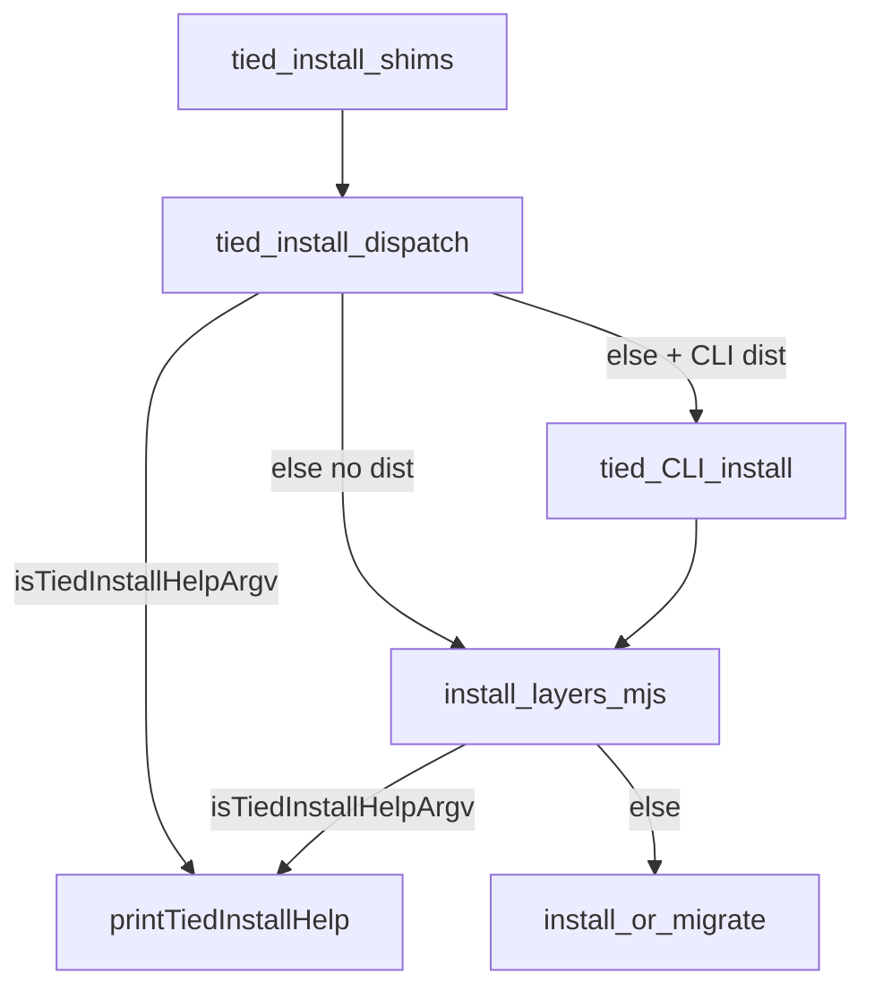

# PLAN — tied-install no-args CLI help (refined)

**Linked Cursor plan:** `tied-install_cli_help_0112c721.plan.md`  
**Parent REQ:** `[REQ-TIED_LAYERED_CLIENT_INSTALL]` · **Related:** `[REQ-TIED_STORE_README_CERTIFIABLE_ONBOARDING]` (`build-workspace.sh` prerequisite)  
**Build entry:** `@build-plan` with remainder pointing at this file.  
**Depth:** `minimal` · **gate_policy:** `advisory` · **Adversarial inquiry:** not activated (operator CLI contract only).

---

## Refine (resolved)

| Sponsor term | Canonical behavior |
| --- | --- |
| **No args** | `./tied-install.sh` → styled help on **stdout**, exit **0**, **no** install side effects. |
| **Explicit help** | `-h` or `--help` as the **only** argument → same help, exit 0. |
| **Install unchanged** | Any positional `CLIENT_DIR` and/or install flags → existing `parseInstallLayersArgs` → `installTiedLayers` / `migrateLayout` / `refreshInstallFromManifest`. Examples: `./tied-install.sh /path/to/client`, `./tied-install.sh .` |
| **Texture parity** | Match rhythm and palette of [`build-workspace.sh`](../../../build-workspace.sh): bold title, dim `─`×56 rule, cyan **▶** sections, dim sub-lines, **Hints** with `•` bullets. Honor `NO_COLOR` and non-TTY (plain text). |
| **macOS zsh** | No zsh-specific shim required; [`tied-install.sh`](../../../tied-install.sh) stays a Node dispatch wrapper (same as today). |
| **Windows triple** | [`tied-install.cmd`](../../../tied-install.cmd) / [`tied-install.ps1`](../../../tied-install.ps1) unchanged structurally; behavior comes from [`tied-install-dispatch.mjs`](../../../tools/bootstrap/tied-install-dispatch.mjs). |

### Unchanged behavior (negative space)

- Install semantics for **explicit** target paths, layers, `--mode`, `--refresh`, `--migrate-layout`, parity gates, and factory passthrough flags.
- Dispatch target selection: CLI `install` when `mcp-server/packages/cli/dist/index.js` exists, else `install-layers.mjs`.
- Shell shims remain thin Node delegates (no duplicated help text in `.sh` / `.ps1`).

### Non-goals

- Restyling [`new-tied-client.mjs`](../../../tools/bootstrap/new-tied-client.mjs) help (`SC-LCI-SMOKE-MATRIX` remains separate).
- Global `tied help` / umbrella CLI texture pass.
- Extracting bash `build-workspace.sh` into Node (optional future shared `cli-texture` module only if both need identical section keys).

### Accepted behavior change (costly choice — sponsor implied)

**Before:** empty argv → `target = process.cwd()` → install runs in cwd.  
**After:** empty argv → help only. Operators who relied on implicit cwd install must use `./tied-install.sh .` or an explicit path.

**LEAP follow-up:** [`REQ-TIED_SETUP`](../../requirements/REQ-TIED_SETUP.yaml) satisfaction criterion *"Windows tied-install.cmd entry point bootstraps cwd…"* must be revised in the same work item to: *bootstraps **when CLIENT_DIR is supplied** (including `.`)* — empty argv shows help on all entry points with parity.

---

## CITDP (analysis)

| Field | Value |
| --- | --- |
| **Change type** | Operator UX + CLI contract (bootstrap Node) |
| **Blast radius** | `tools/bootstrap/lib/console.mjs`, new `tied-install-help.mjs`, `tied-install-dispatch.mjs`, `install-layers.mjs`, bootstrap tests, README + bootstrap README, `REQ-TIED_LAYERED_CLIENT_INSTALL` + `REQ-TIED_SETUP` criterion text, CITDP rows, CHANGELOG |
| **Risk** | Docs/scripts assuming silent cwd install; mitigated by help Hints + repo grep during implement |
| **Breaking** | Yes — empty-invocation install removed; document in CHANGELOG and help |

### Help guard (single print)



- **Shim path (empty argv):** help at **dispatch only** — do not spawn child (avoids duplicate help if both layers checked).
- **Direct `tied install` / `node install-layers.mjs`:** help at **install-layers** only.
- **Help-only runs:** suppress `DIAGNOSTIC: tied-install dispatch -> …` on stderr.

---

## Texture mapping (build-workspace → Node)

| `build-workspace.sh` | `console.mjs` / help module |
| --- | --- |
| `_hr` dim 56× `─` | `writeHr()` |
| `_step` cyan ▶ + bold | `writeSection(title)` |
| `_D` dim body | `writeDim(line)` |
| `_ok` green ✓ | reuse `sayOk` for success lines in post-install only; help uses dim bullets |
| `_die` + Hints | `writeErrorHints(msg, hints[])` → stderr |
| `NO_COLOR` / non-TTY | extend existing `tty` gate in `console.mjs` to bold/cyan/dim |

Keep [`console.mjs`](../../../tools/bootstrap/lib/console.mjs) small; put help **content** and `isTiedInstallHelpArgv` in [`tools/bootstrap/lib/tied-install-help.mjs`](../../../tools/bootstrap/lib/tied-install-help.mjs).

### Help sections (content contract)

1. **Title** — `TIED client install`
2. **Prerequisite** — `./build-workspace.sh` (must run from store root before first install)
3. **Examples** (▶) — external client path; linked primary `--store`; `--migrate-layout`; `--refresh`
4. **Options** — accurate flag list from current `usage()` in `install-layers.mjs` (lines 20–40); no full matrix prose
5. **Hints** — missing `mcp-server/dist/index.js`; legacy layout; self-install refusal; Windows `tied-install.cmd` / `.\tied-install.ps1`; explicit `.` for cwd install

Export:

```js
export function isTiedInstallHelpArgv(argv) {
  return argv.length === 0 || (argv.length === 1 && (argv[0] === "-h" || argv[0] === "--help"));
}
```

**Not help:** `./tied-install.sh --help /path` (positional after help) — treat as unknown flag or parse error per existing layers logic; do not expand parser in this slice.

---

## TIED stack

| Layer | Action |
| --- | --- |
| **REQ** | `REQ-TIED_LAYERED_CLIENT_INSTALL` — add **SC-LCI-CLI-HELP-NO-ARGS** (metric: `tied-install-help.test.mjs` + dispatch empty argv no-spawn) |
| **REQ** | `REQ-TIED_SETUP` — amend cwd bootstrap criterion (see Refine LEAP) |
| **IMPL** | `IMPL-TIED_LAYERED_CLIENT_INSTALL` — sidecar block **TIED_INSTALL_HELP_TEXTURE** (PRE/POST/EFFECTS; token comments) |
| **CITDP** | Append slice to `CITDP-REQ-TIED_LAYERED_CLIENT_INSTALL.yaml`; note SETUP criterion amendment |
| **Tracker** | Copy `agent-req-implementation-checklist.yaml` → `tied-project/working/REQ-TIED_LAYERED_CLIENT_INSTALL/agent-req-checklist-tied-install-cli-help.yaml` |

---

## Test strategy (RED before code)

| Order | File | Assert |
| --- | --- | --- |
| 1 | `tools/bootstrap/tied-install-help.test.mjs` | `isTiedInstallHelpArgv` true/false cases; output contains `build-workspace`, `--migrate-layout`, `Hints`; `NO_COLOR=1` → no `\x1b` |
| 2 | `tools/bootstrap/tied-install-dispatch.test.mjs` | **Change** test that currently expects empty argv to spawn with status 3 → empty/`--help` returns 0, spawn not called; non-empty argv unchanged |
| 3 | `tools/bootstrap/install-layers-help.test.mjs` | Spawn `node install-layers.mjs` with empty argv: exit 0, stdout has title, no `.tied-install.json` written (or mock `main` export if preferred) |
| 4 | Regression | `node --test tools/bootstrap/windows-shims.test.mjs` |

**Run bundle:**

```bash
node --test tools/bootstrap/tied-install-help.test.mjs \
  tools/bootstrap/tied-install-dispatch.test.mjs \
  tools/bootstrap/install-layers-help.test.mjs \
  tools/bootstrap/windows-shims.test.mjs
```

---

## Implement (ordered)

1. Extend `console.mjs` texture helpers (bold, dim, cyan, hr, hint bullets).
2. Add `tied-install-help.mjs` + RED tests.
3. Wire `tied-install-dispatch.mjs` (help guard, no DIAGNOSTIC on help).
4. Wire `install-layers.mjs` (`main` guard; unknown flag → err + pointer to rerun without args).
5. Update README + `tools/bootstrap/README.md` (no args = help; use `.` for cwd).
6. LEAP: REQ satisfaction criteria + IMPL pseudo-code + CITDP + CHANGELOG.
7. `lint_yaml` on changed project YAML; `tied_validate_consistency`.
8. Grep repo for `./tied-install.sh` with no path in scripts/tests; fix call sites to pass `.` or explicit path.

### Gates

- **pre_implementation:** `tied gate check` / `tied_checklist_gate_validate` with Tracker + CITDP before RED.
- **verification:** test bundle above; **close_out** gate before marking REQ slice complete.

---

## Out of scope (unchanged)

- Optional CLI short-circuit in `mcp-server/packages/cli/src/index.ts` for `install` with empty `rest` (install-layers guard is sufficient).
