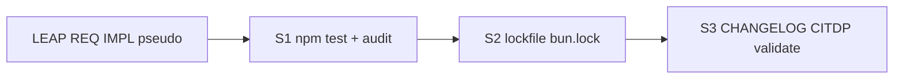

# PLAN — MCP `mcp-server` npm audit cleanup (glob migration)

**Request token:** `REQ-TIED_MCP_NPM_AUDIT_GLOB` (working wave; stack anchor **[REQ-TIED_NODE_TOOLCHAIN_DEFAULT](../../requirements/REQ-TIED_NODE_TOOLCHAIN_DEFAULT.yaml)**)  
**Workflow:** ad-hoc repair → **`@refine-plan`** (this pass) → **`@build-plan`** (verification + LEAP) → **`@close-out`**  
**`plan_phase`:** `pre-implementation` (product diff landed early; gated work = test evidence, LEAP, lockfile hygiene)  
**Adversarial depth:** `minimal` · **Gate policy:** `advisory`  
**Execution site:** TIED store repo — `mcp-server/`

---

## Problem statement (locked)

`npm install` under **`mcp-server/`** completed but reported **5 vulnerabilities** (2 moderate, 3 high):

| Advisory | Package chain | Remediation chosen |
| --- | --- | --- |
| Moderate | `hono` / `@hono/node-server` (transitive via `@modelcontextprotocol/sdk`) | `npm audit fix` → `hono@4.13.19`, `@hono/node-server@2.1.9` |
| High | `picomatch` via `fast-glob` → `micromatch` | **No safe patch** on npm (`picomatch <=4.0.7`); `npm audit fix --force` would downgrade `fast-glob@2.x` (breaking) |
| — | Direct dependency | Replace **`fast-glob@^3.3.3`** with **`glob@^14.0.6`**; map `onlyFiles: true` → `nodir: true`, `fg.sync` → `globSync` |

**Symptom after Wave A (on disk, uncommitted):** `npm audit` → **`found 0 vulnerabilities`**; `npx tsc -p mcp-server` green.

**Sponsor intent (this refine):** Formalize **test strategy**, **LEAP** stack updates, and **close-out** path for work that bypassed `@build-plan`.

---

## Scope

| In | Out |
| --- | --- |
| `mcp-server/package.json`, `package-lock.json` dependency swap | New REQ token (unless LEAP promotes criterion — see LEAP) |
| Glob call sites (9 TypeScript modules + `run-mcp-tests.mjs`) | Runtime behavior change beyond equivalent glob semantics |
| LEAP touch **`REQ-TIED_NODE_TOOLCHAIN_DEFAULT`** satisfaction criterion for clean audit | `npm audit fix --force` |
| Sync **`mcp-server/bun.lock`** with `glob` (optional lockstep) | Rewriting frozen CITDP evidence blobs |
| **`CHANGELOG.md`** bullet correction (remove stale “fast-glob high advisories remain”) | Root-level / `tools/bootstrap` installs |

---

## Refine (Touchpoint 1 — RESOLVE)

| Topic | Decision |
| --- | --- |
| **Canonical file discovery library** | **`glob`** (npm `glob@14.0.6`) for MCP workspace sources; not `fast-glob` until upstream `picomatch` advisory clears |
| **`--force` audit** | **Rejected** — destructive downgrade |
| **API mapping** | `fast-glob` `onlyFiles: true` → `glob` `nodir: true`; default import `fg` → `glob` / `globSync` from `'glob'` |
| **Traceability home** | Extend **`[REQ-TIED_NODE_TOOLCHAIN_DEFAULT]`** with new SC; no separate product feature REQ unless sponsor promotes |
| **Sequence violation** | Wave A code on disk before PLAN — **`@build-plan`** must record evidence and LEAP before close-out (see [plan-build-sequence-guard](../../../tools/bundled-prompt-type-skills/prompt-shared/plan-build-sequence-guard.md)) |

**profile_depth:** `minimal` (dependency hygiene). **gate_policy:** `advisory`.

### Consequence ladder

| Choice | Reversibility | Note |
| --- | --- | --- |
| `glob` vs `fast-glob` | Reversible | Slight API/perf differences; existing tests are integration-heavy |
| New REQ satisfaction criterion | Costly if wrong REQ | Prefer LEAP onto existing Node toolchain REQ |
| `bun.lock` refresh | Reversible | Keeps Bun users consistent if lockfile is still published |

---

## Wave A — already on disk (implementation summary)

**Do not re-apply in build-plan unless drift detected.**

| Area | Files |
| --- | --- |
| Dependencies | `mcp-server/package.json`, `mcp-server/package-lock.json` |
| Test runner | `mcp-server/scripts/run-mcp-tests.mjs` |
| Call sites | `snapshot-builder.ts`, `path-declared-composition-validate.ts`, `wf-composition-evidence-subcheck.ts`, `corpus-graph/index-builder.ts`, `source-graph/index-builder.ts`, `closure-join-report.ts`, `token-rename.ts`, `dae/tied-next.ts`, `node-only-controlled-runners.test.ts` |

**Verification witness (pre-build-plan):**

```bash
cd mcp-server && npm install && npm audit && npx tsc -p .
# expect: found 0 vulnerabilities; tsc exit 0
```

---

## Plan — build phases (`@build-plan`)



### Phase 0 — LEAP (before claiming verification)

1. **REQ** — Add satisfaction criterion to **`REQ-TIED_NODE_TOOLCHAIN_DEFAULT`** detail (index + detail file):
   - **ID:** `SC-NODE-MCP-AUDIT-CLEAN`
   - **Criterion:** `cd mcp-server && npm audit` reports **zero** vulnerabilities at high+moderate default reporting.
   - **Metric:** Command exit 0; stdout contains `found 0 vulnerabilities`.
2. **IMPL** — LEAP **`implementation_approach.details`** on **`IMPL-TIED_NODE_TOOLCHAIN_DEFAULT`**: note `glob@^14.0.6` for workspace file enumeration (replaces `fast-glob`).
3. **Pseudo-code (optional block)** — Append to **`IMPL-TIED_NODE_TOOLCHAIN_DEFAULT-pseudocode.md`**: `MCP_DEPENDENCY_GLOB` — PRE: audit reports `picomatch`/`fast-glob` chain; POST: direct `glob` dep, `npm audit` clean; EFFECTS: call sites use `glob`/`globSync` with `nodir: true`.
4. **ARCH** — No structural change unless sponsor wants **`ARCH-TIED_NODE_TOOLCHAIN_DEFAULT`** dependency policy bullet (optional).
5. **`lint_yaml`** on changed project YAML; **`tied_validate_consistency`**.

See [leap-proposals/LEAP-REQ-TIED_NODE_TOOLCHAIN-default-mcp-audit.md](./leap-proposals/LEAP-REQ-TIED_NODE_TOOLCHAIN-default-mcp-audit.md).

### Phase 1 — Test strategy execution (no new RED unless gap found)

Per [test-strategy.md](./test-strategy.md):

| Step | Command / artifact |
| --- | --- |
| Full MCP suite | `cd mcp-server && npm test` (build + `run-mcp-tests.mjs`) |
| Typecheck | `cd mcp-server && npx tsc -p .` |
| Audit gate | `cd mcp-server && npm audit` |
| Evidence | Capture stdout to `evidence/npm-test-audit-witness.md` |

**Optional RED (only if a regression is found):** contract test asserting `package.json` has no `fast-glob` and `npm audit --json` metadata has `vulnerabilities` empty — defer unless sponsor wants guard against reintroduction.

### Phase 2 — Lockfile hygiene

| File | Action |
| --- | --- |
| `mcp-server/bun.lock` | Regenerate or hand-edit to drop `fast-glob`, add `glob@14.0.6` if lockfile remains committed for Bun users |
| `package-lock.json` | Already updated; confirm committed |

### Phase 3 — Close-out artifacts

| Artifact | Action |
| --- | --- |
| `tied-project/citdp/CITDP-REQ-TIED_MCP_NPM_AUDIT_GLOB.yaml` | Persist at **`persist-citdp-record`** ([citdp-policy](../../../tied-bundle/docs/citdp-policy.md)) |
| `CHANGELOG.md` | Add operator note: glob migration + hono bumps; **remove/replace** stale bullet claiming 3 high `fast-glob` advisories remain |
| `tied-project/working/REQ-TIED_MCP_NPM_AUDIT_GLOB/evidence/session-handoff.md` | Mark required steps; set `plan_phase: close-out-ready` when gates pass |

---

## CITDP (analysis — persist on implement)

| Field | Value |
| --- | --- |
| **Change definition** | Dependency + import migration for MCP file globs; transitive Hono security bumps |
| **Blast radius** | File indexing: project-size, source/corpus graphs, token rename, DAE `tied-next`, closure-join reports, test discovery |
| **Risks** | R1: `glob` vs `fast-glob` ignore/dot semantics differ on edge paths — mitigated by existing integration tests; R2: `@hono/node-server@2.1.x` declares `node>=20` while repo `engines` says `>=18` — document or bump engines in separate choice |
| **depth_tier** | `minimal` |
| **gate_policy** | `advisory` |

---

## Gate validation (refine-plan)

| Phase | Action |
| --- | --- |
| `pre_implementation` | Advisory `tied_checklist_gate_validate` with working Tracker when present |
| `verification` | `npm test`, `npm audit`, LEAP validation |

**Adversarial inquiry:** `not_applicable` at `minimal` depth.

---

## Forbidden (refine-plan)

- Product code edits beyond LEAP/YAML/lockfile/CHANGELOG during refine-plan
- `npm audit fix --force`
- Marking checklist `[x]` for implementation without `build-plan` changelog attribution

---

## Do next

**Required:** **`@build-plan`** with remainder: *Execute [test-strategy.md](./test-strategy.md), LEAP proposals, bun.lock sync, persist CITDP, CHANGELOG.*

After verification: **`@close-out`** for `REQ-TIED_MCP_NPM_AUDIT_GLOB` / parent toolchain token as sponsor prefers.