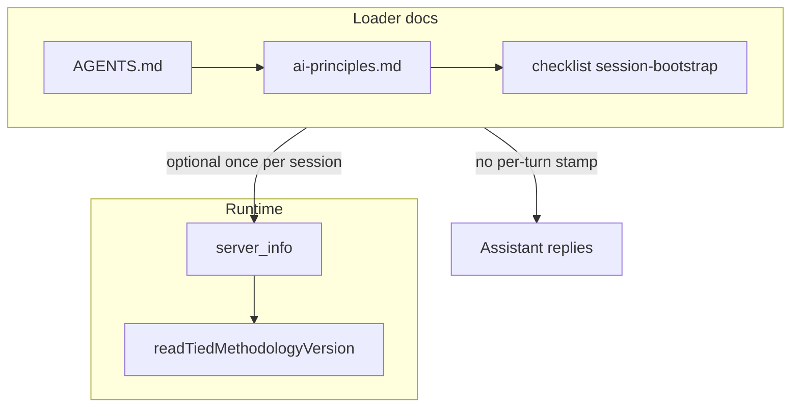

# PLAN — REQ-TIED_METHODOLOGY_VERSION_ON_DEMAND

**Status:** Implemented (build-plan). **Next:** `@close-out` when verification gates pass.

**Sponsor intent:** Remove the mandatory per-turn `TIEDv{semver}:` line from agent loaders and responses. Resolve methodology semver **on demand** via core MCP **`server_info`**, using `readTiedMethodologyVersion` in an `extensions["tied.methodology"]` payload (sponsor choice: `server_info` extension, not a new tool).

**Supersedes (loader only):** [PLAN-TIED-4.0-RESPONSE-STAMP](../PLAN-TIED-4.0-RESPONSE-STAMP/PLAN.md), [CITDP-REQ-TIED_SETUP-RESPONSE-STAMP](../../citdp/CITDP-REQ-TIED_SETUP-RESPONSE-STAMP.yaml) stamp **obligation**. **Keeps:** centralized `readTiedMethodologyVersion` for envelopes, fidelity profiles, and install/bootstrap.



---

## Scope decisions (refined)

| Topic | Decision |
|-------|----------|
| REQ token | **New** `REQ-TIED_METHODOLOGY_VERSION_ON_DEMAND`; **LEAP** `REQ-TIED_SETUP`, `REQ-MCP_SERVER_INFO`, `REQ-PROMPT_TYPE_SUBAGENT` |
| W7 `response_stamp_*` | **Keep dimension IDs** (avoid breaking rubric manifests); set `response_stamp_present` and `response_stamp_version_mismatch` to **warn-only, never error-tier** (mirror `response_stamp_legacy_phrase`). Update tests/fixtures; note in CHANGELOG. |
| Historical `tied-project/working/**/checklist-tracker.yaml` | **Do not edit** (frozen evidence) |
| Methodology `tied-bundle/docs/agent-req-implementation-checklist.yaml` | **Edit** `session-bootstrap` task (~L739) |
| `templates/**` | No `TIEDv` hits today; recheck at build-plan if bootstrap copies AGENTS from store root only |
| MCP absent | Session bootstrap may read root `VERSION` or AGENTS footer **without** echoing semver in every user-visible turn |

---

## Impact surfaces

| Surface | Change |
|---------|--------|
| [AGENTS.md](../../../AGENTS.md) §1, §3.1, §6 | Drop per-turn stamp; document optional `server_info` for semver |
| [tied-bundle/docs/ai-principles.md](../../../tied-bundle/docs/ai-principles.md) | Rename/replace **MANDATORY ACKNOWLEDGMENT** → on-demand version + operating-guide load |
| [tied-bundle/docs/agent-req-implementation-checklist.yaml](../../../tied-bundle/docs/agent-req-implementation-checklist.yaml) | Replace stamp task with `server_info` / extension path |
| [tied-project/requirements/REQ-TIED_SETUP.yaml](../../requirements/REQ-TIED_SETUP.yaml) + index mirror | LEAP validation criterion away from transcript stamp |
| [.cursor/agents/*.md](../../../.cursor/agents/) (16 files) | Replace `TIEDv4.0.0:` step with bootstrap + `server_info` |
| [tied-project/vocab/tied-methodology.md](../../vocab/tied-methodology.md) | **TIED response stamp** → deprecated optional; **methodology version on demand** via `server_info` |
| [mcp-server/contracts/server_info/server_info.response.schema.json](../../../mcp-server/contracts/server_info/server_info.response.schema.json) | Document `extensions.tied.methodology` object shape |
| [mcp-server/src/server-info/build.ts](../../../mcp-server/src/server-info/build.ts) | Populate extension via `readTiedMethodologyVersion` |
| [mcp-server/src/tied-methodology-version.ts](../../../mcp-server/src/tied-methodology-version.ts) | Prefer small **provenance** export (`version` + `source`) shared by envelope + `server_info` (avoid duplicating walk logic) |
| [scripts/lib/conversation-adherence-dimensions.mjs](../../../scripts/lib/conversation-adherence-dimensions.mjs) | Warn-only stamp dimensions |
| [mcp-server/src/e2e/prompt-type-subagent.test.ts](../../../mcp-server/src/e2e/prompt-type-subagent.test.ts) | Assert `server_info` bootstrap clause, not `TIEDv` regex |
| [tied-bundle/docs/ai-agent-tied-mcp-usage.md](../../../tied-bundle/docs/ai-agent-tied-mcp-usage.md) | Workflow table row for `server_info` |

---

## Build tranches (`@build-plan` order)

1. **T1 — Contract + runtime** — Extend `server_info` schema/example; implement provenance reader if needed; RED/GREEN `server-info.test.ts`; LEAP **REQ-MCP_SERVER_INFO** satisfaction criteria if needed.
2. **T2 — TIED stack** — Create REQ/ARCH/IMPL indexes + details via MCP; IMPL pseudo-code sidecars; `semantic-tokens.yaml`; `pseudocode_validate`.
3. **T3 — Loaders + agents** — AGENTS, ai-principles, methodology checklist, vocab, 16× `.cursor/agents`, prompt-type e2e test.
4. **T4 — W7 + LEAP SETUP** — Adherence dimensions/tests; REQ-TIED_SETUP criterion; `tied_verify` spot-check if stamp referenced; CHANGELOG.

**Gate before code:** `gate-pseudocode-validation` + `persist-implementation-records` for new/changed IMPL set.

---

## TIED tokens (draft)

- **REQ-TIED_METHODOLOGY_VERSION_ON_DEMAND** — no mandatory transcript stamp; semver via `server_info.extensions.tied.methodology`; loaders aligned.
- **ARCH-TIED_METHODOLOGY_VERSION_ON_DEMAND** — `server_info` v1 extension namespace; authority order unchanged (gates > envelope > reconcile).
- **IMPL-TIED_METHODOLOGY_VERSION_ON_DEMAND** — `POPULATE_TIED_METHODOLOGY_EXTENSION`, `UPDATE_LOADER_DOCS`, `DEPRECATE_W7_STAMP_FLAGGING`.

---

## Verification battery (close-out)

```text
npm test --prefix mcp-server -- src/server-info/server-info.test.ts src/e2e/prompt-type-subagent.test.ts src/tied-methodology-version.test.ts
node scripts/conversation-adherence-score.test.mjs
tied_validate_consistency
lint_yaml (changed project YAML)
```

Manual: one agent turn with no leading `TIEDv…:`; `server_info` shows expected semver in extension.

---

## Risk (consequence ladder)

| Item | Ladder | Note |
|------|--------|------|
| W7 warn-only flip | **Costly** if external dashboards treated numerators as SLA | CHANGELOG + dimension `severity` |
| Client AGENTS create-if-absent | **Reversible** | `tied-install --refresh` + README nudge |
| Stale agents habit-stamping | **Reversible** | Warn-only W7 only |

---

## Adversarial depth

- **depth_tier:** `minimal`
- **gate_policy:** `advisory`
- No integrated inquiry artifacts required for doc/contract scope.

---

## Artifacts in this folder

| File | Role |
|------|------|
| [PLAN.md](./PLAN.md) | This plan |
| [test-strategy.md](./test-strategy.md) | RED/GREEN design |
| [CITDP-REQ-TIED_METHODOLOGY_VERSION_ON_DEMAND.yaml](./CITDP-REQ-TIED_METHODOLOGY_VERSION_ON_DEMAND.yaml) | Pre-implementation CITDP (persist after implementation) |
| [checklist-tracker.yaml](./checklist-tracker.yaml) | Per-request tracker (`request: REQ-TIED_METHODOLOGY_VERSION_ON_DEMAND`) |

**Linked Cursor plan:** `~/.cursor/plans/remove_response_stamp_51e7a32e.plan.md` (keep narrative in sync until build-plan copies here as canonical).
