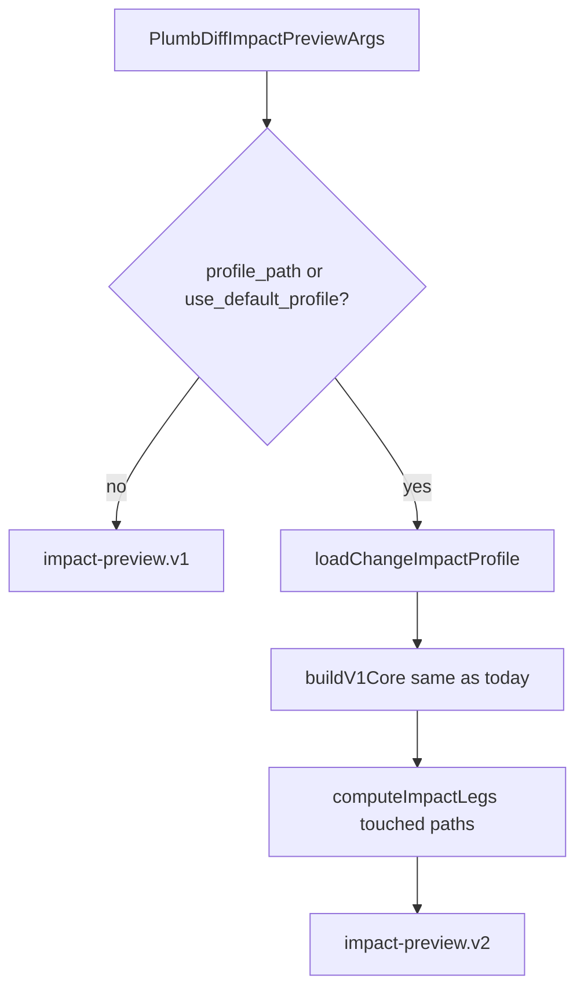

# PLAN — plumb v2 completion ([REQ-TIED_OPEN_ONTOLOGIES_WAVE3])

| Field | Value |
| --- | --- |
| **Request** | [REQ-TIED_OPEN_ONTOLOGIES_WAVE3](../../requirements/REQ-TIED_OPEN_ONTOLOGIES_WAVE3.yaml) |
| **Slice** | Plumb **impact-preview.v2** + **change-impact-profile.v1** only (envelope `independent_proofs[]` already shipped) |
| **Entry scenario** | TIED prepared; tests/code not updated ([PROC-AGENT_REQ_CHECKLIST] change to existing system) |
| **CITDP** | [CITDP-REQ-TIED_OPEN_ONTOLOGIES_WAVE3](../../citdp/CITDP-REQ-TIED_OPEN_ONTOLOGIES_WAVE3.yaml) |
| **Tracker** | [agent-req-implementation-checklist.yaml](./agent-req-implementation-checklist.yaml) |
| **Refined** | 2026-10-26 (refine-plan pass) |
| **Next handoff** | `@build-plan` using this file + Tracker |

---

## 1. Refine (Touchpoint 1 — RESOLVE)

### Canonical terms

| Sponsor / doc term | TIED / code term | Notes |
| --- | --- | --- |
| **plumb v2** | `impact-preview.v2` | Emitted only when profile opt-in is explicit |
| **change-impact profile** | `change-impact-profile.v1.yaml` | Client-owned; not methodology YAML |
| **impact legs** | `impact_legs[]` on v2 report | Path/glob matches; **not_measured** semantics |
| **path touch summary** | `path_touch_summary` | Aggregate counts; must not imply semantic equivalence (CITDP falsification) |
| **Open Ontologies plan/apply** | Metaphor only | No `onto_*` MCP, no RDF store |

**RESOLVE charter:** Names only; sponsor intent authority unchanged.

### Change definition (this slice)

| | |
| --- | --- |
| **Current (2026-10-26)** | `tied_plumb_diff_impact_preview` MCP advertises v2/profile args; [plumb-diff-impact-preview.ts](../../../mcp-server/src/analysis/plumb-diff-impact-preview.ts) emits **v1 only**; handler drops profile args ([tools/index.ts](../../../mcp-server/src/tools/index.ts) ~L3669). |
| **Desired** | Opt-in profile load → **impact-preview.v2** with `impact_legs` + `path_touch_summary`; default callers unchanged (**v1**). |
| **Non-goals** | Open Ontologies MCP; RDF/OWL; auto-run foreign verifiers; merge with BBCE declared surface (composable only). |

### Depth and gates (from CITDP)

- **depth_tier:** `integrated`
- **gate_policy:** `advisory`
- **Triggers matched:** `external_input_metadata`, `mcp_tool_surface`
- **Pre-RED:** `sub-adversarial-inquiry-pass` + four artifacts under `tied-bundle/working/REQ-TIED_OPEN_ONTOLOGIES_WAVE3/adversarial-inquiry/` when gate requires identity-bound activation
- **Gate snapshot (refine pass):** `tied_checklist_gate_validate` **pre_implementation** → **blocked** until Tracker steps through `session-bootstrap` … `test-strategy` and CITDP is passed as full record (not stub)

### Consequence ladder

| Choice | Class | Default |
| --- | --- | --- |
| Reuse BBCE `matchPathAgainstGlobs` | Reversible | **Yes** — document in profile `proof_boundary` |
| v2 on profile load failure (diagnostics, no silent v1) | Reversible | **Yes** — per CITDP opt-in honesty |
| Ship committed `tied-project/change-impact-profile.v1.yaml` in stdd | Costly | **No** — example template only |

---

## 2. Architecture and contracts

### Flow



### Profile: `change-impact-profile.v1`

Zod literal `schema_version: "change-impact-profile.v1"`.

```yaml
schema_version: change-impact-profile.v1
proof_boundary: "path/glob touch only — not semantic or REQ satisfaction"
legs:
  - leg_id: kg_assets
    label: "Knowledge-graph assets"
    path_globs:
      - "ontology/**"
      - "**/*.ttl"
    related_tokens: []  # optional advisory link to REQ/ARCH/IMPL
```

**Resolution:**

- `use_default_profile: true` → `{gitRoot}/tied-project/change-impact-profile.v1.yaml`
- `profile_path` → resolve cwd-relative or absolute from `process.cwd()` / git root (same pattern as other MCP path args)
- If **both** set: **`profile_path` wins** (document in pseudo-code)

**Load failure:** Still return **v2** with `profile.load_ok: false`, `profile.diagnostics[]`, empty `impact_legs` (never silent downgrade to v1 when opt-in was requested).

### Report: `impact-preview.v2`

- **Superset** of v1 fields (same `tokens_detected`, `implicated`, etc.)
- `schema_version: "impact-preview.v2"`
- `profile: { source_path, load_ok, diagnostics? }`
- `impact_legs[]`: `{ leg_id, label, path_globs, matched_touched_paths[], matched_count, related_tokens?, semantics: "not_measured" }`
- `path_touch_summary: { total_touched_files, legs_with_matches, proof_boundary }`
- `human_readable_summary`: v1 text + deterministic v2 appendix (sorted `leg_id`)

### TypeScript

- Export `PlumbDiffImpactPreviewReportV1` | `PlumbDiffImpactPreviewReportV2` (discriminated on `schema_version`)
- Export type alias `PlumbDiffImpactPreviewReport = V1 | V2`
- [plumb-audit-gate.ts](../../../mcp-server/src/analysis/plumb-audit-gate.ts): `stablePreviewSummaryRef` uses only shared v1-shaped fields (no change to audit default path)

### BBCE relationship

| Artifact | Purpose |
| --- | --- |
| BBCE declared surface / slice map | Scenario-scoped **locality** metrics (CITDP ref) |
| **change-impact-profile.v1** | **Plumb opt-in** path legs for non-token diffs (Wave 3 / Open Ontologies compose) |

Do not merge schemas; cross-link in template README only.

---

## 3. Test strategy (RED before code)

### Module: `change-impact-profile.test.ts`

| Test | Assert |
| --- | --- |
| `parses_valid_profile` | Zod accepts minimal one-leg profile |
| `rejects_missing_proof_boundary` | Parse error with diagnostic |
| `computeImpactLegs_matches_globs` | `src/a.ts` matches `src/**`; no match outside |
| `computeImpactLegs_deterministic_order` | Same inputs → same sorted `matched_touched_paths` |

### Module: `plumb-diff-impact-preview.test.ts`

| Test | Assert |
| --- | --- |
| (existing) v1 token/registry | Unchanged — still `impact-preview.v1` |
| `v2_without_profile_opt_in_stays_v1` | No profile args → v1 |
| `v2_with_profile_emits_legs` | Temp repo + profile under `tied-project/` + staged diff on `src/b.ts` without tokens → leg match |
| `v2_missing_profile_file` | `use_default_profile: true`, no file → v2, `load_ok: false`, diagnostics |
| `v2_includes_path_touch_summary` | `proof_boundary` echoed from profile |

### Composition

- MCP handler passes `profile_path` / `use_default_profile` through (single smoke via existing tool registration or unit test on handler if pattern exists elsewhere)

### Evidence commands (verification phase)

```bash
cd mcp-server && npx tsx --test src/analysis/change-impact-profile.test.ts src/analysis/plumb-diff-impact-preview.test.ts
cd mcp-server && npm run build
```

---

## 4. Implementation sequence

1. **IMPL pseudo-code** — [IMPL-TIED_CHANGE_IMPACT_PROFILE-pseudocode.md](../../implementation-decisions/IMPL-TIED_CHANGE_IMPACT_PROFILE-pseudocode.md); `pseudocode_validate`
2. **RED** — new + extended tests above (fail)
3. **change-impact-profile.ts** — parse YAML (fs + `yaml`/`parse` same as BBCE loaders), `computeImpactLegs`, reuse `matchPathAgainstGlobs` from [change-locality-pilot.ts](../../../mcp-server/src/analysis/change-locality-pilot.ts)
4. **plumb-diff-impact-preview.ts** — extract `buildV1Core`; add v2 wrapper + args; extend Zod schemas
5. **tools/index.ts** — wire profile args
6. **Template** — [tied-bundle/templates/tied/analysis/examples/change-impact-profile.v1.example.yaml](../../../tied-bundle/templates/tied/analysis/examples/change-impact-profile.v1.example.yaml) + one line in [tied/analysis/README.md](../../../tied-bundle/templates/tied/analysis/README.md)
7. **Doc LEAP** — [open-ontologies-repository-vs-tied-agent-management.md](../../../docs/comparisons/open-ontologies-repository-vs-tied-agent-management.md) phased table: plumb profile + envelope rows → done/partial + link REQ; MCP integration stays Defer
8. **CITDP LEAP** — update `current_behavior` to reflect envelope done + plumb v2 shipped (on persist after implementation)
9. **Close** — `lint_yaml` on touched project YAML; `tied_validate_consistency`; `tied_verify` if enrolled; gate **verification** + traceable commit when sponsor asks

---

## 5. Files touched (checklist)

| Path | Action |
| --- | --- |
| `mcp-server/src/analysis/change-impact-profile.ts` | Add |
| `mcp-server/src/analysis/change-impact-profile.test.ts` | Add |
| `mcp-server/src/analysis/plumb-diff-impact-preview.ts` | Refactor + v2 |
| `mcp-server/src/analysis/plumb-diff-impact-preview.test.ts` | Extend |
| `mcp-server/src/tools/index.ts` | Wire args |
| `tied-project/implementation-decisions/IMPL-TIED_CHANGE_IMPACT_PROFILE-pseudocode.md` | Add |
| `tied-bundle/templates/tied/analysis/examples/change-impact-profile.v1.example.yaml` | Add |
| `tied-bundle/templates/tied/analysis/README.md` | Update |
| `docs/comparisons/open-ontologies-repository-vs-tied-agent-management.md` | Update phased table |
| `tied-project/citdp/CITDP-REQ-TIED_OPEN_ONTOLOGIES_WAVE3.yaml` | LEAP `current_behavior` after ship |

---

## 6. Out of scope (explicit defer)

- `fail_on_independent_proof_errors` on `request_evidence_envelope_validate`
- `methodology-composition-matrix.md` Open Ontologies row (Phase 3 doc-only)
- Project vocab RECORD for ontology plan/certificate (Phase 2)
- Optional Open Ontologies MCP client wiring
