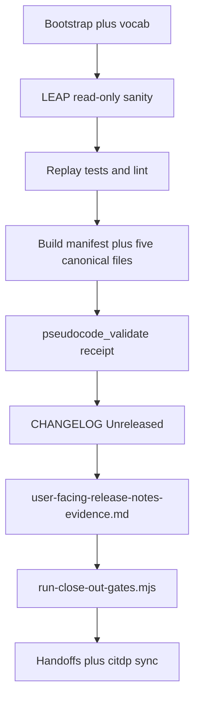

# plan-close-out — REQ-TIED_PROCESS_CERTIFICATION_READINESS

**Plan status:** Refine pass **3** (2026-10-18) — ready for `@plan-close-out` / build execution.  
**Product:** Slices 0–6 complete ([session-handoff.md](tied-project/working/REQ-TIED_PROCESS_CERTIFICATION_READINESS/evidence/session-handoff.md)).  
**Tracker (this wave):** [checklist-tracker-plan-close-out-refine.yaml](tied-project/working/REQ-TIED_PROCESS_CERTIFICATION_READINESS/checklist-tracker-plan-close-out-refine.yaml)  
**Close-out test outline:** [test-strategy-close-out.md](tied-project/working/REQ-TIED_PROCESS_CERTIFICATION_READINESS/test-strategy-close-out.md)  
**Gate tracker (close_out phase):** [gate-tracker-close-out.yaml](tied-project/working/REQ-TIED_PROCESS_CERTIFICATION_READINESS/gate-tracker-close-out.yaml)

**Constraints:** [plan-close-out skill](tools/bundled-prompt-type-skills/plan-close-out/SKILL.md) — no `git add` / `git commit`; `TIED_BASE_PATH` = `/Users/fareed/Documents/dev/chatgpt/stdd/tied-project`.

---

## Refine (Touchpoint 1 — RESOLVE)

### Intent (one line)

Finish **machine and process close-out** for **[REQ-TIED_PROCESS_CERTIFICATION_READINESS]**: upgrade adherence reconcile to **band A**, replay unified gates with a plan-close-out-owned `run_id`, add **CHANGELOG**, refresh handoffs — **without** claiming certification or performing `traceable-commit`.

### Canonical terms

| Term | Meaning |
| --- | --- |
| **Machine close-out** | `merged_decision.allowed: true` **and** envelope `blocking_gap_count: 0` with `fail_on_error_gaps: true` at integrated depth |
| **Canonical evidence filenames** | Paths in `gate-tracker-close-out.yaml` `evidence_refs` (e.g. `risk-assessment-evidence.md`) — distinct from descriptive siblings like `gitignore-close-out-hygiene.md` |
| **Band A** | Reconcile `process_grade.band: A` after all six canonical paths exist on disk |
| **PCR wave** | Staged paths for sponsor commit — exclude unrelated repo drift |

### Sponsor decisions (recorded)

| Decision | Choice | Ladder |
| --- | --- | --- |
| Adherence at close-out | **Upgrade to band A** (add canonical files) | **Reversible** — gate already passed at band C |
| Commit timing | **Deferred** — sponsor `traceable-commit` | **Costly** — no agent commit |
| Close-out `run_id` | `pcr-plan-close-out-20261018` | **Reversible** |
| Product scope | **No new features** unless LEAP drift | **Reversible** |
| `depth_tier` / `gate_policy` | **integrated** / **advisory** (unchanged) | Locked from build |

### Non-goals

- Stages 6 & 8 implementation (external appraisal)
- Methodology-learning experiment upsert (optional)
- Committing `tied-bundle/working/REQ-TIED_PROCESS_CERTIFICATION_READINESS/` inquiry trees
- Bundling unrelated source-graph / fixture envelope hygiene in PCR commit

### RESOLVE charter

Agent prepares evidence and proposed commit message; sponsor owns commit scope and timing.

**Refine gate (pass 3):** `pre_implementation` **re-gate blocked** — `integrated_depth_requires_pairing` / `activation_pairing_incomplete` (adversarial phase dir not on disk). **Build receipt stands:** [pre-implementation-gate-result.json](tied-project/working/REQ-TIED_PROCESS_CERTIFICATION_READINESS/evidence/pre-implementation-gate-result.json). Refine receipt: [refine-plan-gate-result-pass3.json](tied-project/working/REQ-TIED_PROCESS_CERTIFICATION_READINESS/evidence/refine-plan-gate-result-pass3.json). **Does not block plan-close-out** — execute **close_out** unified runner only.

---

## Plan (CITDP + test strategy)

### Change definition (close-out delta only)

| | Current | Desired |
| --- | --- | --- |
| **CHANGELOG** | No PCR bullet in [CHANGELOG.md](CHANGELOG.md) | [Unreleased] / Added entry matching CAE/EASAR style |
| **Adherence** | Band **C** — six canonical paths missing | Band **A** — thin receipts + manifest |
| **Handoff** | Build session-handoff; no `plan-close-out-handoff.md` | Both updated with three completion signals |
| **Gate receipt** | `pcr-close-out-20261018` (build) | Fresh `pcr-plan-close-out-20261018` owned by plan-close-out |

**CITDP:** [CITDP-REQ-TIED_PROCESS_CERTIFICATION_READINESS.yaml](tied-project/working/REQ-TIED_PROCESS_CERTIFICATION_READINESS/CITDP-REQ-TIED_PROCESS_CERTIFICATION_READINESS.yaml) — `plan_close_out` block; persist copy to [citdp/](tied-project/citdp/) after execution.

### Risks (close-out wave)

| Risk | Mitigation |
| --- | --- |
| Claiming “done” from gate alone | Report **three completion signals** separately |
| `envelope_revision_conflict` on manifest/profile patch | Document as benign if envelope validate passes (peer programs) |
| Staging unrelated files | Use staging cheat sheet; sponsor review |
| `user-facing-release-notes-evidence.md` before CHANGELOG | **Order:** CHANGELOG first, then that evidence file |

### Test strategy

Authority: [test-strategy-close-out.md](tied-project/working/REQ-TIED_PROCESS_CERTIFICATION_READINESS/test-strategy-close-out.md) (replay only). Full module matrix remains in [test-strategy.md](tied-project/working/REQ-TIED_PROCESS_CERTIFICATION_READINESS/test-strategy.md).

---

## Implement (execution order)



### 1. Bootstrap

- PRELOAD [process-certification-readiness.md](tied-project/vocab/process-certification-readiness.md), [fidelity-research.md](tied-project/vocab/fidelity-research.md), [quality-assurance.md](tied-project/vocab/quality-assurance.md).
- MCP `tied_config_get_base_path` → `tied-project/`.

### 2. LEAP sanity

Spot-check REQ **Implemented**, six IMPL **Active**, product paths in handoff. LEAP only if drift found.

### 3. Verification replay

See [test-strategy-close-out.md](tied-project/working/REQ-TIED_PROCESS_CERTIFICATION_READINESS/test-strategy-close-out.md).

### 4. Canonical evidence (before gate replay)

| File | Content |
| --- | --- |
| `risk-assessment-evidence.md` | Integrated depth, advisory policy, CITDP risks |
| `sub-adversarial-inquiry-pass-evidence.md` | Links to structural / verification / close-out pass md |
| `gate-pseudocode-validation-evidence.md` | `pseudocode_validate` results |
| `verification-evidence-manifest.v1.json` | Replay command results (EASAR-shaped) |
| `gitignore-close-out-hygiene-evidence.md` | Alias of [gitignore-close-out-hygiene.md](tied-project/working/REQ-TIED_PROCESS_CERTIFICATION_READINESS/evidence/gitignore-close-out-hygiene.md) |

### 5. CHANGELOG then user-facing evidence

- Insert [Unreleased] bullet (tokens, product summary, proof boundaries, `run_id`, band **A**, evidence links).
- Then create `user-facing-release-notes-evidence.md` pointing at CHANGELOG + [certification-of-workflows.md](docs/methodologies/certification-of-workflows.md).

### 6. Unified close-out replay

```bash
node tools/bootstrap/templates/run-close-out-gates.mjs \
  --project-root /Users/fareed/Documents/dev/chatgpt/stdd \
  --request-token REQ-TIED_PROCESS_CERTIFICATION_READINESS \
  --tracker-path tied-project/working/REQ-TIED_PROCESS_CERTIFICATION_READINESS/gate-tracker-close-out.yaml \
  --citdp-path tied-project/working/REQ-TIED_PROCESS_CERTIFICATION_READINESS/CITDP-REQ-TIED_PROCESS_CERTIFICATION_READINESS.yaml \
  --phase close_out \
  --run-id pcr-plan-close-out-20261018 \
  --envelope-blocking \
  --sync-dispositions \
  --reconcile
```

Save receipt as `evidence/closeout-run-close-out-gates-plan-close-out.json` (keep prior final JSON for audit).

**Success:** three signals per [completion-signals-handoff.md](tools/bundled-prompt-type-skills/prompt-shared/completion-signals-handoff.md); **band A** on reconcile.

### 7. Handoffs (no commit)

| Artifact | Action |
| --- | --- |
| `evidence/plan-close-out-handoff.md` | Create — signals, risks, staging scope |
| `evidence/session-handoff.md` | Refresh run_ids, band A, CHANGELOG |
| `evidence/traceable-commit-evidence.md` | Plan-close-out replay noted; commit deferred |
| `evidence/sub-close-out-evidence-sync-evidence.md` | New run_id + receipt path |
| `citdp/CITDP-REQ-TIED_PROCESS_CERTIFICATION_READINESS.yaml` | Sync from working CITDP |

### Gitignore ([PROC-GITIGNORE_CLOSE_OUT])

Track PCR wave; ignore `tied-bundle/working/REQ-TIED_PROCESS_CERTIFICATION_READINESS/`; document **N/A** or proposed patterns in handoff.

### Proposed commit message (sponsor only)

```
feat(mcp): EDSE process certification readiness layer (non-certifying)

REQ-TIED_PROCESS_CERTIFICATION_READINESS: versioned bundle resources,
conformance/capability/independent/adaptive modules, readiness + assessor
pack compose, MCP + CLI, envelope artifact kinds. Stages 6/8 documented
as future external work. Close-out run_id=pcr-plan-close-out-20261018;
blocking_gap_count=0; 15 focused tests.

Proof boundaries: ready_for_external_appraisal-not-certified; no rollup
scores; read-only project TIED YAML.

Refs: ARCH-TIED_PROCESS_CERTIFICATION_READINESS, IMPL-TIED_PROCESS_CERTIFICATION_*,
PROC-PROCESS_CERTIFICATION_READINESS
```

### Staging scope (PCR wave)

`mcp-server/src/process-certification-readiness/**`, MCP/CLI/envelope wiring, `tied-bundle/resources/process-certification/**`, PCR `tied-project/` tokens + vocab + citdp, `docs/methodologies/certification-of-workflows.md`, `tied-project/working/REQ-TIED_PROCESS_CERTIFICATION_READINESS/**`, root `CHANGELOG.md`. Omit unrelated modified paths unless intentional.

---

## Out of scope

- `git commit` / push
- Optional methodology-learning upsert
- External stages 6 & 8

**Next command:** Execute this plan (`@plan-close-out` or agent implement pass).
