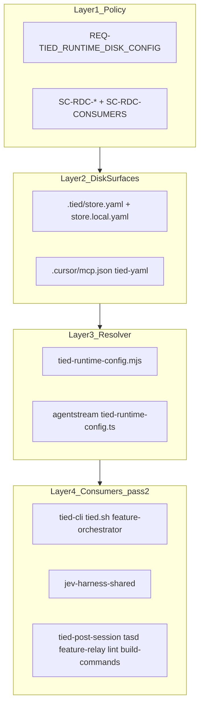

# [REQ-TIED_RUNTIME_DISK_CONFIG] — global path env cleanup (refined pass 2)

**Refined:** 2026-11-03 (pass 1 of this track)  
**Prior:** [PLAN-refine-pass2.md](./PLAN-refine-pass2.md) (committed **eded7a37**), [NON-TIED PLAN](../NON-TIED-ON-DISK-RUNTIME-CONFIG/PLAN.md)  
**Working token:** `REQ-TIED_RUNTIME_DISK_CONFIG` (extend — no new REQ unless audit finds a separate boundary)  
**CITDP:** [CITDP-REQ-TIED_RUNTIME_DISK_CONFIG.yaml](./CITDP-REQ-TIED_RUNTIME_DISK_CONFIG.yaml) — pass-2 delta in [Plan — CITDP](#plan--citdp-summary)  
**Tracker:** [agent-req-implementation-checklist.yaml](./agent-req-implementation-checklist.yaml) — reset implement steps for pass 2 before RED  

**Depth / gates:** `profile_depth: minimal`, `gate_policy: advisory`  
**Pre-implementation gate:** Re-run `tied_checklist_gate_validate` with pass-2 CITDP delta and refreshed Tracker before RED/code. Pass inner CITDP record (not wrapper key only).

---

## Refine — pass 2 (resolved intent)

| Sponsor term | Resolved meaning |
| --- | --- |
| **Global runtime paths** | Store root, MCP `dist/index.js`, client `tied-project/`, linked `tied-bundle/` — **on-disk only** ([NON-TIED PLAN](../NON-TIED-ON-DISK-RUNTIME-CONFIG/PLAN.md) class table). |
| **Pass 2 delta** | Pass 1 shipped resolver + CLI + partial agentstream; **secondary consumers** and **operator shell scripts** still read `TIED_REPO_ROOT` / `TIED_MCP_BIN` from the environment. Pass 2 removes those reads (or replaces with **script anchor** / `resolve-tied-cli-env.mjs`). |
| **Script anchor** | Path derived from the checkout that owns the script (`constants.mjs`, `SCRIPT_DIR/..`), not `process.env.TIED_REPO_ROOT`. |
| **Spawn injection** | Values passed into MCP child env after disk resolve — transport, not operator configuration (unchanged). |
| **Feature env** | Metrics, envelope hooks, agentstream bypass, JEV trace/provider, IMPL essence — **env-OK** this pass; queued for [pending-full-runtime-disk-handoff.md](./evidence/pending-full-runtime-disk-handoff.md). |
| **Secrets** | Always env (e.g. `JEV_API_KEY`) — never committed yaml. |

**Non-goals (unchanged from pass 1 CITDP):** MCP introspection extension (handoff E); TS/JS shared fixture parity (handoff 4); full env→disk for non-path toggles (separate handoff queue).

**Costly choices (accepted defaults — deviate only with sponsor confirmation)**

| Choice | Default | Ladder |
| --- | --- | --- |
| `build-commands.sh` and `TIED_REPO_ROOT` env | **Ignore-with-diagnostic** one release; prefer 2nd positional arg for source root | Reversible |
| Split commit: follow-on slice vs pass-2 audit | **Two commits** if tree still mixed | Reversible |
| New satisfaction criterion **SC-RDC-CONSUMERS** | **Add** to REQ index in same PR | Low cost |

---

## Goal

After pass 2, an operator can **unset** global path exports (`TIED_SOURCE`, `TIED_REPO_ROOT`, `TIED_BASE_PATH`, `TIED_MCP_BIN`, `TIED_STORE_ROOT`, `__TIED_REPO_ROOT` for path resolution) from the dev shell; **first-party** tools resolve the same paths as IDE MCP after `./tied-install.sh --refresh`.

---

## Top-down layers



**Precedence:** client MCP JSON → store yaml merge → fail closed; CLI wrappers **unset** shell `TIED_MCP_BIN`, `TIED_REPO_ROOT`, `TIED_STORE_ROOT` before resolve.

---

## Code anchors (pass 2)

| Behavior | Module | Pass-2 action |
| --- | --- | --- |
| Disk-first harness store root | `mcp-server/packages/agentstream/src/jev-harness-shared.ts` | Remove env fallback arms ~140–154; fix `formatHarnessDistMissingMessage` |
| Linked onboarding cwd | `tools/bundled-tied-yaml-skill/scripts/tied.sh`, `feature-orchestrator.sh` | **Commit** follow-on (`cd TIED_CLI_PROJECT_ROOT`) |
| Plan-skills methodology path | `mcp-server/src/jev/merged-routing-baseline.ts` | **Commit** follow-on (no store bleed) |
| Feature defaults | `mcp-server/src/feature-orchestration/defaults.ts` | Already mcp.json-only — verify tests; no env arm |
| Operator scripts | `scripts/tied-post-session.sh`, `tasd.sh`, `feature-relay.sh`, `lint.sh`, `build-commands.sh` | Migrate to anchor/resolver |
| Resolver (read-only) | `tools/bootstrap/lib/tied-runtime-config.mjs` | No rewrite unless LEAP drift |

---

## Plan — CITDP summary

| Area | Pass-2 change |
| --- | --- |
| **change_definition.current** | Resolver + CLI honor disk; JEV harness and operator scripts still use global path env fallbacks; dev shell docs imply `export TIED_*` paths |
| **change_definition.desired** | All listed consumers use disk or script anchor; harness error text points to refresh + mcp.json; operator profile doc lists removed vs kept env |
| **impact** | `mcp-server/packages/agentstream/*`, `scripts/*.sh`, `tools/bundled-tied-yaml-skill/SKILL.md`, `tools/bootstrap/README.md`, optional REQ SC + IMPL pseudo-code LEAP |
| **risk** | Low–medium — shell script behavior in brownfield shells; mitigated by diagnostics + docs |
| **test-strategy** | Extend harness tests; optional consumer grep/contract; existing RDC battery + bootstrap-and-load |

**CITDP file updates (implement pass, before code):**

- Append success criterion **SC-RDC-CONSUMERS** to working CITDP `success_criteria` and REQ detail when adding index row.
- Extend `impact_analysis.impl_inventory` with script paths above.
- Add pass-2 `evidence.command_seq` line for script-audit smoke if added.

Full record: [CITDP-REQ-TIED_RUNTIME_DISK_CONFIG.yaml](./CITDP-REQ-TIED_RUNTIME_DISK_CONFIG.yaml).

---

## Test strategy (acceptance)

| ID | Criterion | Metric / file |
| --- | --- | --- |
| **SC-RDC-RESOLVE** | (regression) Client MCP JSON resolution | `tied-runtime-config.test.mjs`, `tied-cli-invoke.test.mjs` |
| **SC-RDC-IGNORE-ENV** | (regression) Shell global path env ignored | `tied-runtime-config.test.mjs`, `mcp-base-path.test.mjs` |
| **SC-RDC-CONSUMERS** | **New** — harness/scripts do not **resolve** store/MCP from operator `TIED_REPO_ROOT` / `TIED_MCP_BIN` | `jev-harness-shared.test.ts`; optional static audit script or grep gate in test |
| **SC-JEV-HARNESS-DIST** | (regression) Linked client harness dist via disk | `jev-harness-preflight.test.ts`, `jev-harness-shared.test.ts` |
| **SC-CLI-E2E-*** | (regression) Bootstrap install expectations | `bootstrap-and-load.test.ts` |
| **SC-LCI-REFRESH-SMOKE** | (regression) `./tied-install.sh --refresh .` | CITDP `evidence.command_seq` |

**RED before GREEN (order):**

1. Harness tests assert env fallbacks never override valid mcp.json disk config.
2. Any new consumer contract test for scripts (prefer Node helper over full bash e2e).

**Verification commands:**

```bash
node --test tools/bootstrap/lib/tied-runtime-config.test.mjs \
  tools/bootstrap/lib/mcp-base-path.test.mjs tools/bootstrap/lib/mcp-layer.test.mjs \
  tools/bootstrap/lib/layout.test.mjs tools/bootstrap/lib/copy-managed.test.mjs \
  tools/bootstrap/lib/tied-cli-invoke.test.mjs

cd mcp-server && npx tsx --test \
  src/e2e/bootstrap-and-load.test.ts \
  packages/agentstream/src/jev-harness-shared.test.ts \
  packages/agentstream/src/jev-harness-preflight.test.ts \
  src/jev/plan-skills.test.ts

./tied-install.sh --refresh .
```

---

## Implement — phased checklist

### Phase 0 — Land follow-on slice

Commit if still uncommitted (see [session-handoff.md](./evidence/session-handoff.md)):

- `tools/bundled-tied-yaml-skill/scripts/{tied,feature-orchestrator}.sh`
- `mcp-server/packages/agentstream/src/jev-harness-shared.ts` (disk-first; env removal in phase 1)
- `mcp-server/src/jev/merged-routing-baseline.ts`
- Tests touched by follow-on

### Phase 1 — Harness env fallbacks (TDD)

- **RED:** `jev-harness-shared.test.ts` — wrong shell env + valid mcp.json → disk wins; after GREEN, env must not rescue when disk missing (anchor/package rules only).
- **GREEN:** Remove `TIED_MCP_BIN` / `TIED_REPO_ROOT` arms in `resolveJevHarnessDistStoreRoot`; update `formatHarnessDistMissingMessage`.
- **LEAP:** `IMPL-TIED_JEV_DECISION_COPROCESSOR` block `RESOLVE_JEV_HARNESS_DIST_STORE_ROOT`; cross-ref `IMPL-TIED_RUNTIME_DISK_CONFIG`.

### Phase 2 — Operator scripts

| Script | Target |
| --- | --- |
| `scripts/tied-post-session.sh` | `SCRIPT_DIR/..` + optional `resolve-tied-cli-env.mjs` from client cwd |
| `scripts/tasd.sh`, `scripts/feature-relay.sh` | Store path from anchor / walk-up, not inline env bake |
| `scripts/lint.sh` | Resolver from repo cwd |
| `scripts/build-commands.sh` | `_BUILD_COMMANDS_REPO_ROOT`; diagnostic if `TIED_REPO_ROOT` set; 2nd positional for source root |
| `scripts/_build_commands_cli_guide.inc.sh` | Runtime paths = disk policy |
| `scripts/update_client.sh` | Docs-only: remove stale bake comments or point to RDC |

### Phase 3 — Documentation

- `tools/bundled-tied-yaml-skill/SKILL.md`, `tools/bootstrap/README.md`
- `tied-project/working/REQ-TIED_RUNTIME_DISK_CONFIG/evidence/operator-shell-profile.md` — remove vs keep env table

### Phase 4 — Close-out

- `pseudocode_validate` on touched IMPL sidecars
- `lint_yaml` on changed `tied-project/**`
- `tied_validate_consistency`, `tied_verify` if applicable
- Persist CITDP to `tied-project/citdp/`
- Update [session-handoff.md](./evidence/session-handoff.md): pass 2 **closed**; promote [pending-full-runtime-disk-handoff.md](./evidence/pending-full-runtime-disk-handoff.md) to **do next**

**LEAP rule:** Code ≠ pseudo-code → **IMPL first**, then tests, then ARCH/REQ if scope changes.

---

## Handoff queue (after pass 2 completes)

| Artifact | Role |
| --- | --- |
| [pending-full-runtime-disk-handoff.md](./evidence/pending-full-runtime-disk-handoff.md) | Next wave: full on-disk config **except secrets** |
| [session-handoff.md](./evidence/session-handoff.md) | Handoff manager updates plan spine status |

Pass 2 does **not** migrate metrics, envelope hooks, agentstream flags, or JEV non-secret toggles to disk.

---

## Out of scope

- [pending-full-runtime-disk-handoff.md](./evidence/pending-full-runtime-disk-handoff.md) body (follow-on REQ/refine)
- `tied_config_get_base_path` introspection (item E)
- Shared JS/TS runtime fixture parity (item 4)
- Unrelated workspace dirty paths (fixtures, source-graph reports)

---

## Tracker / gate status

| Step | Disposition |
| --- | --- |
| Refine (this document) | **completed** 2026-11-03 |
| change-definition, impact-discovery, risk-assessment, test-strategy (pass 2) | **completed** → CITDP delta + table above |
| sub-adversarial-inquiry-pass | **not_applicable** (minimal depth) |
| pre_implementation gate | **completed** (minimal advisory; pass 2 build-plan) |
| Implement phases 0–4 | **completed** (code + docs; uncommitted) |
| verification / close_out | **pending** — `@close-out` for gates + persist CITDP |

**Next workflow:** `build-plan` linked to this file, or implement following Tracker from persist step after gate allows.
