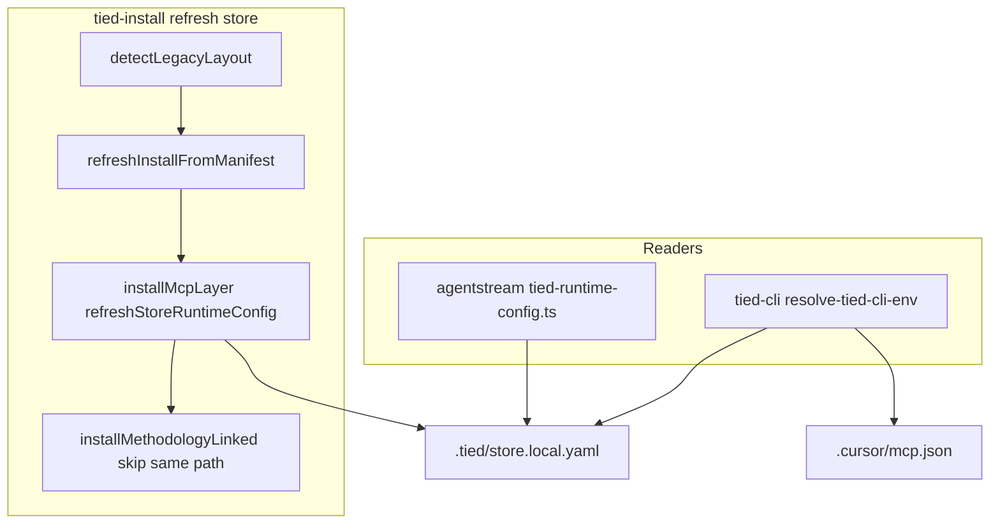

# [REQ-TIED_RUNTIME_DISK_CONFIG] + tied-install IMPL alignment (refined pass 1)

**Refined:** 2026-11-03  
**Working token:** `REQ-TIED_RUNTIME_DISK_CONFIG`  
**Related tokens:** [REQ-TIED_LAYERED_CLIENT_INSTALL], [REQ-TIED_TWO_FOLDER_LAYOUT], [REQ-TIED_CLI_MCP_JSON_BASE_PATH], [ARCH-TIED_LAYERED_CLIENT_INSTALL], [ARCH-TIED_TWO_FOLDER_LAYOUT], [IMPL-TIED_LAYERED_CLIENT_INSTALL], [IMPL-TIED_TWO_FOLDER_LAYOUT], [IMPL-TIED_FILES]  
**Source plans:** [NON-TIED-ON-DISK-RUNTIME-CONFIG/PLAN.md](../NON-TIED-ON-DISK-RUNTIME-CONFIG/PLAN.md), [session-handoff.md](../NON-TIED-ON-DISK-RUNTIME-CONFIG/session-handoff.md), Cursor plan `tied-install_impl_leap_4d81ca50`  
**CITDP (draft):** [CITDP-REQ-TIED_RUNTIME_DISK_CONFIG.yaml](./CITDP-REQ-TIED_RUNTIME_DISK_CONFIG.yaml)  
**Tracker:** [agent-req-implementation-checklist.yaml](./agent-req-implementation-checklist.yaml)

**Depth / gates:** `profile_depth: minimal`, `gate_policy: advisory` (documentation-first LEAP on shipped bootstrap code; no auth/network/persistence behavior change).

**Pre-implementation gate:** Run `tied_checklist_gate_validate` with `phase: pre_implementation`, this Tracker, and CITDP **before** any MCP/tied-cli YAML writes. Re-run after CITDP hydrate if dispositions change.

---

## Refine — pass 1 (RESOLVE)

| Topic | Prior draft | Pass 1 resolution |
| --- | --- | --- |
| **Scope** | “Documentation-only LEAP” vs new REQ | **Two tracks, one PR:** (A) full stack **[REQ-TIED_RUNTIME_DISK_CONFIG]** for resolver + install writer; (B) **LEAP-only** updates to existing IMPL tokens for tied-install bugs fixed in code (no new REQ for store-self DOCS skip) |
| **Runtime config** | NON-TIED boundary | **Promoted to TIED** — sponsor confirmed full REQ/ARCH/IMPL (not cross-ref-only) |
| **Code vs docs** | Implied greenfield | **Code is already correct** in `layout.mjs`, `methodology.mjs`, `copy-managed.mjs`, `tied-runtime-config.mjs`, `mcp.mjs`; implement pass = YAML + pseudo-code + tests + validation, **not** behavior rewrites unless LEAP finds drift |
| **Legacy `.tied/`** | Ambiguous vs store config | **RESOLVE:** root `.tied/` with `schema: tied-store-config.v1` in `store.yaml` is **not** legacy; legacy `.tied/` (reports, no store config schema) remains **`LEGACY_LAYOUT_DETECTED`** |
| **Store `--refresh`** | Undocumented self-install | **RESOLVE:** when `projectRoot === storeRoot`, `refreshInstallFromManifest` sets `allowSelfInstall: true` and default `skipVerify`; document in IMPL-TIED_LAYERED |
| **MCP `tied-layout.ts`** | Full marker parity? | **Reversible default:** document **intentional subset** in ARCH/IMPL comment; **no TS change** unless MCP preflight fails on store `.tied/` |
| **migrate-layout** | Remove all `.tied/` | **Unchanged:** migration still removes legacy `.tied/` **without** store config v1 schema |
| **Working folder** | NON-TIED only | **Continue** under `tied-project/working/REQ-TIED_RUNTIME_DISK_CONFIG/`; update session-handoff when TIED promotion completes |

**Costly choices (confirm before deviating)**

- Extending MCP `detectLegacyLayout` to full `LEGACY_LAYOUT_MARKERS` parity (defer)
- New REQ token for “install self-path guard” separate from runtime disk REQ (rejected — fold into IMPL-TIED_LAYERED LEAP)

---

## Goal

1. **Traceability:** Operator global paths (`store_root`, MCP dist, linked bundle) are **install-managed on disk** ([`.tied/store.yaml`](../../../.tied/store.yaml), [`.tied/store.local.yaml`](../../../.tied/store.local.yaml), client MCP JSON), not shell exports — captured in [REQ-TIED_RUNTIME_DISK_CONFIG].
2. **Alignment:** [tied-install](../../../tied-install.sh) behavior documented in IMPL pseudo-code matches runtime, including store refresh with committed `.tied/` and linked methodology docs at canonical paths.



---

## Plan — CITDP summary

| Area | Change |
| --- | --- |
| **change_definition** | Runtime resolver/install writer implemented (NON-TIED pass); TIED stack missing; IMPL drift on legacy gate, store refresh, DOCS_TO_COPY self-path, linkOrMaterializeCopy |
| **impact** | `tools/bootstrap/lib/*`, `tied-project/{requirements,architecture-decisions,implementation-decisions}/*`, optional `install-layers.integration.test.mjs` |
| **risk** | Low — doc/test; code pre-verified with `./tied-install.sh --refresh .` |
| **test-strategy** | See table below; RED only for new integration test if not already covered |

Full draft: [CITDP-REQ-TIED_RUNTIME_DISK_CONFIG.yaml](./CITDP-REQ-TIED_RUNTIME_DISK_CONFIG.yaml).

---

## Test strategy (acceptance)

| ID | Criterion | Metric |
| --- | --- | --- |
| **SC-RDC-RESOLVE** | Client resolves MCP dist + corpus from MCP JSON without shell path env | `tied-runtime-config.test.mjs`, `tied-cli-invoke.test.mjs` |
| **SC-RDC-STORE** | Store resolves from `.tied/store.yaml` + local overlay | `tied-runtime-config.test.mjs` |
| **SC-RDC-REFRESH** | MCP layer refresh writes/updates `store.local.yaml` | `mcp-layer.test.mjs` |
| **SC-RDC-IGNORE-ENV** | Shell `TIED_MCP_BIN` / `TIED_REPO_ROOT` / `TIED_STORE_ROOT` ignored for global paths | `tied-runtime-config.test.mjs`, CLI diagnostic optional |
| **SC-TFL-STORE-TIED** | Store runtime `.tied/` not flagged as legacy | `layout.test.mjs` |
| **SC-LCI-STORE-DOCS** | Store self-install linked methodology does not delete canonical DOCS_TO_COPY files | **New** integration or `methodology` unit test + existing `copy-managed.test.mjs` |
| **SC-LCI-REFRESH-SMOKE** | Store `./tied-install.sh --refresh .` exits 0 | Manual / CI note in CITDP command_seq |

**Command battery (verification phase):**

```bash
node --test tools/bootstrap/lib/tied-runtime-config.test.mjs \
  tools/bootstrap/lib/mcp-base-path.test.mjs \
  tools/bootstrap/lib/mcp-layer.test.mjs \
  tools/bootstrap/lib/layout.test.mjs \
  tools/bootstrap/lib/copy-managed.test.mjs
# + new integration test when added
./tied-install.sh --refresh .
# MCP: pseudocode_validate on changed sidecars; tied_validate_consistency
```

---

## Implement — ordered checklist

Follow [agent-req-implementation-checklist.yaml](./agent-req-implementation-checklist.yaml) from **session-bootstrap** through **verification-gate**. Compressed sequence for this request:

1. **impact-discovery** — Load IMPL sidecars listed in Related tokens; confirm code anchors in `layout.mjs`, `install-layers.mjs`, `install-layers-core.mjs`, `methodology.mjs`, `copy-managed.mjs`, `tied-runtime-config.mjs`, `layers/mcp.mjs`.
2. **risk-assessment** — Record `minimal` / `advisory`; no integrated adversarial pass unless scope expands.
3. **gate-pseudocode-validation** — After LEAP drafts written, `pseudocode_validate` on all touched sidecars.
4. **persist-requirement-records** — Create [REQ-TIED_RUNTIME_DISK_CONFIG] detail + index via **tied-cli/MCP** (policy: no ad-hoc index edits).
5. **persist-architecture-records** — [ARCH-TIED_RUNTIME_DISK_CONFIG].
6. **persist-implementation-records** — [IMPL-TIED_RUNTIME_DISK_CONFIG] + sidecar; LEAP edits to IMPL-TIED_TWO_FOLDER_LAYOUT, IMPL-TIED_LAYERED_CLIENT_INSTALL, IMPL-TIED_FILES (and light ARCH yaml).
7. **three-way-alignment-unit** — Add integration test if gap remains after unit tests.
8. **sync-tied-stack** — `lint_yaml` on changed project YAML; `tied_validate_consistency`.
9. **verification-gate** — `tied_verify` if project uses verification-gated mode; smoke refresh.
10. **persist-citdp-record** — Write [tied-project/citdp/CITDP-REQ-TIED_RUNTIME_DISK_CONFIG.yaml](../../citdp/CITDP-REQ-TIED_RUNTIME_DISK_CONFIG.yaml) after green validation.
11. **traceable-commit** — Vocab VALIDATE; update [session-handoff.md](../NON-TIED-ON-DISK-RUNTIME-CONFIG/session-handoff.md) with REQ link.

**LEAP rule:** If validation finds code ≠ pseudo-code, update **IMPL first**, then tests, then ARCH/REQ if scope changed.

---

## REQ satisfaction criteria (draft for implement)

**[REQ-TIED_RUNTIME_DISK_CONFIG]** (new) — derive from [NON-TIED PLAN § Test strategy](../NON-TIED-ON-DISK-RUNTIME-CONFIG/PLAN.md):

- SC-RDC-RESOLVE-MCP, SC-RDC-RESOLVE-STORE, SC-RDC-IGNORE-ENV, SC-RDC-FAIL-CLOSED, SC-RDC-INSTALL-WRITES (map to test files above).
- `depends_on`: REQ-TIED_LAYERED_CLIENT_INSTALL, REQ-TIED_CLI_MCP_JSON_BASE_PATH; `related_to`: REQ-TIED_TWO_FOLDER_LAYOUT.

**LEAP amendments (existing REQ, no new tokens):**

- [REQ-TIED_TWO_FOLDER_LAYOUT]: clarify SC-TFL-NO-LEGACY-TIED-DIR — exempt store runtime `.tied/` when `tied-store-config.v1` present.
- [REQ-TIED_LAYERED_CLIENT_INSTALL]: optional SC-LCI-STORE-REFRESH and SC-LCI-STORE-DOCS (if sponsor accepts new SC IDs in same PR).

---

## Out of scope

- Re-implementing resolver/CLI/agentstream (already shipped).
- MCP `tied-layout.ts` full marker parity (document only).
- `add-feature` greenfield install behavior changes.

---

## Tracker / gate note

Copy checklist with `execution_evidence.request: REQ-TIED_RUNTIME_DISK_CONFIG`. Mark **Refine** and **Plan** steps complete when this file and CITDP draft are reviewed. **Do not** mark Implement complete until verification gate and `tied_validate_consistency` pass.
