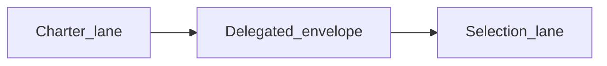

# PLAN — [REQ-TIED_SPONSOR_TWO_LANE_DELIVERY] (refined)

**Linked refine:** `@refine-plan` pass 2 (2026-10-25)  
**Source plan:** [refine_sponsor_lane_3f1eed54.plan.md](/Users/fareed/.cursor/plans/refine_sponsor_lane_3f1eed54.plan.md)  
**Authoritative Tracker:** [`checklist-tracker.yaml`](checklist-tracker.yaml) — sole input for `tracker_path` / gate validation  
**Template reference (not gate input):** [`agent-req-implementation-checklist.yaml`](agent-req-implementation-checklist.yaml) ← copy of `tied-bundle/docs/agent-req-implementation-checklist.yaml`  
**CITDP (working):** [`CITDP-REQ-TIED_SPONSOR_TWO_LANE_DELIVERY.yaml`](CITDP-REQ-TIED_SPONSOR_TWO_LANE_DELIVERY.yaml)  
**Test strategy:** [`test-strategy-outline.md`](test-strategy-outline.md)  
**Persist CITDP to `tied-project/citdp/`:** after `@build-plan` close-out  

**Working-artifact placement:** committed rationale under `tied-project/working/`; regenerable gate receipts under `tied-bundle/working/{REQ}/gates/` ([working-artifact-placement.md](../../../tied-bundle/docs/working-artifact-placement.md)).

---

## 1. Refine (Touchpoint 1 — RESOLVE)

| Sponsor / field term | Resolved meaning |
| --- | --- |
| **Before-deploy / after-deploy** | Avoid in normative prose → **charter lane** (pre-code) and **selection lane** (post-code) |
| **Charter lane** / **sponsor charter gate** | Sponsor strategic decisions: intent, non-goals, success criteria, scope, costly **what-to-build** choices — through **`pre_implementation`** |
| **Selection lane** / **sponsor selection gate** | Sponsor preference among **implemented** alternatives — **`verification`** through **`close_out`** (optional production deploy receipt) |
| **pre-code sponsor decision** | Locked or deferred-with-default at charter; else **`sponsor_charter_backlog`** on CITDP/Tracker |
| **post-code sponsor decision** | Valid only with **`selection_evidence`** per option (test id, demo path, feature flag, gate receipt) |
| **mid-lane sponsor deferral** | Agent proceeds on documented default; backlog row + **warn-only** diagnostic (W3+) — **no** extra sponsor chat turn |
| **Deliver as expected** | Selection lane choices must be **supported by deployed/built product**, not hypotheticals |

**Vocabulary PRELOAD:** [sponsor-agent-relationship.md](../../vocab/sponsor-agent-relationship.md), [pseudocode-and-citdp.md](../../vocab/pseudocode-and-citdp.md), [project-operations-mcp.md](../../vocab/project-operations-mcp.md).

**Distinct from**

| Artifact | Relationship |
| --- | --- |
| **[REQ-TIED_SPONSOR_AGENT_RELATIONSHIP]** | Source for **consequence ladder**, hinge fields, over-asking — two-lane **composes**, does not replace |
| **[REQ-TIED_SPONSOR_RISK_TIER_PLAYBOOK]** | **Attention map** (how much review) ≠ **touchpoint count** (when sponsor speaks) |
| **[REQ-TIED_SPONSOR_QUESTIONS]** | MCP readout — extend with **lane** + phase filter |
| **[REQ-TIED_PRE_HANDOFF_VERIFICATION_CHARTER]** | Executable checks before handoff — not sponsor Q&A scheduling |
| **[REQ-TIED_FEATURE_ORCHESTRATION]** | **Deferred** — not in this REQ unless sponsor re-opens scope |

**Existing code authority (compose, do not duplicate)**

| Symbol | Location | Two-lane use |
| --- | --- | --- |
| **`classifyDecisionConsequence`** | `mcp-server/src/relationship/consequence-ladder.ts` | Lane classifier inputs ladder rung; no second taxonomy |
| **`validateHingeFields`** | `mcp-server/src/checklist-validator.ts` | Sponsor-questions + gate diagnostics reuse hinge shape |
| **`extractSponsorQuestions`** | `mcp-server/src/project-operations/sponsor-questions.ts` | Extend with **lane** metadata; already calls ladder + hinges |

**Consequence ladder (this REQ)**

| Choice | Ladder | Disposition |
| --- | --- | --- |
| Hard-block gates when mid-lane backlog present | **Costly** | **Reject** — sponsor chose **warn-only** (W3+) |
| Merge reviewer / strict inquiry into sponsor lanes | **Costly** | **Reject** — proof boundary |
| Auto-approve deferred costly items | **Costly** | **Reject** — charter/selection timing only |
| Docs or checklist prose before sidecar + RED classifier tests | **Reversible** | **Reject for build-plan** — TDD order is sidecar → **`pseudocode_validate`** → RED → GREEN docs/code |

**depth_tier / profile_depth:** `minimal` · **gate_policy:** `advisory` · **assurance_profile:** `baseline-functional` · **eligibility_triggers_matched:** `[]` · **methodology_surface_change_class:** `checklist_step`

---

## 2. Plan (CITDP — build-plan map)

### 2.1 TIED stack

| Layer | Token |
| --- | --- |
| REQ | **REQ-TIED_SPONSOR_TWO_LANE_DELIVERY** |
| ARCH | **ARCH-TIED_SPONSOR_TWO_LANE_DELIVERY** |
| IMPL | **IMPL-TIED_SPONSOR_TWO_LANE_DELIVERY** |

**ARCH sketch:** Three modules — (1) **lane classifier** (pure), (2) **checklist composition** (warn diagnostic hook), (3) **sponsor-questions adapter** (MCP boundary). No global agent hook; no auto-merge.

**BBCE:** **`bbce_advisory_enforced: true`** on Tracker (new REQ + ARCH detail); verification-time advisory pass only — see CITDP `risk_analysis.bbce_alignment`.

### 2.2 Content waves (W1–W4) vs build-plan waves (0–8)

| Content wave | Paths | Build-plan wave |
| --- | --- | --- |
| **W1** docs/vocab | `tied-bundle/docs/sponsor-two-lane-delivery.md`, vocab rows, `client-development-index`, `ai-principles` / `AGENTS.md` cross-ref | **4** (after RED) |
| **W2** checklist | `agent-req-implementation-checklist.md` + `.yaml` (five slug markers, SC-TLD-003); optional CITDP template backlog shape note | **5** |
| **W3** MCP | Sidecar, `sponsor-decision-lane.ts`, `sponsor-questions.ts`, `checklist-validator.ts` warn hook | **1–2** (sidecar/validate), **6** (GREEN) |
| **W4** tests/bootstrap | `sponsor-two-lane-*.test.ts`, `sponsor-two-lane-delivery-doc.test.mjs`, manifest | **2** RED, **7** GREEN doc test |

### 2.3 IMPL pseudo-code blocks (author at build-plan wave 1)

Sidecar: `tied-project/implementation-decisions/IMPL-TIED_SPONSOR_TWO_LANE_DELIVERY-pseudocode.md`

1. **`CLASSIFY_SPONSOR_DECISION_LANE`** — PRE/POST/EFFECTS; OUTPUT `charter` \| `selection` \| `mid_lane_defer`
2. **`BATCH_CHARTER_COSTLY_CHOICES`** — at `risk-assessment`; merge hinges + costly list into charter backlog
3. **`VALIDATE_SELECTION_EVIDENCE`** — at `verification-gate`; FAILURE_MODES: missing evidence → warn, defer selection
4. **`AUDIT_MID_LANE_SPONSOR_DEFERRAL`** — warn-only; feeds gate receipt

Run **`pseudocode_validate`** before RED (T-TLD matrix in test-strategy-outline).

### 2.4 Satisfaction criteria

| ID | Close when |
| --- | --- |
| **SC-TLD-001** | Vocab routing + `validate_vocab_index.rb` |
| **SC-TLD-002** | Doc + index link + bootstrap doc test |
| **SC-TLD-003** | Checklist parity test (five slugs) |
| **SC-TLD-004** | Classifier + sponsor-questions tests green |
| **SC-TLD-005** | `tied_validate_consistency` + pseudo-code Layer B/C |

### 2.5 Build-plan waves (single sequence)

| Wave | Action |
| --- | --- |
| **0** | Refresh **`pre_implementation`** gate receipt → `tied-bundle/working/REQ-TIED_SPONSOR_TWO_LANE_DELIVERY/gates/` |
| **1** | `tied_token_create_with_detail` REQ/ARCH/IMPL; sidecar + **`pseudocode_validate`** |
| **2** | **RED** tests T-TLD-01..08 (see test-strategy-outline) |
| **3** | *(reserved — no parallel doc-only track)* |
| **4** | **GREEN** W1 docs + vocab RECORD |
| **5** | **GREEN** W2 checklist markers + parity |
| **6** | **GREEN** W3 MCP/classifier |
| **7** | **GREEN** W4 doc test + bootstrap manifest |
| **8** | `tied_validate_consistency`; **`verification`** gate; **`tied_verify`**; envelope/manifest; **`close_out`**; `citdp_record_write` → `tied-project/citdp/`; CHANGELOG; **commit only when sponsor asks** |

---

## 3. Implement boundary

| refine-plan (pass 2) | `@build-plan` |
| --- | --- |
| PLAN + CITDP + Tracker + test-strategy-outline + handoff | Waves 0–8 |
| **`pre_implementation`** gate on authoritative Tracker/CITDP | Re-run if CITDP/depth/policy changes |
| No REQ/ARCH/IMPL index writes | MCP `tied_token_create_with_detail` |
| No checklist or MCP code edits | W2–W4 content via waves 4–7 |
| Plan/refine evidence only | Implementation + verification evidence |

---

## 4. Gate receipts (refine-plan)

| Gate | Status | Receipt |
| --- | --- | --- |
| `pre_implementation` | **allowed: true** (minimal, pass 2) | [`pre_implementation-2026-10-25T17-07-04-163Z.json`](../../../tied-bundle/working/REQ-TIED_SPONSOR_TWO_LANE_DELIVERY/gates/pre_implementation-2026-10-25T17-07-04-163Z.json) (`run_id=pre-impl-2026-10-25-sponsor-two-lane-pass2`) |

Legacy receipts under `tied-project/working/.../gates/` (if present) are **superseded** — authoritative regenerable path is **`tied-bundle/working/`** per placement policy.

---

## 5. Session handoff

When gate **`allowed: true`**, next step **`@build-plan`** with this PLAN as linked scope. See [`evidence/session-handoff.md`](evidence/session-handoff.md).
