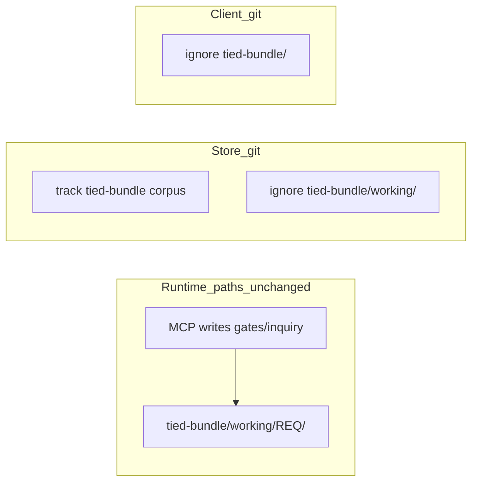
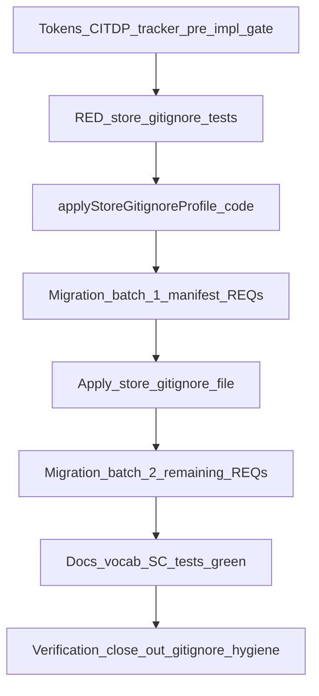

# REQ-TIED_STORE_BUNDLE_GIT_POLICY — store vs client `tied-bundle/` git strategy

**Linked plan (Cursor):** `/Users/fareed/.cursor/plans/store_bundle_git_policy_ac5fa441.plan.md`  
**Committed working copy (Implement):** `tied-project/working/REQ-TIED_STORE_BUNDLE_GIT_POLICY/PLAN.md` (same body after token creation).

---

## Refine (sponsor intent)

**Problem:** The store is both **methodology publisher** (`tied-bundle/` → [`materializeLinkedMethodologyBundle`](tools/bootstrap/lib/methodology-bundle.mjs)) and **TIED client** (`tied-project/` in git). Clients use INSTALL MANAGED v2 with whole-tree `tied-bundle/` ignored ([`gitignore-block.mjs`](tools/bootstrap/lib/layers/gitignore-block.mjs)). The store `.gitignore` incorrectly includes that same `tied-bundle/` line (lines 520–525 today), plus ~400 lines of duplicate/`!working/` holes, while **~238 files remain git-tracked** under `tied-bundle/working/` across **22 REQ roots** — contradicting the store exception in [working-artifact-placement.md](tied-bundle/docs/working-artifact-placement.md).

**Goal:** Separate **runtime path** from **git policy**:

| Layer | Store | External client |
|-------|--------|-----------------|
| **Where MCP/tools write local working evidence** | `tied-bundle/working/{REQ}/` (unchanged — [`working-root.ts`](mcp-server/src/working-root.ts)) | Same |
| **What git tracks** | Corpus under `tied-bundle/` **except** `working/` + `install.json`; all of `tied-project/` | Only `tied-project/`; whole install-managed `tied-bundle/` ignored |

**Non-goals:** Client INSTALL MANAGED v2; moving methodology corpus out of git; changing linked/full install ([`methodology.mjs`](tools/bootstrap/lib/layers/methodology.mjs)).

**Sponsor choice (locked):** Full migration of git-tracked `tied-bundle/working/**` in this REQ.

**`profile_depth`:** `minimal`. **`gate_policy`:** default checklist.

**Vocab (RECORD in Implement):** **asymmetric git** (store vs client `tied-bundle/` tracking); **store local working profile** (whole-root ignore, not client install block).

---

## CITDP (planning)

| Field | Draft |
|-------|--------|
| **Change type** | Infrastructure — closes WAP “legacy debt” gray zone with explicit migration |
| **Blast radius** | [`.gitignore`](.gitignore), [`working-gitignore.mjs`](tools/bootstrap/lib/working-gitignore.mjs) (`collapseLegacyWorkingGitignorePatterns` today forces `undividedMirror: true`), 22 REQ trees, [`regression-manifest.json`](tied-project/working/REQ-TIED_CHECKLIST_GATE_ENFORCEMENT/fixture-1787603099/regression-manifest.json) (hashes under `tied-bundle/working/...`), docs/vocab |
| **Depends on** | [REQ-TIED_TWO_FOLDER_LAYOUT](tied-project/requirements/REQ-TIED_TWO_FOLDER_LAYOUT.yaml), [REQ-TIED_WORKING_ARTIFACT_PLACEMENT](tied-project/requirements/REQ-TIED_WORKING_ARTIFACT_PLACEMENT.yaml) |
| **Risks** | Confusing **envelope path strings** (runtime local root) with **git-tracked pins**; breaking checklist regression hashes; removing store `tied-bundle/` ignore while leaving corpus untracked if operators relied on `git add -f` |
| **Mitigation** | Migration inventory; update manifests/fixtures not historical narrative markdown; SC-SBGP-CORPUS-VISIBLE + bootstrap test |

**Tokens:** `REQ-TIED_STORE_BUNDLE_GIT_POLICY`, `ARCH-TIED_STORE_BUNDLE_GIT_POLICY`, `IMPL-TIED_STORE_BUNDLE_GIT_POLICY` (`APPLY_STORE_GITIGNORE_PROFILE`, `MIGRATE_TRACKED_LOCAL_WORKING`, `ASSERT_NO_TRACKED_LOCAL_WORKING`).

---

## Target store `.gitignore` (refined)

### Track / ignore

| Path | Store git |
|------|-----------|
| `tied-bundle/` corpus (indexes, details, `docs/`, `templates/`, `vocab/`) | **Track** |
| `tied-bundle/working/` (entire tree) | **Ignore** |
| `tied-bundle/install.json` | **Ignore** |
| `tied-project/**` | **Track** (never ignore) |

### Split the trailing INSTALL MANAGED block

Today the store ends with client-equivalent `# BEGIN TIED INSTALL MANAGED` including **`tied-bundle/`** (wrong for store). **Refined rule:**

- **Remove** only `tied-bundle/` from that block on the **store** repo (keep `.cursor/mcp.json`, `.mcp.json`, `.cursor/skills/`, `.claude/skills/`, `CLAUDE.md`, hooks — still local/dev managed on the store checkout).
- **Add** a dedicated managed block, e.g. `# BEGIN TIED STORE LOCAL WORKING (managed)` / `# END …`, containing at minimum:
  - `tied-bundle/working/`
  - `tied-bundle/install.json`
- **Remove** from the store file: all hand-duplicated `tied-bundle/working/**` lines outside that block, `# BEGIN TIED UNDIVIDED STORE MIRROR`, and `!working/...` holes that only re-admitted migrated git-tracked trees.
- **Retain** repo-root `working/evaluation/`, `working/fleet-constraint-v2/`, `working/evidence-chain/` ignore/allowlist policy until a separate REQ migrates those corpora.

### Bootstrap code (must change)

1. **`applyStoreGitignoreProfile(content)`** (new export in [`working-gitignore.mjs`](tools/bootstrap/lib/working-gitignore.mjs)): idempotent merge of STORE LOCAL WORKING block; strip UNDIVIDED MIRROR; strip `tied-bundle/` from INSTALL MANAGED **only when** `TIED_REPO_ROOT` / caller marks store profile (do **not** change [`writeGitignoreBlock`](tools/bootstrap/lib/layers/gitignore-block.mjs) client behavior).
2. **`collapseLegacyWorkingGitignorePatterns`**: after this REQ, call store merge with **`undividedMirror: false`** (today line 213 still uses `true` — plan must flip and test).

Granular [`EXPANDED_LOCAL_WORKING_GITIGNORE_GLOBS`](tools/bootstrap/lib/working-gitignore.mjs) remains for legacy collapse helpers; **store invariant** is whole-root `tied-bundle/working/`, not pattern-by-pattern coverage.

Optional operator script: `tools/bootstrap/scripts/apply-store-gitignore-profile.mjs` → applies profile to repo-root `.gitignore`.

---

## Migration (22 REQ roots)

**Roots:** `REQ-PSEUDOCODE_CONSTRAINT_LANGUAGE`, `REQ-PSEUDOCODE_FLEET_G4_MAINTENANCE`, `REQ-PSEUDOCODE_FLEET_NB1_TRANCHE_ZERO` … `NB4`, `REQ-PSEUDOCODE_STATIC_ANALYSIS`, `REQ-TIED_ASYNC_METHODOLOGY`, `REQ-TIED_BOOTSTRAP_DETAIL_INTEGRITY`, `REQ-TIED_CHECKLIST_GATE_ENFORCEMENT`, `REQ-TIED_CLAUDE_*` (5), `REQ-TIED_JEV_*` (4), `REQ-TIED_NEW_CLIENT_ADHERENCE`, `REQ-TIED_SPONSOR_AGENT_RELATIONSHIP`, `REQ-VOCABULARY_EXPLORER`.

### Consumer update rule (critical)

| Reference kind | Action |
|----------------|--------|
| **Runtime layout** (envelopes, gate scripts, MCP docs saying “artifacts under `tied-bundle/working/`”) | **Keep** — still correct on disk |
| **Git-tracked regression pin** (manifest hashes, tests `readFileSync` on committed paths, e2e expecting files in index) | **Move** to `mcp-server/test/fixtures/store-local-working/{REQ}/...` or `tied-project/working/{REQ}/evidence/` and update consumer |
| **Historical close-out JSON/markdown** mentioning old paths | **Optional** one-line note; do not rewrite en masse unless blocking validation |

**Procedure per REQ tree:**

1. `rg tied-bundle/working/{REQ}` — classify each hit with the table above.
2. Per file: fixture minimum pin | promote to `tied-project/working/.../evidence/` | `git rm` only if regenerable and unreferenced.
3. `git mv` / `git rm`; record `{from,to,reason,consumer_refs}` in `evidence/migration-inventory.v1.json`.
4. Update [`regression-manifest.json`](tied-project/working/REQ-TIED_CHECKLIST_GATE_ENFORCEMENT/fixture-1787603099/regression-manifest.json) paths/hashes if gate receipts move to fixtures.

**Order:** `REQ-TIED_CHECKLIST_GATE_ENFORCEMENT` + pseudocode fleet/claude gate trees first (manifest + bootstrap regression).

---

## Implement sequence (ordered slices)

1. Tokens + tracker + CITDP; `pre_implementation` gate.
2. RED tests (fail on current repo state).
3. Implement `applyStoreGitignoreProfile` + fix `collapseLegacyWorkingGitignorePatterns`.
4. Migrate batch 1 (checklist gate + highest fan-out consumers); tests green for batch.
5. Apply store `.gitignore` via helper (remove duplicate lines + client `tied-bundle/` rule).
6. Migrate remaining 22 roots; `git ls-files tied-bundle/working` empty.
7. Docs/vocab; bootstrap + mcp-server tests; `tied_validate_consistency`.
8. Verification + `[PROC-GITIGNORE_CLOSE_OUT]` + envelope close-out.

---

## Test strategy

| Test | Asserts |
|------|---------|
| Extended [`working-gitignore.test.mjs`](tools/bootstrap/lib/working-gitignore.test.mjs) | Store profile: `tied-bundle/working/`, `tied-bundle/install.json`, no UNDIVIDED MIRROR, idempotent; client profile unchanged |
| New [`store-gitignore-policy.test.mjs`](tools/bootstrap/lib/store-gitignore-policy.test.mjs) | Temp git repo: after apply, `git check-ignore -q tied-bundle/working/x` and not corpus; INSTALL MANAGED has no `tied-bundle/` line |
| New tracked-tree invariant | From repo root: `git ls-files tied-bundle/working` length === 0 |
| [`gitignore-block.test.mjs`](tools/bootstrap/lib/layers/gitignore-block.test.mjs) | Client `writeGitignoreBlock` still includes `tied-bundle/` |
| MCP/bootstrap integration | After manifest path updates, existing layered-install / gate tests pass |

**Note:** `git ls-files` ignores `.gitignore`; invariant tests **index**, not untracked presence.

---

## Satisfaction criteria

| ID | Criterion |
|----|-----------|
| SC-SBGP-STORE-PROFILE | Managed STORE LOCAL WORKING + dev INSTALL paths without `tied-bundle/`; no UNDIVIDED MIRROR |
| SC-SBGP-ZERO-TRACKED-LOCAL | `git ls-files tied-bundle/working` empty |
| SC-SBGP-FIXTURE-PARITY | CI green; inventory documents moved pins |
| SC-SBGP-CLIENT-PARITY | `writeGitignoreBlock` unchanged |
| SC-SBGP-DOCS | WAP + install matrix + `tied-methodology.md` asymmetric git |
| SC-SBGP-CORPUS-VISIBLE | `tied-bundle/docs/ai-principles.md` not ignored; corpus files remain trackable |

---

## Documentation / LEAP

- [working-artifact-placement.md](tied-bundle/docs/working-artifact-placement.md) — gray zone → completed; runtime vs git table.
- [install-resource-matrix.md](tied-project/working/REQ-TIED_LAYERED_CLIENT_INSTALL/install-resource-matrix.md) — **Store repo git** row.
- [AGENTS.md](AGENTS.md), [tied-methodology.md](tied-project/vocab/tied-methodology.md) — **TIED bundle root** row: store commits corpus; clients gitignore whole tree.
- [tools/bootstrap/README.md](tools/bootstrap/README.md) — store vs client gitignore profiles.

Project YAML for new tokens stays in **`tied-project/`** only.

---

## Out of scope

- Repo-root `working/evaluation/`, `working/fleet-constraint-v2/` corpus migration.
- Changing install materialization or MCP classifier.
- Deleting untracked on-disk trees under `tied-bundle/working/` (index-only cleanup).

---

## Next step for sponsor

Run **`/build-plan`** (or plan-new-feature Implement) when ready to execute; first gate is tracker + `pre_implementation` with this PLAN copied under `tied-project/working/REQ-TIED_STORE_BUNDLE_GIT_POLICY/`.
