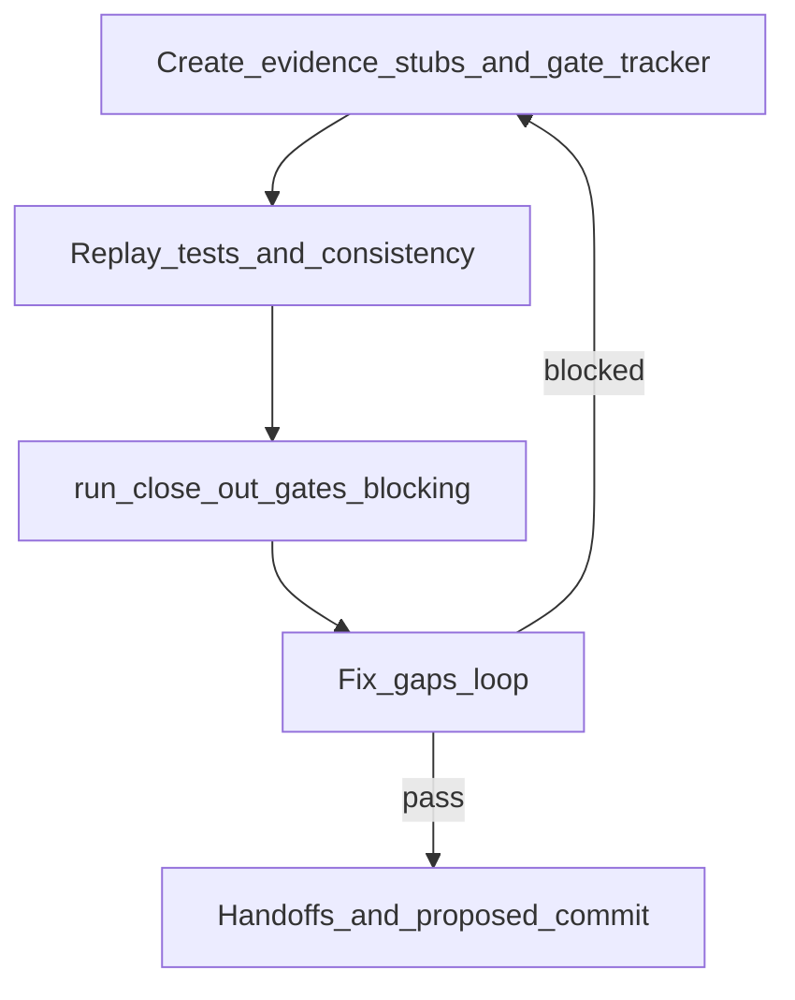

# plan-close-out — REQ-TIED_STORE_README_CERTIFIABLE_ONBOARDING

**Linked Cursor plan:** `readme_close-out_574b3db1.plan.md` (refined 2026-10-18)  
**Build plan:** [PLAN.md](./PLAN.md) · **CITDP:** [../../citdp/CITDP-REQ-TIED_STORE_README_CERTIFIABLE_ONBOARDING.yaml](../../citdp/CITDP-REQ-TIED_STORE_README_CERTIFIABLE_ONBOARDING.yaml)  
**Depth:** `minimal` · **gate_policy:** `advisory` · **Adversarial:** `not_applicable` (CITDP)  
**Authoritative close-out entry:** `@plan-close-out` with this file.

---

## Refine (resolved)

| Term | Meaning |
| --- | --- |
| **Machine close-out** | `close_out` gate `allowed: true` **and** envelope validate `blocking_gap_count: 0` with `--envelope-blocking` |
| **Envelope on disk** | `tied-project/working/REQ-TIED_STORE_README_CERTIFIABLE_ONBOARDING/evidence/request-evidence-envelope.v1.json` — **gitignored** ([`.gitignore`](../../../.gitignore)); regenerate via runner; cite `closeout-run-close-out-gates-*.json` in handoff |
| **Gate tracker** | [gate-tracker-close-out.yaml](./gate-tracker-close-out.yaml) — **only** input to `tied_checklist_gate_validate` at `close_out` (not the full 800-line checklist copy) |
| **traceable-commit slug** | `policy: plan-close-out-commit-deferred` — completed with rationale; sponsor commits separately |
| **Commit wave** | README certifiable stack only — exclude unrelated EASAR/PCR/hygiene-only untracked files unless sponsor expands |

### Sponsor decisions

| Decision | Choice | Ladder |
| --- | --- | --- |
| Commit timing | Deferred — agent proposes message only | **Costly** |
| Close-out `run_id` | `readme-certifiable-close-out-20261018` | Reversible |
| Adherence band target | **A** if all canonical evidence paths exist; **B / thin_ledger** acceptable at advisory minimal if reconcile warns on legacy slug hashes | Reversible |
| `pre_implementation` re-gate | **Skip** — build-plan wave; close_out runner only unless gate blocks | Reversible |

### Non-goals

- Re-edit README three-band IA
- Bundling other local `main` commits in proposed scope
- Integrated adversarial inquiry activation

---

## Build baseline (already landed)

| Artifact | Path |
| --- | --- |
| README | [README.md](../../../README.md) |
| Structure test | [mcp-server/src/store-readme-structure.test.ts](../../../mcp-server/src/store-readme-structure.test.ts) |
| TIED stack | `REQ-TIED_STORE_README_CERTIFIABLE_ONBOARDING`, `ARCH-TIED_STORE_README_INFORMATION_ARCHITECTURE`, `IMPL-TIED_STORE_README_SECTIONS` |
| Satellites | [client-development-index.md](../../../tied-bundle/docs/client-development-index.md), [tools/bootstrap/README.md](../../../tools/bootstrap/README.md) |
| CHANGELOG | [Unreleased] bullet (line ~12) — append close-out `run_id` only if missing |

---

## Execution order



### 1 — Evidence stubs + gate tracker (before runner)

Create directory `evidence/` and **canonical** `*-evidence.md` files referenced by [gate-tracker-close-out.yaml](./gate-tracker-close-out.yaml) (author at execute time). Minimum set:

| Slug | Evidence path | Content hint |
| --- | --- | --- |
| `risk-assessment` | `evidence/risk-assessment-evidence.md` | CITDP risks; minimal depth |
| `gate-pseudocode-validation` | `evidence/gate-pseudocode-validation-evidence.md` | Sidecar + optional PSA JSON path or “lint-only minimal waiver” |
| `verification-gate` | `evidence/verification-gate-evidence.md` | Test + consistency replay |
| `persist-citdp-record` | `evidence/persist-citdp-record-evidence.md` | Path to persisted CITDP |
| `gitignore-close-out-hygiene` | `evidence/gitignore-close-out-hygiene-evidence.md` | N/A or sponsor-pasted untracked list |
| `sub-close-out-evidence-sync` | `evidence/sub-close-out-evidence-sync-evidence.md` | Filled after runner with manifest ref |
| `traceable-commit` | `evidence/traceable-commit-evidence.md` | “Deferred; see proposed-commit-message.txt” |
| `user-facing-release-notes` | `evidence/user-facing-release-notes-evidence.md` | Pointer to CHANGELOG [Unreleased] bullet |

**Do not** include `sub-adversarial-inquiry-pass` in gate tracker (`depth_tier: minimal`, CITDP `not_applicable`).

`execution_evidence.impl_inventory`: `[IMPL-TIED_STORE_README_SECTIONS]` only.

### 2 — Verification replay

```bash
export TIED_BASE_PATH="/Users/fareed/Documents/dev/chatgpt/stdd/tied-project"
cd /Users/fareed/Documents/dev/chatgpt/stdd/mcp-server
node --import tsx --test src/store-readme-structure.test.ts
/Users/fareed/Documents/dev/chatgpt/stdd/.cursor/skills/tied-yaml/scripts/tied-cli.sh tied_validate_consistency
```

Optional: `pseudocode_validate` for `IMPL-TIED_STORE_README_SECTIONS`. Capture exit codes in `verification-gate-evidence.md` and optional `tied-validate-consistency.stdout.txt`.

### 3 — Unified close-out runner

```bash
export TIED_BASE_PATH="/Users/fareed/Documents/dev/chatgpt/stdd/tied-project"
node /Users/fareed/Documents/dev/chatgpt/stdd/tools/bootstrap/templates/run-close-out-gates.mjs \
  --project-root /Users/fareed/Documents/dev/chatgpt/stdd \
  --request-token REQ-TIED_STORE_README_CERTIFIABLE_ONBOARDING \
  --tracker-path tied-project/working/REQ-TIED_STORE_README_CERTIFIABLE_ONBOARDING/gate-tracker-close-out.yaml \
  --citdp-path tied-project/citdp/CITDP-REQ-TIED_STORE_README_CERTIFIABLE_ONBOARDING.yaml \
  --phase close_out \
  --run-id readme-certifiable-close-out-20261018 \
  --envelope-blocking \
  --sync-dispositions \
  --reconcile
```

**Blockers playbook**

| Symptom | Fix |
| --- | --- |
| Missing `evidence_refs` path | Create stub markdown at exact path |
| `impl_inventory` / PSA | Add PSA JSON under `evidence/pseudocode-analysis/` or document minimal waiver in gate-pseudocode evidence |
| Envelope structural gap | Re-run after manifest build; check `verification-evidence-manifest.v1.json` |
| Adherence thin ledger | Add missing canonical filenames; re-run `--reconcile` |

### 4 — LEAP + CHANGELOG

- README ↔ test ↔ IMPL sidecar alignment; no stack edit unless replay failed.
- CHANGELOG: do not duplicate feature bullet; optional suffix `close-out run_id=readme-certifiable-close-out-20261018`.

### 5 — Handoff (required)

| File | Role |
| --- | --- |
| [evidence/plan-close-out-handoff.md](./evidence/plan-close-out-handoff.md) | Three completion signals |
| [evidence/session-handoff.md](./evidence/session-handoff.md) | Sponsor next: traceable-commit |
| [evidence/proposed-commit-message.txt](./evidence/proposed-commit-message.txt) | Staging guide + message |
| `evidence/closeout-run-close-out-gates-final.json` | Machine receipt (track in git) |

---

## Proposed commit scope

- [README.md](../../../README.md)
- [CHANGELOG.md](../../../CHANGELOG.md)
- [mcp-server/src/store-readme-structure.test.ts](../../../mcp-server/src/store-readme-structure.test.ts)
- `tied-project/requirements.yaml`, `tied-project/requirements/`, `tied-project/architecture-decisions/`, `tied-project/implementation-decisions/`, `tied-project/semantic-tokens.yaml`, `tied-project/citdp/CITDP-REQ-TIED_STORE_README_CERTIFIABLE_ONBOARDING.yaml`
- [tied-bundle/docs/client-development-index.md](../../../tied-bundle/docs/client-development-index.md)
- [tools/bootstrap/README.md](../../../tools/bootstrap/README.md)
- `tied-project/working/REQ-TIED_STORE_README_CERTIFIABLE_ONBOARDING/` (PLAN, PLAN-CLOSE-OUT, gate-tracker, evidence markdown + JSON receipts; **not** gitignored envelope)

## Proposed commit message

```
docs(readme): certifiable operator onboarding three-band IA

Restructure store README for macOS quick start, EDSE/certifiability
operator guidance, and consolidated install appendix; add structure
test and REQ-TIED_STORE_README_CERTIFIABLE_ONBOARDING stack.

Evidence: tied-project/working/REQ-TIED_STORE_README_CERTIFIABLE_ONBOARDING/evidence/
REQ-TIED_STORE_README_CERTIFIABLE_ONBOARDING
```

---

## Gate tracker skeleton (implementer copy)

Create [gate-tracker-close-out.yaml](./gate-tracker-close-out.yaml) with:

```yaml
depth_tier: "minimal"
gate_policy: "advisory"
request_token: "REQ-TIED_STORE_README_CERTIFIABLE_ONBOARDING"
schema_version: "checklist-tracker.v1"
name: "readme-certifiable-close-out-gate"
execution_evidence:
  request: "REQ-TIED_STORE_README_CERTIFIABLE_ONBOARDING"
  envelope_path: "tied-project/working/REQ-TIED_STORE_README_CERTIFIABLE_ONBOARDING/evidence/request-evidence-envelope.v1.json"
  impl_inventory:
    - "IMPL-TIED_STORE_README_SECTIONS"
  completed:
    - "risk-assessment"
    - "gate-pseudocode-validation"
    - "verification-gate"
    - "persist-citdp-record"
    - "gitignore-close-out-hygiene"
    - "sub-close-out-evidence-sync"
    - "traceable-commit"
    - "user-facing-release-notes"
steps: [] # populate each slug with disposition completed + evidence_refs (see CAE gate-tracker-close-out.yaml)
```

Populate `steps` mirroring [REQ-TIED_CONTEXT_ADAPTIVE_ENGINEERING/gate-tracker-close-out.yaml](../REQ-TIED_CONTEXT_ADAPTIVE_ENGINEERING/gate-tracker-close-out.yaml) **minus** `sub-adversarial-inquiry-pass`, paths retargeted to this REQ folder.

---

## Forbidden (@plan-close-out skill)

`git add`, `git commit`, agent-initiated `git status` / `git diff` for hygiene (use sponsor paste or N/A).
