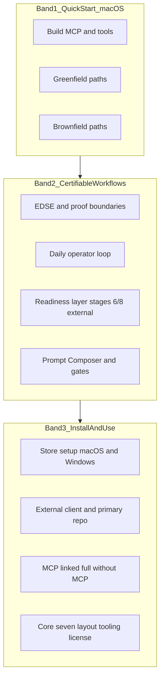
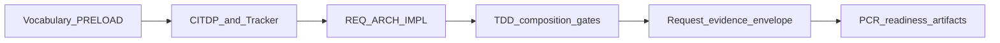

# PLAN — REQ-TIED_STORE_README_CERTIFIABLE_ONBOARDING

**Linked Cursor plan:** `readme_certifiable_onboarding_cc2865c4.plan.md` (refined 2026-10-18)  
**Depth:** `minimal` · **gate_policy:** `advisory` · **BBCE:** doc-only; blast radius = root README + 2–3 satellite docs + one structure test  
**Authoritative build entry:** `@build-plan` with remainder pointing at this file or the linked plan.  
**Close-out:** [PLAN-CLOSE-OUT.md](./PLAN-CLOSE-OUT.md) (`@plan-close-out`, refined 2026-10-18).

---

# README certifiable operator flow

## Refine (resolved)

| Sponsor term | Canonical meaning |
| --- | --- |
| **macOS quick start** | Minimal copy-paste block at document top: store build, then greenfield vs brownfield bootstrap—Windows deferred to closing appendix. |
| **Greenfield** | No prior TIED layout (or disposable factory client): `test-new-tied-client` / `./tied-install.sh /path/to/client` / first-time **linked** install on a primary repo with `--store`. First feature work via Prompt Composer (`/plan-new-feature`) after MCP + skills. |
| **Brownfield** | Existing product repo + legacy layout or code: `tied-install --migrate-layout`, refresh/migration, EASAR / pseudo-code Track C, operating-environment externalities—then checklist-driven change. |
| **Certifiable workflows** | EDSE + CASE practice layer + `[PROC-AGENT_REQ_CHECKLIST]` gates + request evidence envelope + `[REQ-TIED_PROCESS_CERTIFICATION_READINESS]` readiness artifacts (`ready_for_external_appraisal` **≠** certified). Proof boundaries from [process-certification-readiness.md](../../vocab/process-certification-readiness.md). |
| **Middle body** | **Replace-most-narrative** (sponsor choice): remove lengthy problem/iceberg/benefits/fit essays from README; replace with certifiable-workflow operator story and links to [client-development-index.md](../../../tied-bundle/docs/client-development-index.md) and [certification-of-workflows.md](../../../docs/methodologies/certification-of-workflows.md). |
| **Closing install/use** | Single appendix **Install and use** consolidating store setup, external client, primary repo, MCP, without-MCP, tooling, layout, and read-next pointers (macOS + Windows parity). |

### Unchanged behavior (negative space)

- Bootstrap engine flags, MCP env semantics, and `tied-install` defaults stay as implemented; README only describes them.
- No new certification claims, ISO/CMMI compliance language, or maturity rollup scores in prose.
- Methodology YAML under `tied-bundle/` remains read-only; no MCP tool behavior changes in this REQ.

### Non-goals

Changing bootstrap engine behavior, MCP tools, or methodology YAML; automating external appraisal (stages 6 & 8).

---

## CITDP (analysis)

| Field | Value |
| --- | --- |
| **Change type** | Documentation + structure test (operator IA) |
| **Blast radius** | [README.md](../../../README.md), [client-development-index.md](../../../tied-bundle/docs/client-development-index.md), optional [tools/bootstrap/README.md](../../../tools/bootstrap/README.md) cross-link, new TIED tokens, [CHANGELOG.md](../../../CHANGELOG.md) |
| **Risk** | Broken deep links to README headings (mitigated—see anchor table); operators miss Windows path if Band 3 is skipped (mitigated—Band 1 points to Band 3) |
| **Store-as-primary note** | **This git repo** is the TIED store **and** carries `tied-project/` product traceability. Quick start must state: use a **separate store clone** when running `tied-install --store … .` into other primary repos (`SELF_INSTALL_REFUSED` if store root equals primary root)—keep **Methodology development layout** content in Band 3 (preserve `#methodology-development-layout` anchor). |

### Anchor preservation (costly-choice mitigation)

Keep these **exact** `##` heading strings somewhere under **Install and use** so existing links keep working:

| Heading (GitHub anchor) | Current role | After move |
| --- | --- | --- |
| `Getting started with a new client project` | External client bootstrap | Band 3 § external client (unchanged title) |
| `Primary implementation repository` | Linked install narrative | Band 3 § primary repo (unchanged title); [tools/bootstrap/README.md](../../../tools/bootstrap/README.md) link preserved |
| `TIED source repository setup` | Store build | Band 3 § store setup (unchanged title) |
| `Spec-driven execution (optional)` | agentstream batch | Band 3 § **Automation (optional)**—**keep H2 text** or add `<a id="spec-driven-execution-optional"></a>` if renamed |
| `Methodology development layout` | Self-install guard | Band 3 subsection (unchanged title) |

Headings **removed** from README (content lives in linked docs only): `The problem TIED addresses`, `Sponsor and executor`, `Gated lifecycle`, `What TIED is`, `Benefits, costs, and fit`, `Proof boundaries and honest limits`, `How to use this repository`—replace with one-screen intro + Core seven link in Band 2.

---

## TIED stack

| Layer | Token | Role |
| --- | --- | --- |
| REQ | **`REQ-TIED_STORE_README_CERTIFIABLE_ONBOARDING`** | Three-band README IA; macOS quick start; certifiable body; install appendix. |
| ARCH | **`ARCH-TIED_STORE_README_INFORMATION_ARCHITECTURE`** | QuickStart → CertifiableWorkflow → InstallReference; bootstrap README stays mechanics-deep (cross-link only). |
| IMPL | **`IMPL-TIED_STORE_README_SECTIONS`** | Section contracts + `VERIFY_README_STRUCTURE` pseudo-code. |

### Satisfaction criteria (REQ detail)

1. **SC-README-BANDS** — Root README opens with **Quick start (macOS)** before any install appendix; certifiable-workflow body precedes **Install and use**.
2. **SC-README-ANCHORS** — Structure test passes; preserved H2 anchors listed above remain addressable.
3. **SC-README-PCR-OPS** — Band 2 documents PCR proof boundary and at least one verify path (tests + `tied_validate_consistency`; optional `tied certification …` CLI).
4. **SC-README-TOOLCHAIN** — Band 1/Band 3 retain unified `mcp-server` workspace build story ([REQ-TIED_UNIFIED_TOOLCHAIN](../../../requirements/REQ-TIED_UNIFIED_TOOLCHAIN.yaml)).
5. **SC-README-INDEX** — Client development index gains certifiability scenario row pointing at README + vocab.

**LEAP (same work item):** client-development-index scenario row; optional bootstrap README one-liner; do **not** rewrite `REQ-TIED_PRIMARY_REPO_ONBOARDING` status—new REQ owns store-wide IA.

**Artifacts:** `tied-project/citdp/CITDP-REQ-TIED_STORE_README_CERTIFIABLE_ONBOARDING.yaml` after implementation; Tracker at `tied-project/working/REQ-TIED_STORE_README_CERTIFIABLE_ONBOARDING/agent-req-implementation-checklist.yaml`.

---

## Target README outline



### Stable H2 contract (structure test)

These three H2 titles are **normative** (exact match):

1. `## Quick start (macOS)`
2. `## Performing work in certifiable workflows`
3. `## Install and use`

Band 1 opening (after title/version block): one sentence what TIED is + link to Core seven—no separate “problem/iceberg” H2s.

### Band 1 — Quick start (macOS only, concise)

```bash
cd mcp-server && npm install && npm run build
cd ../tools/bootstrap && npm install
```

| Subsection | Content |
| --- | --- |
| **Build TIED MCP and tools** | `dist/index.js`, umbrella `tied` CLI; Windows → Band 3. |
| **Greenfield** | Mini-table: `test-new-tied-client`; `./tied-install.sh /path`; primary `tied-install.sh --mode linked --store "$STORE" .`; then MCP + `/plan-new-feature`. Link [catalog-greenfield](../../../docs/demos/catalog-greenfield-plan-new-feature-prompts.md) as optional. |
| **Brownfield** | `--migrate-layout`; [methodology-migration.md](../../../tied-bundle/docs/methodology-migration.md); [EASAR](../../../docs/methodologies/evidence-assured-software-architecture-recovery.md); [OEE](../../../docs/tied-operating-environment-externalities.md). |

### Band 2 — Performing work in certifiable workflows

| Section | Content source |
| --- | --- |
| **What certifiable means here** | Stages 1–5, 7 in-repo; 6 & 8 external—[certification-of-workflows.md](../../../docs/methodologies/certification-of-workflows.md). |
| **EDSE daily loop** | Context profile → practice selection → checklist; [context-adaptive-engineering.md](../../vocab/context-adaptive-engineering.md). |
| **Executable spine** | Tracker, CITDP, `tied gate check`, envelope; [client-development-index.md](../../../tied-bundle/docs/client-development-index.md) harness matrix. |
| **Certifiability readiness** | `[REQ-TIED_PROCESS_CERTIFICATION_READINESS]` artifacts; **CLI:** `tied certification spec-validate`, `conformance-evaluate`, `readiness-report-compose`, … (see `process-certification-cli.ts` usage line). **Verify:** `node --import tsx --test src/process-certification-readiness/*.test.ts` + `tied_validate_consistency`. |
| **REQ-scoped prompt types** | `plan-new-feature`, `build-plan`, `plan-close-out`; AGENTS.md authority. |
| **Honest limits** | Short bullets from vocab proof boundaries (no essay). |



Relocate **Spec-driven execution** block to Band 3 **Automation (optional)**; keep heading text or explicit HTML anchor.

### Band 3 — Install and use

Merge existing install content under one H2; preserve legacy H2 strings as documented in anchor table. Include: prerequisites, macOS/Windows store setup, external client, primary repo (+ mermaid, env JSON, doctor), MCP, without MCP, methodology development layout, tooling table, repository layout, shortened “where to read next”, language adaptation (one paragraph + link), license.

---

## Test strategy

| Test | Intent |
| --- | --- |
| **`mcp-server/src/store-readme-structure.test.ts`** | Resolve repo-root `README.md`; assert three normative H2s; assert substrings: `certification-of-workflows.md`, `client-development-index.md`, `process-certification-readiness`, `npm install && npm run build`; assert **forbidden claim patterns** (case-insensitive): `\bISO\s+certified\b`, `\bCMMI\s+level\s+\d`, `\bcertified\s+EDSE\b` (discussing certification as out-of-scope is OK—test targets affirmative claims only). |
| **Manual** | `node tools/bootstrap/install-layers.mjs --doctor .` from store root after edit. |
| **CI** | Run new test with `mcp-server` test suite after `npm run build`. |

RED first: test fails on current README (missing normative H2s).

---

## Implement ([PROC-AGENT_REQ_CHECKLIST] compressed)

1. Copy Tracker → `working/REQ-TIED_STORE_README_CERTIFIABLE_ONBOARDING/agent-req-implementation-checklist.yaml`.
2. Create REQ/ARCH/IMPL via MCP + `IMPL-TIED_STORE_README_SECTIONS-pseudocode.md` (`VERIFY_README_STRUCTURE` with PRE/POST/FAILURE_MODES).
3. RED → GREEN structure test; rewrite README per bands; CHANGELOG [Unreleased].
4. LEAP: client-development-index row; optional bootstrap cross-link.
5. `lint_yaml` on changed project YAML; `tied_validate_consistency`.
6. **Gates (minimal):** `tied gate check --request-token REQ-TIED_STORE_README_CERTIFIABLE_ONBOARDING --phase pre_implementation` before RED if Tracker+CITDP exist; verification/close_out before completion claims; envelope sync only if Tracker enables envelope for this REQ.

---

## Risk register

| Choice | Ladder | Plan default |
| --- | --- | --- |
| Remove legacy narrative H2s | **Costly** (bookmarks) | Anchor table + structure test |
| Demote spec-driven batch | **Reversible** | Band 3 automation |
| New REQ vs extend PRIMARY_REPO_ONBOARDING | **Reversible** | New REQ |

---

## Key files

- [README.md](../../../README.md)
- [PLAN.md](./PLAN.md) (this file)
- TIED indexes + `working/REQ-TIED_STORE_README_CERTIFIABLE_ONBOARDING/`
