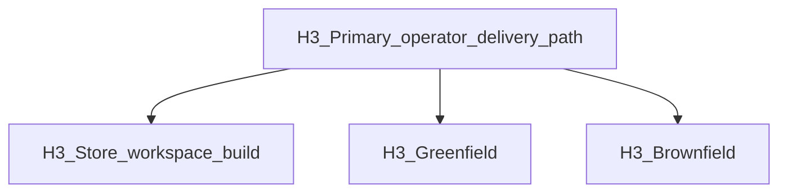

# PLAN — REQ-TIED_STORE_README_OPERATOR_DELIVERY_SPINE

**Refined:** 2026-10-19 (`@refine-plan`)  
**Linked Cursor plan:** `readme_operator_delivery_spine_e76cbae7.plan.md`  
**Depth:** `minimal` · **gate_policy:** `advisory` · **BBCE:** doc-only; blast radius = root README + structure test + project TIED YAML + CHANGELOG; optional client-development-index row  
**Authoritative build entry:** `@build-plan` with remainder pointing at this file.  
**Parent REQ:** [REQ-TIED_STORE_README_CERTIFIABLE_ONBOARDING](../../requirements/REQ-TIED_STORE_README_CERTIFIABLE_ONBOARDING.yaml) (Implemented — three-band H2 contract unchanged)

---

## Refine (resolved, pass 2)

| Sponsor term | Canonical operator term | Where it appears |
| --- | --- | --- |
| Onboard | **Prepare the store**, then **install into a client** | Two-step spine; avoid a single vague verb |
| Publish | **Client install** — deliver methodology layers into a target directory | `./tied-install.sh`; CLI title **TIED client install** |
| Build tools | **Store workspace build** | `./build-workspace.sh`; CLI title **TIED workspace build** |

**Normative Band 1 headings (exact `###` strings for structure test):**

1. `### Primary operator delivery path` — new; sits immediately after the Band 1 platform sentence (line ~9 today).
2. `### Store workspace build` — replaces `### Build TIED MCP and tools` (GitHub anchor changes; no known external anchor dependency on old title).

**Prose-only alias:** store-to-client delivery spine (OEE [WF-002](../OEE-TIED-CLIENT-DELIVERY/external-workflow-register.md)); do not use as a third H3.

### Unchanged behavior (negative space)

- Bootstrap scripts, help CLIs, and install defaults unchanged; README describes only.
- Normative H2 bands and [PRESERVED_HEADINGS](../../../mcp-server/src/store-readme-structure.test.ts) from parent REQ unchanged.
- Manual npm equivalent under **TIED source repository setup** retained, demoted vs `./build-workspace.sh`.

### Non-goals

npm/registry release publishing; EDPC `publish_build`; MCP or install engine code changes.

---

## CITDP (analysis)

| Field | Value |
| --- | --- |
| **Change type** | Documentation + structure test extension |
| **Blast radius** | [README.md](../../../README.md), [store-readme-structure.test.ts](../../../mcp-server/src/store-readme-structure.test.ts), new REQ detail + ARCH traceability row, [IMPL-TIED_STORE_README_SECTIONS-pseudocode.md](../../implementation-decisions/IMPL-TIED_STORE_README_SECTIONS-pseudocode.md), [CHANGELOG.md](../../../CHANGELOG.md) |
| **In-scope LEAP** | [client-development-index.md](../../../tied-bundle/docs/client-development-index.md) scenario row (see below); optional one-line [tools/bootstrap/README.md](../../../tools/bootstrap/README.md) if not redundant |
| **Out-of-scope LEAP** | Rewriting Band 2 certifiable narrative; changing `REQ-TIED_STORE_README_CERTIFIABLE_ONBOARDING` status |
| **Risk** | Band 1 length / duplication between spine H3 and **Store workspace build** H3 — **mitigation:** spine = numbered steps + pointers; detail lives in the subsection below |
| **Integrations** | None (no network/auth/persistence) → `minimal` depth appropriate |

### Desired vs current (RED baseline)

| Contract | Current README | After GREEN |
| --- | --- | --- |
| H3 `Primary operator delivery path` | Absent | Present before greenfield table |
| H3 `Store workspace build` | Titled `Build TIED MCP and tools` | Renamed |
| `./tied-install.sh --help` | Absent (only build `--help`) | Mentioned in spine + tooling |
| `--refresh` or `--migrate-layout` in Band 1/3 | Brownfield table only has migrate | Explicit install-help pointer in spine or client bootstrap lead |
| Layout tree `build-workspace.sh` | Absent | Listed at repo root |
| Tooling list order | `tied-install.sh` first | `build-workspace.*` first |

---

## TIED stack

| Layer | Token | Role |
| --- | --- | --- |
| REQ | **`REQ-TIED_STORE_README_OPERATOR_DELIVERY_SPINE`** | SC-README-SPINE through SC-README-STRUCTURE-TEST (below) |
| ARCH | **`ARCH-TIED_STORE_README_INFORMATION_ARCHITECTURE`** | Add requirement traceability to new REQ; decision unchanged (three-band IA) |
| IMPL | **`IMPL-TIED_STORE_README_SECTIONS`** | Extend `VERIFY_README_STRUCTURE` POST: new substrings + normative H3 titles under Quick start |

**Cross-refs:** [REQ-TIED_LAYERED_CLIENT_INSTALL](../../requirements/REQ-TIED_LAYERED_CLIENT_INSTALL.yaml), [REQ-TIED_UNIFIED_TOOLCHAIN](../../requirements/REQ-TIED_UNIFIED_TOOLCHAIN.yaml), [REQ-TIED_STORE_README_CERTIFIABLE_ONBOARDING](../../requirements/REQ-TIED_STORE_README_CERTIFIABLE_ONBOARDING.yaml).

### Satisfaction criteria

| ID | Criterion | Metric |
| --- | --- | --- |
| SC-README-SPINE | Band 1 H3 **Primary operator delivery path** lists build → install → MCP confirm with both `--help` commands | README + structure test |
| SC-README-INSTALL-HELP | README documents no-arg `./tied-install.sh` help and `--refresh` or `--migrate-layout` for brownfield/refresh | README + structure test |
| SC-README-LAYOUT | Repository layout ASCII includes `build-workspace.sh` (+ Windows peers or explicit “same family” line) | README |
| SC-README-STRUCTURE-TEST | Extended test passes; three normative H2 order unchanged | `store-readme-structure.test.ts` |

**Artifacts at implement:** `tied-project/citdp/CITDP-REQ-TIED_STORE_README_OPERATOR_DELIVERY_SPINE.yaml`; Tracker `agent-req-implementation-checklist.yaml` in this folder.

---

## Target information flow (Band 1)



Spine content (implementer scaffold — tighten wording, keep commands):

```markdown
### Primary operator delivery path

1. **Store workspace build** (store root): `./build-workspace.sh` — details in [Store workspace build](#store-workspace-build) below; `./build-workspace.sh --help`.
2. **Client install**: `./tied-install.sh /path/to/client` (or linked primary install from the greenfield table); `./tied-install.sh --help` (no arguments prints styled help). Brownfield layout: `--migrate-layout`; refresh: `--refresh`.
3. **Confirm MCP**: `tied_config_get_base_path` → client `tied-project/` — [Optionally enable the MCP server](#2-optionally-enable-the-mcp-server).

Windows store build and install shims: [Install and use](#install-and-use).
```

Then **`### Store workspace build`** — keep existing bash block and outputs paragraph; remove duplicate “require built workspace” lead-in if already stated in spine.

**Greenfield footnote:** `test-new-tied-client` assumes a **built store** (`./build-workspace.sh` on the store clone first).

---

## Band 3 edits (summary)

| Section | Change |
| --- | --- |
| **TIED source repository setup** | First command `./build-workspace.sh`; manual npm under **Manual equivalent** |
| **Getting started with a new client project** | Opening paragraph: prerequisite **built store workspace** (mirror install help) |
| **Tooling and scripts** | First bullets: `build-workspace.sh` / `.ps1` / `.cmd`, then `tied-install.sh` |
| **Repository layout** | Add `build-workspace.sh`, `build-workspace.ps1`, `build-workspace.cmd` before `tied-install.sh` |
| **Spec-driven execution (optional)** | Optional consistency: replace lone `cd mcp-server && npm run build` with “after `./build-workspace.sh`” (reversible; not structure-tested) |

---

## LEAP — client development index (in scope)

Add one row to **Scenario → start here** in [client-development-index.md](../../../tied-bundle/docs/client-development-index.md):

| Situation | Start at | Also open |
| --- | --- | --- |
| Fresh store clone / deliver TIED to a client | Root [README.md](../../README.md) § Quick start → **Primary operator delivery path** | [tools/bootstrap/README.md](../../../tools/bootstrap/README.md); `how install-matrix` after `source scripts/build-commands.sh` |

Place near **Claude Code client bootstrap** or **Upgrade TIED methodology** (operator-facing, not REQ-scoped work).

**Vocab:** RECORD **primary operator delivery path** in [tied-methodology.md](../../vocab/tied-methodology.md) bootstrap section only if the phrase appears in index + README (expected — do RECORD at pre-commit).

---

## Structure test contract (normative additions)

Extend [store-readme-structure.test.ts](../../../mcp-server/src/store-readme-structure.test.ts):

**New `REQUIRED_SUBSTRINGS`:**

- `### Primary operator delivery path`
- `### Store workspace build`
- `tied-install.sh --help`
- `--migrate-layout` (already in brownfield table — remains required)

**Optional assertion:** Quick start section contains `Primary operator delivery path` before `### Greenfield` (index order).

**Unchanged:** `NORMATIVE_H2`, `PRESERVED_HEADINGS`, `FORBIDDEN_CLAIM_PATTERNS`, existing `REQUIRED_SUBSTRINGS`.

**Run:** `node --import tsx --test mcp-server/src/store-readme-structure.test.ts` from repo root (same as parent REQ evidence).

---

## Test strategy

| Phase | Action |
| --- | --- |
| RED | Extend structure test; confirm failure on current README (missing H3 + `tied-install.sh --help`) |
| GREEN | README + IMPL pseudo-code + TIED tokens |
| Manual | `./build-workspace.sh --help` and `./tied-install.sh --help` match README claims |

No composition/E2E tests.

---

## Implement ([PROC-AGENT_REQ_CHECKLIST] compressed)

1. Copy Tracker from [agent-req-implementation-checklist.yaml](../../../tied-bundle/docs/agent-req-implementation-checklist.yaml) → `agent-req-implementation-checklist.yaml`.
2. MCP: `tied_config_get_base_path` → `.../stdd/tied-project`.
3. Create REQ + update ARCH traceability + extend IMPL pseudo-code (`VERIFY_README_STRUCTURE` POST substrings); `semantic-tokens.yaml` entry for new REQ.
4. `tied gate check --request-token REQ-TIED_STORE_README_OPERATOR_DELIVERY_SPINE --phase pre_implementation` (Tracker + CITDP paths).
5. RED → GREEN structure test; README; client-development-index row; CHANGELOG [Unreleased].
6. `lint_yaml` on changed project YAML; `tied_validate_consistency`.
7. Verification/close_out gates + CITDP persist under `evidence/`.

---

## Risk register

| Choice | Ladder | Plan default |
| --- | --- | --- |
| Exact H3 titles in structure test | Reversible | Locked strings above |
| Rename build subsection | Reversible | Accept anchor drift |
| New REQ vs amend Implemented parent | Reversible | **New REQ** |
| client-development-index row | Reversible | **In scope** (pass 2) |

---

## Key files

- [README.md](../../../README.md)
- [PLAN.md](./PLAN.md) (this file)
- [store-readme-structure.test.ts](../../../mcp-server/src/store-readme-structure.test.ts)
- Working: `tied-project/working/REQ-TIED_STORE_README_OPERATOR_DELIVERY_SPINE/`
