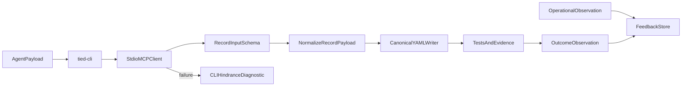

# PLAN — Native record inputs and QC loop

**Plan status:** **Close-out complete** — `run_id=ntic-close-out-20261020-r1`; [evidence/closeout-run-close-out-gates.json](evidence/closeout-run-close-out-gates.json) **`merged_decision.allowed=true`**; envelope **`blocking_gap_count=0`** (advisory warns remain). Verification receipt [gates/verification-2026-10-20T05-57-24-415Z.json](gates/verification-2026-10-20T05-57-24-415Z.json). **Kaizen PDCA** deferred (no sponsor baseline -32602 text).

## Session handoff (refine-plan pass 1)

| Artifact | Path |
| --- | --- |
| **Primary REQ** | [REQ-TIED_TOOL_INPUT_COMPATIBILITY](../../requirements/REQ-TIED_TOOL_INPUT_COMPATIBILITY.yaml) |
| **ARCH / IMPL** | [ARCH-TIED_TOOL_INPUT_NORMALIZATION](../../architecture-decisions/ARCH-TIED_TOOL_INPUT_NORMALIZATION.yaml) · [IMPL-TIED_TOOL_INPUT_NORMALIZATION](../../implementation-decisions/IMPL-TIED_TOOL_INPUT_NORMALIZATION.yaml) |
| **IMPL sidecar** | [IMPL-TIED_TOOL_INPUT_NORMALIZATION-pseudocode.md](../../implementation-decisions/IMPL-TIED_TOOL_INPUT_NORMALIZATION-pseudocode.md) |
| **CITDP (working)** | [CITDP-REQ-TIED_TOOL_INPUT_COMPATIBILITY.yaml](CITDP-REQ-TIED_TOOL_INPUT_COMPATIBILITY.yaml) |
| **Tracker (refine)** | [checklist-tracker-refine.yaml](checklist-tracker-refine.yaml) |
| **Test strategy** | [test-strategy.md](test-strategy.md) |
| **Provenance** | [evidence/plan-refine-provenance.md](evidence/plan-refine-provenance.md) |
| **Delta log** | [evidence/plan-refine-delta.jsonl](evidence/plan-refine-delta.jsonl) |

**Cross-ref (do not broaden):** [REQ-TIED_UNIFIED_TOOLCHAIN](../../requirements/REQ-TIED_UNIFIED_TOOLCHAIN.yaml) — this change is MCP input-shape only, not toolchain consolidation.

---

## Refine (Touchpoint 1 — RESOLVE)

### Intent (one line)

Let agents pass **structured record input** (native JSON objects) to MCP YAML write tools and **tied-cli** without `-32602` string-type validation failures, while preserving string compatibility, canonical YAML persistence, and explicit **CLI hindrance diagnostic** lines for transport/protocol failures.

### Canonical vocabulary (RECORD in [tied-yaml-mcp.md](../../vocab/tied-yaml-mcp.md))

| Preferred term | Meaning |
| --- | --- |
| **structured record input** | Non-array JSON object accepted directly on MCP `tools/call` for record-shaped fields |
| **input normalization** | Shared coercion: object pass-through OR legacy string → `parseRecordOrYaml` |
| **CLI hindrance diagnostic** | `DIAGNOSTIC: TIED_CLI_HINDRANCE` JSON line on stderr; exit code unchanged; no auto feedback |

### Sponsor decisions (defaults — reversible unless noted)

| Decision | Choice | Ladder |
| --- | --- | --- |
| Object vs string on write tools | **Both**; objects recommended in docs | Reversible |
| `tied_feedback_add.context` | **Keep JSON string** (handler already parses); out of scope unless parity proven necessary | Reversible |
| CLI diagnostic | **Add** diagnostic line; preserve ERROR text and exit codes | Reversible |
| PDCA / Kaizen | **Manual** capture + outcome record; no silent LEAP from failure path | Reversible |
| `depth_tier` | **integrated** (external agent input + persistence) | Costly — requires inquiry activation before RED |
| `gate_policy` | **advisory** | Reversible |

### Non-goals

- Changing canonical YAML writer semantics or scalar-style resolution
- Migrating every `z.record` tool to union schemas (only listed write surfaces)
- ISO 9001 certification or automatic `tied_feedback_add` on CLI failure
- Broadening [REQ-TIED_UNIFIED_TOOLCHAIN](../../requirements/REQ-TIED_UNIFIED_TOOLCHAIN.yaml) scope

### Unchanged-behavior checklist

| Surface | Must stay |
| --- | --- |
| String JSON/YAML record args | Same parse rules and error messages from `parseRecordOrYaml` |
| `@file` / `TIED_CLI_ARGS_FILE` | Still valid; object payloads may appear inside args file JSON |
| Batch tools already object-native (`yaml_updates_apply`, feedback capture, etc.) | Unchanged |
| MCP write isolation | Project YAML only under `tied-project/` |

### Anti-examples

- Accepting arrays or primitives as record payloads
- Silently stringifying objects in a way that breaks colon-quoting expectations downstream
- Auto-opening feedback entries from CLI hindrance path
- Claiming ISO certification from PDCA-shaped checklist evidence

---

## Plan (CITDP)

### Change definition

| | Current | Desired |
| --- | --- | --- |
| MCP Zod schemas | `record` / `updates` / `index_record` / `detail_record` are **string-only** | **Union**: string **or** record object; JSON Schema exposes both |
| Handler | `parseRecordOrYaml(string)` only | `normalizeRecordPayload(unknown)` then existing writers |
| tied-cli stdio client | Generic ERROR on JSON-RPC / validation failures | Adds **`DIAGNOSTIC: TIED_CLI_HINDRANCE`** with `failure_kind`, optional `jsonrpc_code`, `recovery_hint` |
| Operator docs | Strings documented as primary | Objects **recommended**; strings **compatibility**; hindrance diagnostic documented |
| Traceability | Ad hoc `-32602` report | Dedicated **REQ → ARCH → IMPL** chain + Kaizen before/after |

### Write-tool inventory (in scope)

| Tool | Field(s) |
| --- | --- |
| `yaml_index_insert` | `record` |
| `yaml_index_update` | `updates` |
| `yaml_detail_create` | `record` |
| `yaml_detail_update` | `updates` |
| `citdp_record_write` | `record` |
| `tied_token_create_with_detail` | `index_record`, `detail_record` |

**Out of scope:** `tied_feedback_add.context` (optional JSON **string** by contract); tools already typed as `z.record(z.unknown())`.

### Profile / gates

- **`depth_tier`:** **integrated**
- **`gate_policy`:** **advisory**
- **`assurance profiles`:** `baseline-functional`, `external-input-security`, `data-integrity-migration`, `stateful-reliability` (CLI exit codes), `ai-enabled` (agent tool boundary)
- **Proof boundary:** Unit + composition MCP schema tests + CLI regression; does not prove every IDE MCP client implementation

### Risks

| Risk | Mitigation |
| --- | --- |
| Object injection / prototype pollution | Reject non-plain objects if needed; Zod record schema; security profile cases |
| Divergent coercion between MCP and tied-cli args file | Same `normalizeRecordPayload` module imported by server; CLI file still JSON-parse then server normalizes |
| Schema drift (new write tool added) | REQ criterion lists tools; composition test enumerates exported tool schemas |
| Agents rely on diagnostic without reading ERROR | Docs: diagnostic is adjunct; ERROR remains authoritative for humans |

---

## Implementation phases (`@build-plan`)

### Phase 0 — TIED stack (refine-plan pass 1)

- Mint [REQ-TIED_TOOL_INPUT_COMPATIBILITY](../../requirements/REQ-TIED_TOOL_INPUT_COMPATIBILITY.yaml), [ARCH-TIED_TOOL_INPUT_NORMALIZATION](../../architecture-decisions/ARCH-TIED_TOOL_INPUT_NORMALIZATION.yaml), [IMPL-TIED_TOOL_INPUT_NORMALIZATION](../../implementation-decisions/IMPL-TIED_TOOL_INPUT_NORMALIZATION.yaml)
- Validate [IMPL-TIED_TOOL_INPUT_NORMALIZATION-pseudocode.md](../../implementation-decisions/IMPL-TIED_TOOL_INPUT_NORMALIZATION-pseudocode.md) (`pseudocode_validate`, gate mode)
- Working CITDP, tracker, test strategy, `pre_implementation` gate receipt under this folder

### Phase 1 — RED tests

- Extend [parse-content.test.ts](../../../mcp-server/src/parse-content.test.ts) for object branch + shared normalizer
- [yaml-canonicalization-mcp.test.ts](../../../mcp-server/src/tools/yaml-canonicalization-mcp.test.ts) + focused handler/schema regression (Zod parse, not handler-only)
- [tied-cli-large-args.test.cjs](../../../mcp-server/test/tied-cli-large-args.test.cjs) for hindrance diagnostic line + exit code parity

### Phase 2 — Production code

- Add `normalizeRecordPayload` + `recordInputSchema` in [parse-content.ts](../../../mcp-server/src/parse-content.ts) (or adjacent module re-exported)
- Wire [tools/index.ts](../../../mcp-server/src/tools/index.ts) write tools per inventory
- Update [tied-mcp-stdio-client.cjs](../../../tools/bundled-tied-yaml-skill/scripts/tied-mcp-stdio-client.cjs)

### Phase 3 — Docs + Kaizen PDCA

- **Plan:** `tied_feedback_capture_observation` for baseline `-32602` / workaround (redacted command, idempotency key)
- **Do:** countermeasure through TDD
- **Check:** tests, `npx tsc -b`, YAML lint, `tied_validate_consistency`, security cases
- **Act:** `tied_feedback_outcome_record` with `improved` or `inconclusive`
- Update bundled docs: [mcp-server/README.md](../../../mcp-server/README.md), [SKILL.md](../../../tools/bundled-tied-yaml-skill/SKILL.md), [reference.md](../../../tools/bundled-tied-yaml-skill/reference.md), [yaml-update-mcp-runbook.md](../../../tied-bundle/docs/yaml-update-mcp-runbook.md), [ai-agent-tied-mcp-usage.md](../../../tied-bundle/docs/ai-agent-tied-mcp-usage.md)

---

## Implement boundary (refine-plan)

- **Deferred:** Phase 1–3 production edits and RED tests — execute via **`@build-plan`** linked to this PLAN after gate receipt is green.
- **No commit** in refine-plan; preserve unrelated dirty worktree files.
- **No** standalone SESSION_SUMMARY.

---

## Verification (build-plan close-out)

- Focused tests listed in [test-strategy.md](test-strategy.md)
- `npx tsc -b` in `mcp-server`
- `lint_yaml` on changed TIED YAML
- `pseudocode_validate` (gate) + `tied_validate_consistency`
- Integrated **verification** and **close_out** gates when implementation completes
