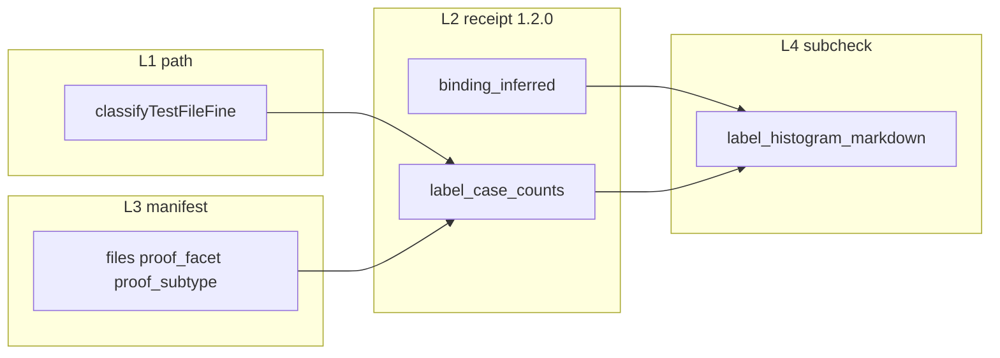

# PLAN — Trial proof-intent stack (orchestrator)

**Working folder:** `REQ-TIED_TRIAL_PROOF_INTENT_STACK` (orchestrator only — **no** REQ index token unless sponsor asks)  
**Linked Cursor plan:** `.cursor/plans/trial_proof_intent_l1-l4_453525e0.plan.md`  
**Track:** `@add-feature` → **`@refine-plan`** (this revision) → per-layer `@refine-plan` / `@build-plan` → sponsor **G1–G4** → `@close-out`  
**plan_phase:** `pre-implementation`

**Label taxonomy (normative):** [evidence/proof-test-label-taxonomy.md](evidence/proof-test-label-taxonomy.md)

---

## Sponsor choices (locked)

| Choice | Decision |
| --- | --- |
| **Packaging** | Four sibling REQs, strict ship order **L1 → L2 → L3 → L4** with LEAP between layers |
| **Coarse receipts** | Keep four facet keys; cohort JSONL era discipline unchanged except **1.2.0** additive `label_case_counts` |
| **Fine labels** | `proof_subtype` dot-enum (taxonomy doc); dissect clients in store batch compare + subcheck |
| **L3 default** | **WF-lite** manifest (binding rows + per-file labels); not full `binding_inventory_validate` on every disposable trial |
| **L1 suffix map** | `.integration`, `.binding`, `.contract` → **composition** facet; subtype from fine classifier |
| **L3 close-out gate** | Manifest validation **advisory** by default (costly to make blocking) |
| **L4 readout** | Subcheck **appends evidence** only in v1; label histogram in readout appendix |

**Proof boundary:** Descriptive evidence and facilitator rubric support — not REQ **Implemented** status, not model leaderboard, not maturity score. Preserve [sponsor lens A vs B](tied-project/working/FACILITATOR-WF-09-COMPOSITION-GRADING/evidence/sponsor-lens-decision.md).

---

## Labeling architecture (full stack)

| Layer | Label responsibility |
| --- | --- |
| **L1** | Path → `{ proof_facet, proof_subtype }`; document `PROOF_LABEL` / legacy `PROOF_KIND`; add `.contract.test.ts` |
| **L2** | Emit `label_case_counts`; optional `composition.wiring` uplift from inference; compare table subtype columns (flag) |
| **L3** | Manifest overrides; binding row `test_files[]` + optional `proof_subtype`; reconcile diagnostics |
| **L4** | Subcheck v2: declared vs path vs manifest; facilitator markdown + JSON histogram |

**Sponsor G1b:** Confirm fine subtype enum before L2 codes `label_case_counts` keys.

---

## Problem statement

WF cohort tooling conflates path-declared composition counts, structural binding inference, agent-declared manifest intent, and facilitator sub-check grading — and **collapses** integration/wiring/contract into a single `comp` integer.

| Layer | Signal | Today | Risk |
| --- | --- | --- | --- |
| **L1** | Receipt `composition_tests` | Path rules in `classifyTestFile` | No integration vs wiring vs contract dissection |
| **L2** | Structural binding | Manual facilitator import scan | Not reproducible at scale |
| **L3** | Agent-declared intent | Absent on most WF clients | Automation cannot read “what the agent meant” |
| **L4** | Grading sub-check | Ad hoc `wf-09-composition-subcheck.v1.json` | Not wired into `@record-wf-trial` / MCP |

**Baseline:** [`REQ-TIED_PROJECT_SIZE_PROOF_FACET_TEST_CASES`](../REQ-TIED_PROJECT_SIZE_PROOF_FACET_TEST_CASES/PLAN.md) closed @ `validator_version` **1.1.0** (case counts).

---

## Child REQ map

| Layer | Token | Depends on | Child PLAN |
| --- | --- | --- | --- |
| **L1** | `REQ-TIED_PROJECT_SIZE_PROOF_PATH_SEMANTICS` | `REQ-TIED_PROJECT_SIZE_PROOF_FACET_TEST_CASES` | [PLAN](../REQ-TIED_PROJECT_SIZE_PROOF_PATH_SEMANTICS/PLAN.md) |
| **L2** | `REQ-TIED_PROJECT_SIZE_PROOF_FACET_INFERENCE` | L1 | [PLAN](../REQ-TIED_PROJECT_SIZE_PROOF_FACET_INFERENCE/PLAN.md) |
| **L3** | `REQ-WF_TRIAL_PROOF_MANIFEST_LITE` | `REQ-WF_TRIAL_COMPOSITION_PROMPTS`, L2 | [PLAN](../REQ-WF_TRIAL_PROOF_MANIFEST_LITE/PLAN.md) |
| **L4** | `REQ-WF_TRIAL_COMPOSITION_EVIDENCE_SUBCHECK` | L2, L3, `REQ-WF_TRIAL_READOUT_GRADING_RATIONALE` | [PLAN](../REQ-WF_TRIAL_COMPOSITION_EVIDENCE_SUBCHECK/PLAN.md) |

**Facilitator cohort:** Re-run [project-size-batch-discover-compare](../../../non-tied-plans/project-size-batch-discover-compare/PLAN.md) after **L2** (subtype columns behind flag).

---

## Implementation order and sponsor pauses

| Phase | Skill | Deliverable | Sponsor pause |
| --- | --- | --- | --- |
| 0 | `@refine-plan` (stack) | Taxonomy + aligned child PLANS | **G1b** enum |
| 1 | `@build-plan` L1 | `classifyTestFileFine`, suffixes, adjunct | **G1** |
| 2 | `@build-plan` L2 | `label_case_counts` + inference @ **1.2.0** | **G2** |
| 3 | `@build-plan` L3 | Manifest labels + validator | **G3** |
| 4 | `@build-plan` L4 | Subcheck histogram + record-wf-trial | **G4** |
| 5 | `@close-out` ×4 | CITDP persist, consistency, CHANGELOG | Optional batch |

---

## Risks (consequence ladder)

| Choice | Class | Gate |
| --- | --- | --- |
| Fine subtype enum churn | Reversible until L2 ship | G1b |
| `label_case_counts` @ 1.2.0 | Costly for cohort JSONL | Catalog era split |
| Fifth coarse receipt bucket (e.g. integration) | Costly | **Rejected** — subtypes only |
| Blocking manifest labels | Costly | G3 advisory default |

---

## depth_tier / gate_policy

**minimal** / **advisory** for all four layers.

---

## Do next

1. Sponsor **G1b** — approve [proof-test-label-taxonomy.md](evidence/proof-test-label-taxonomy.md).
2. **`@build-plan`** [L1](../REQ-TIED_PROJECT_SIZE_PROOF_PATH_SEMANTICS/PLAN.md) → **G1**.
