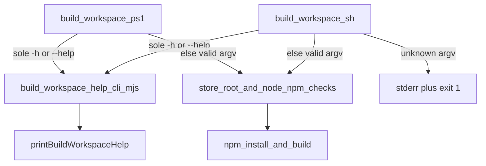

# PLAN — build-workspace `-h` / `--help` (refined)

**Linked Cursor plan:** `build-workspace_cli_help_14797e68.plan.md`  
**Parent REQ:** `[REQ-TIED_UNIFIED_TOOLCHAIN]` · **Related:** `[REQ-TIED_LAYERED_CLIENT_INSTALL]` (install help prerequisite), `[REQ-TIED_STORE_README_CERTIFIABLE_ONBOARDING]` (Band 1/3 toolchain docs)  
**Build entry:** `@build-plan` with remainder pointing at this file.  
**Depth:** `minimal` · **gate_policy:** `advisory` · **Adversarial inquiry:** not activated (operator CLI contract only).

---

## Refine (resolved)

| Sponsor term | Canonical behavior |
| --- | --- |
| **Explicit help** | Sole `-h` or `--help` → styled help on **stdout**, exit **0**, **no** npm/build side effects. |
| **No args** | Unchanged: run full workspace build (mcp-server install+build, then tools/bootstrap install). |
| **Texture parity** | Match [`printTiedInstallHelp`](../../../tools/bootstrap/lib/tied-install-help.mjs) via shared [`console.mjs`](../../../tools/bootstrap/lib/console.mjs): bold title, dim `─`×56 rule, cyan **▶** sections, dim body lines, **Hints** with `•` bullets; honor `NO_COLOR` and non-TTY. |
| **Help before build preconditions** | Help path runs **before** store-root / npm prechecks in shell scripts. Help does **not** require npm on PATH (only Node, same as [`tied-install.sh`](../../../tied-install.sh) shim). |
| **Cross-platform** | Unix: [`build-workspace.sh`](../../../build-workspace.sh); macOS: [`build-workspace.zsh`](../../../build-workspace.zsh) delegates `"$@"`; Windows: [`build-workspace.ps1`](../../../build-workspace.ps1) / [`build-workspace.cmd`](../../../build-workspace.cmd) (cmd forwards `%*` to ps1). |
| **Unknown arguments** | Any invocation with arguments that is **not** exactly one of `-h` / `--help` → stderr error + pointer to `./build-workspace.sh --help`, exit **1** (fail fast; do not pass stray args to npm). |

### Unchanged behavior (negative space)

- Zero-argument build: same two steps, same success/failure messages, same `_die` hint blocks in bash/ps1.
- No Node dispatch for the build itself (bash/ps1 still invoke npm directly).
- [`build-workspace.zsh`](../../../build-workspace.zsh) remains a one-line exec wrapper (no duplicated help text).
- [`tied-install-help.mjs`](../../../tools/bootstrap/lib/tied-install-help.mjs) content unchanged except optional one-line cross-link in Hints if implementer adds reciprocal `./build-workspace.sh --help` (optional polish, not required for SC).

### Non-goals

- No-args → help (install CLI uses that pattern; **build** keeps no-args = run).
- Moving npm build steps into Node or adding `build-workspace-dispatch.mjs` for the full build.
- Shared `cli-texture` package beyond reusing existing `console.mjs`.
- PowerShell-native help text duplication (Windows uses the same Node help CLI as Unix).

### Accepted defaults (reversible choices — sponsor confirmed)

| Choice | Default |
| --- | --- |
| Unknown CLI args | Reject before preconditions (see table row above). |
| Help module location | `tools/bootstrap/lib/build-workspace-help.mjs` + `tools/bootstrap/build-workspace-help-cli.mjs` entry (mirror bootstrap test layout for `install-layers.mjs`). |
| REQ ownership | Primary criterion on **REQ-TIED_UNIFIED_TOOLCHAIN**; README touch under **REQ-TIED_STORE_README_CERTIFIABLE_ONBOARDING** docs only (no new SC there unless LEAP adds a substring test later). |

**Breaking change:** None.

---

## CITDP (analysis)

| Field | Value |
| --- | --- |
| **Change type** | Operator UX + CLI contract (bootstrap Node help + shell guards) |
| **Blast radius** | New `build-workspace-help.mjs`, `build-workspace-help-cli.mjs`, `build-workspace.sh`, `build-workspace.ps1`, bootstrap tests, README + bootstrap README, `REQ-TIED_UNIFIED_TOOLCHAIN` criterion, new `IMPL-TIED_WORKSPACE_BUILD_ENTRY` index+detail+pseudo-code, CITDP row, CHANGELOG |
| **Risk** | Low — additive flags only; unknown-arg guard may surprise scripts that passed junk args (grep during implement) |
| **Breaking** | No |

### Help guard (single print)



- **Shell path:** help at **shell guard only** — `exec node …/build-workspace-help-cli.mjs` (no npm, no duplicate help in bash/ps1 prose).
- **Direct test path:** `node tools/bootstrap/build-workspace-help-cli.mjs` from repo root (and from arbitrary `cwd` — CLI resolves store root via `import.meta.url`, not `process.cwd()`).
- **Help-only runs:** no build banner (`Step 1/2`), no `DIAGNOSTIC` noise.

---

## Texture mapping (install help ↔ build help)

| `tied-install-help.mjs` | `build-workspace-help.mjs` |
| --- | --- |
| `writeHr()` | same |
| `writeSection("Examples")` | `writeSection("Examples")` |
| `writeSection("Options")` | **omit** (no build flags in this slice) |
| `writeSection("Hints")` | `writeSection("Hints")` |
| Prerequisite → `./build-workspace.sh` | **What it does** → Step 1/2 summary from current scripts |
| — | **Next steps** → `tied-install`, `build-commands.sh` |

### Help sections (content contract)

1. **Title** — `TIED workspace build`
2. **Summary** (dim) — one line: mcp-server workspace + bootstrap deps
3. **Examples** (▶) — `./build-workspace.sh`, `./build-workspace.zsh`, `.\build-workspace.ps1`, `build-workspace.cmd`, `./build-workspace.sh --help`
4. **What it does** (▶) — Step 1/2 bullets (produces `mcp-server/dist/index.js`, `@tied/cli`, `@tied/agentstream`, bootstrap `js-yaml`) — prose only
5. **Next steps** (▶) — `./tied-install.sh /path/to/client`, `source scripts/build-commands.sh`, `build-mcp` / `build-workspace` aliases
6. **Hints** (▶) — run **build** from TIED store root; Node 18+; `./tied-install.sh --help`; Windows triple; `NO_COLOR=1`

Export:

```js
export function isBuildWorkspaceHelpArgv(argv) {
  return argv.length === 1 && (argv[0] === "-h" || argv[0] === "--help");
}
```

**Not help:** `./build-workspace.sh --help extra` → unknown-arg error (same spirit as install: help flag not combined with other tokens).

**Shell guard (bash)** — after `ROOT=…` and ANSI helpers, **before** mcp-server checks:

```bash
if [[ $# -eq 1 && ( "$1" == "-h" || "$1" == "--help" ) ]]; then
  if ! command -v node >/dev/null 2>&1; then
    echo "ERROR: Node.js is required but was not found on PATH." >&2
    exit 1
  fi
  exec node "${ROOT}/tools/bootstrap/build-workspace-help-cli.mjs"
fi
if [[ $# -gt 0 ]]; then
  _die "Unexpected argument(s): $*" \
    "Run ./build-workspace.sh --help for usage."
fi
```

**PowerShell:** equivalent guard after `$Root`; use `& node (Join-Path $Root 'tools\bootstrap\build-workspace-help-cli.mjs')` then `exit $LASTEXITCODE`.

---

## TIED stack

| Layer | Action |
| --- | --- |
| **REQ** | `REQ-TIED_UNIFIED_TOOLCHAIN` — add **SC-UNIFIED-BUILD-WORKSPACE-HELP** (metric: `build-workspace-help.test.mjs` + `build-workspace-sh-help.test.mjs`) |
| **ARCH** | Link `IMPL-TIED_WORKSPACE_BUILD_ENTRY` → `ARCH-TIED_UNIFIED_TOOLCHAIN` (cross-platform store workspace entry) |
| **IMPL** | Register **`IMPL-TIED_WORKSPACE_BUILD_ENTRY`** (headers exist today; index missing). Detail YAML + sidecar block **BUILD_WORKSPACE_HELP** (PRE/POST/EFFECTS; token comments). Optionally cross-ref existing `IMPL-TIED_UNIFIED_TOOLCHAIN` in traceability `related_to`. |
| **semantic-tokens.yaml** | Add `IMPL-TIED_WORKSPACE_BUILD_ENTRY` |
| **CITDP** | Append slice to `tied-project/citdp/CITDP-REQ-TIED_UNIFIED_TOOLCHAIN.yaml` |
| **Tracker** | Copy `tied-bundle/docs/agent-req-implementation-checklist.yaml` → `tied-project/working/REQ-TIED_UNIFIED_TOOLCHAIN/agent-req-checklist-build-workspace-cli-help.yaml` |

---

## Test strategy (RED before code)

| Order | File | Assert |
| --- | --- | --- |
| 1 | `tools/bootstrap/build-workspace-help.test.mjs` | `isBuildWorkspaceHelpArgv` true for `-h`/`--help` only; false for `[]`, `['--help','x']`, `['--verbose']`; output has title, `mcp-server`, `tied-install`, `Hints`; `NO_COLOR=1` → no `\x1b` |
| 2 | `tools/bootstrap/build-workspace-sh-help.test.mjs` | `spawnSync('bash', [path/to/build-workspace.sh, '--help'], { cwd: REPO_ROOT, env: { NO_COLOR: '1' } })` → status 0; stdout matches title; stdout **does not** match `/Step 1\/2/` |
| 3 | Same file | `spawnSync(process.execPath, [HELP_CLI])` with `--help` not needed (CLI is help-only); direct CLI exit 0 |
| 4 | Regression | `node --test tools/bootstrap/tied-install-help.test.mjs` |

**Run bundle:**

```bash
node --test tools/bootstrap/build-workspace-help.test.mjs \
  tools/bootstrap/build-workspace-sh-help.test.mjs \
  tools/bootstrap/tied-install-help.test.mjs
```

---

## Implement (ordered)

1. RED: tests above.
2. Add `lib/build-workspace-help.mjs` + `build-workspace-help-cli.mjs` (`isMainModule` → print + exit 0).
3. Wire guards in `build-workspace.sh` and `build-workspace.ps1` (help + unknown-arg).
4. LEAP: REQ criterion, IMPL token + pseudo-code, CITDP, CHANGELOG.
5. Docs: README Quick start (`--help` mention); `tools/bootstrap/README.md` parity sentence with tied-install.
6. `lint_yaml` on changed project YAML; `tied_validate_consistency`.
7. Grep for `build-workspace.sh` with extra args in scripts/docs (should be none).

### Gates

- **pre_implementation:** `tied_checklist_gate_validate` with Tracker + CITDP before RED.
- **verification:** test bundle; **close_out** before marking slice complete.

---

## Out of scope

- `build-workspace.sh` no-args → help.
- npm-free build or offline cache flags.
- Windows CI job for ps1 `--help` (manual smoke acceptable; Node unit + bash integration required).
