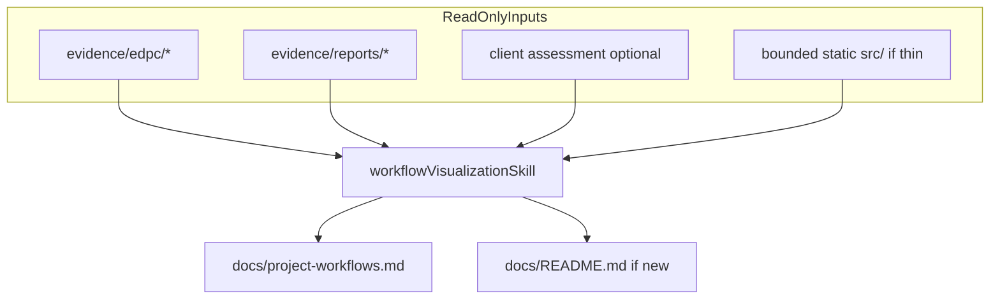

# [REQ-TIED_WORKFLOW_VISUALIZATION_SKILL] Workflow visualization skill — refined plan

**Status:** Refined (2026-10-30, pass 2 — visualization catalog). **Source:** `.cursor/plans/workflow_visualization_skill_0e8c2237.plan.md` (add-feature intake).

**Canonical skill body (target):** [`tools/bundled-workflow-visualization-skill/SKILL.md`](../../../tools/bundled-workflow-visualization-skill/SKILL.md)

**Sponsor invoke name:** **`workflow-visualization`** (`/workflow-visualization`, `@workflow-visualization`).

**User-facing output (when skill runs on a client repo):** **`docs/<project>-workflows.md`** (default **`output_dir`:** `docs/`). Create **`docs/README.md`** index when `docs/` is new.

**Runtime boundary:** Docs-only on the **target implementation repo** — no REQ/ARCH/IMPL mint, no `src/` edits, no connection-string or host literals, no runtime-behavior claims without evidence tier support.

---

## Refine — RESOLVE and depth

| Field | Value |
| --- | --- |
| `profile_depth` / `depth_tier` | **minimal** |
| `gate_policy` | **advisory** |
| Adversarial inquiry | **not_applicable** at store build — bootstrap + static `SKILL.md` contract only (parity with [REQ-TIED_FEEDBACK_REPORT_SKILL](../REQ-TIED_FEEDBACK_REPORT_SKILL/)) |
| Sponsor intent | Standalone skill after **full brownfield comprehension** ([PROC-EDPC_COMPREHENSION]) or **invoked alone**; sponsor-facing Mermaid workflow markdown easy to find under `docs/` |
| **Reversible defaults** | Skill name `workflow-visualization`; file suffix `-workflows.md`; default dir `docs/` |
| **Costly choice (defer unless sponsor opts in)** | Step 9: move `working/.../evidence/reports/` into `docs/` and retarget publish manifest / CITDP links — requires explicit invocation remainder |

### RESOLVE charter (names only)

| Term | Meaning |
| --- | --- |
| **workflow visualization skill** | Bundled install at `.cursor/skills/workflow-visualization`; procedure in store `tools/bundled-workflow-visualization-skill/` |
| **strategic visualization document** | Hub `docs/<project>-workflows.md` plus optional satellite docs; **visualization catalog** (perspectives below), not a fixed section count |
| **workflow inventory** | List of behavioral flows extracted from comprehension before drawing (charter journeys, ledger claims, integrators, entry points, batch jobs) |
| **comprehension source** | EDPC artifacts under `tied-project/working/{REQ}/evidence/edpc/` and sibling `evidence/reports/`, or static `src/` baseline with tier `source_static` |
| **Derived vs Declared** | Per-section prose: observed/static trace vs README/charter/docs-only claims |

### Eligibility note (integrated waiver)

Refine integrated triggers (network, auth, persistence in **target** systems) apply when the skill **runs** on a brownfield repo. **This build** only ships manifest + `SKILL.md` + tests — **minimal** depth with documented waiver: runtime honesty rules live in skill procedure; proof boundary is install + contract tests.

---

## Intent

Register a **sixth** standalone client skill (after xlate, unblock, handoff, clear-workspace, feedback) that composes **read-only** comprehension inputs into sponsor-facing workflow documentation with defensible Mermaid — **all high-level workflows**, **every integration-critical path**, and **each material domain slice** the evidence supports — complementing EDPC publish (workflow **F**) and client assessment (**H**) without replacing machine evidence under `working/`.



---

## TIED stack (mint at build-plan)

| Layer | Token |
| --- | --- |
| REQ | **REQ-TIED_WORKFLOW_VISUALIZATION_SKILL** |
| ARCH | **ARCH-TIED_WORKFLOW_VISUALIZATION_SKILL_BOUNDARY** — vs EDPC publish, vs TIED writes, vs handoff/close-out |
| IMPL | **IMPL-TIED_WORKFLOW_VISUALIZATION_SKILL** — manifest + `SKILL.md` + `reference.md` + bootstrap/e2e tests |

**Manifest row (target):**

```json
{ "skillName": "workflow-visualization", "storeDir": "tools/bundled-workflow-visualization-skill" }
```

**Cross-refs:** [REQ-TIED_CLIENT_BOOTSTRAP_SKILLS], [REQ-PROMPT_TYPE_GLOBAL_SKILLS], [REQ-TIED_EDPC_COMPREHENSION] (consumer-only at runtime).

---

## Skill procedure (target SKILL.md outline)

1. **Strip prefix** — `/workflow-visualization`; parse remainder for `request_token`, `output_dir`, `project` slug override, `migrate_reports: true` (step 9 only).
2. **Resolve inputs (read-only)** — in order:
   - Sponsor-named paths.
   - Else `tied-project/working/{REQ}/evidence/edpc/` (charter, SCM shell, claims ledger, publish manifest) + `evidence/reports/` (system map, architecture summaries, inventory JSON/YAML).
   - Optional CAM / workflow **H** artifacts.
   - If thin: bounded static read of `src/` + root manifests; record baseline revision (sponsor-pasted git context or explicit path note — **no automatic git**); tier **`source_static`** unless manifest specifies otherwise.
3. **Resolve `<project>` slug** — invocation override → `package.json` / `pyproject.toml` / `pom.xml` name → repository directory basename; kebab-case, `[a-z0-9-]+`.
4. **Build workflow inventory** — merge deduplicated flows from (when present): engagement charter user journeys / scope matrix; `claims-ledger.v1.yaml` (workflow, integration, data, security tags); `edpc-queues.v1.yaml` action/finding items naming behaviors; EASAR inventory entry points; `evidence/reports/` system map; CAM workflow **H** assertions; static scan of hosts (API controllers, message consumers, schedulers, CLIs). Classify each flow: **critical domain**, **integration boundary**, **high-level operator**, **batch/ops**, **supporting**.
5. **Compose documents** — per [reference.md](../../../tools/bundled-workflow-visualization-skill/reference.md) and **Visualization catalog** below: hub + satellites as needed; never invent services; omit perspectives only with an explicit “not evidenced” line in the hub.
6. **Write outputs** — primary `{output_dir}/<project>-workflows.md` (hub); optional `{output_dir}/<project>-workflows-<domain-slug>.md`, `{output_dir}/<project>-integrations.md`; `{output_dir}/README.md` if folder created.
7. **Optional step 9** — when `migrate_reports` opted in: copy/move selected report markdown into `docs/`, retarget links, list publish manifest paths touched (sponsor review).
8. **Summarize** — paths written, workflow inventory count, gaps emphasized, suggest `@handoff` if comprehension program continues.

**Mermaid contract:** camelCase node IDs; quoted edge labels when needed; dashed edges for unverified config/endpoints; every solid edge traceable to inventory, report, or static source (cite in prose).

---

## Visualization catalog (comprehension-grounded)

The original **eleven-section** list is the **minimum spine** for small systems. Full EDPC comprehension should drive **as many sections as evidence supports**, grouped by **perspective**. Each included section: **2–4 sentences**, **Derived** vs **Declared**, one `flowchart` (or `sequenceDiagram` when request/response timing matters).

### Output packaging

| Artifact | When |
| --- | --- |
| **`docs/<project>-workflows.md` (hub)** | Always — header, verification gaps, related links, **Workflow inventory** table, foundation views, integration summary, index of domain satellites |
| **`docs/<project>-workflows-<domain-slug>.md`** | When **≥2** critical domain paths need full diagrams, or hub would exceed ~400 lines |
| **`docs/<project>-integrations.md`** | When **≥3** distinct external systems or bidirectional integrators appear in inventory/ledger |

Invocation remainder may force **`hub_only: true`** (spine only) for a first pass.

### A — Foundation (structural spine)

Include when evidence exists; small systems may collapse pairs into one diagram.

| # | Perspective | Primary EDPC / comprehension inputs |
| --- | --- | --- |
| A1 | **System context** | Charter purpose, actors, central host; C4-style |
| A2 | **Solution / project topology** | Deployables, repos, sites, services from inventory |
| A3 | **Layer dependencies** | UI → app → domain → infra; module/package graph |
| A4 | **Primary operator / user request path** | Default happy-path journey from charter or main entry point |

*Original list items 1–4 map here.*

### B — Deployment, configuration, and code structure

| # | Perspective | Inputs |
| --- | --- | --- |
| B1 | **Deployment / runtime topology** | Manifests, IIS/K8s/process model, environment split (dashed if undeployed) |
| B2 | **Configuration and feature-flag plane** | AppSettings, env vars, flags — **dashed** unless production_touch observed |
| B3 | **Source-graph hot path** (optional) | Workflow **C** slice: high fan-in/fan-out modules from graph receipt |
| B4 | **Declared vs observed component map** | SCM shell vs inventory diff; publish manifest `gaps[]` |

### C — Behavioral workflows (expand beyond one domain)

**Rule:** One Mermaid section per **material** workflow, not a single “critical domain” slot.

| Class | Include when | Diagram focus |
| --- | --- | --- |
| **Critical domain paths** | Ledger/charter marks critical; or auth, billing, scheduling, clinical/business core, PII/financial handling | End-to-end domain flow with real component names from codebase |
| **High-level operator workflows** | Charter journeys, admin consoles, support tools | Role → UI/API → outcome |
| **Supporting domain flows** | Secondary but evidenced business capabilities | Shorter flow or grouped hub section “Other domain flows” with **one diagram per flow** still preferred when integrators depend on it |

*Original item 5 (“one critical domain path”) becomes **≥1 section per critical domain** named in the workflow inventory.*

### D — Integration and cross-system logic

**Rule:** **Every** workflow that **integrates with another system** or **performs cross-boundary critical logic** gets its own section (or a dedicated integrations doc).

| # | Perspective | Inputs |
| --- | --- | --- |
| D1 | **External API / service plane (outbound)** | HTTP/SOAP/gRPC clients, SDKs, third-party SaaS |
| D2 | **External clients / integrators (inbound)** | Public APIs, WCF, webhooks, partner batch files |
| D3 | **Async / messaging / events** | Queues, topics, outbox, background workers |
| D4 | **Cross-system choreography** | Multi-hop flows (sponsor system ↔ vendor ↔ database); use `sequenceDiagram` when helpful |
| D5 | **Operating-environment externalities** | Undocumented ops, manual bridges, compat ledger ([OEE](../../docs/tied-operating-environment-externalities.md) vocabulary) — dashed edges |
| D6 | **File / EDI / batch interchange** | SFTP drops, import pipelines tied to integrators |

*Original items 7–8 expand to D1–D6; do not collapse unrelated integrators into one generic box.*

### E — Data and persistence

| # | Perspective | Inputs |
| --- | --- | --- |
| E1 | **OLTP / primary persistence path** | DB contexts, repositories, unit-of-work |
| E2 | **Secondary stores** | Cache, search index, blob, document DB |
| E3 | **Reporting / analytics / replica path** | ETL, read models — if distinct from OLTP |
| E4 | **Data integrity / reconciliation flows** | Workflow **D** / ledger claims on silent failure, duplicate events |

*Original item 6 maps to E1–E4 as applicable.*

### F — Batch, operations, and failure modes

| # | Perspective | Inputs |
| --- | --- | --- |
| F1 | **Batch / console / scheduled utilities** | Cron, Windows services, CLI tools, job hosts |
| F2 | **Operational failure and degraded modes** | `operational-failure-state-bundle`, health snapshot, failure-mode register |
| F3 | **Observation-window ops path** | Logs/metrics/traces — tier-gated; dashed without runtime proof |
| F4 | **Change-impact blast radius** (optional) | Workflow **E** artifact when present |

*Original item 9 maps to F1; EDPC **D** enriches F2–F3.*

### G — Security, identity, and trust boundaries

| # | Perspective | Inputs |
| --- | --- | --- |
| G1 | **Security / auth providers** | IdP, OAuth, SAML, API keys, mutual TLS |
| G2 | **Authorization and session propagation** | Roles, claims, impersonation, service accounts |
| G3 | **Trust zones / network boundaries** | DMZ, VPN, private link — dashed when config not production truth |

*Original item 10 maps to G1–G3.*

### H — UI, channels, and modules

| # | Perspective | Inputs |
| --- | --- | --- |
| H1 | **Major UI / module areas map** | Areas, modules, bounded contexts |
| H2 | **Multi-channel delivery** | Web, mobile API, desktop, legacy UI stack — when multiple channels exist |

*Original item 11 maps to H1–H2.*

### I — Comprehension meta-views (TIED-specific, sponsor-facing)

Optional but valuable after full EDPC; keep thin — link to machine artifacts, do not duplicate queues/ledger tables.

| # | Perspective | Inputs |
| --- | --- | --- |
| I1 | **EDPC choreography map** | Workflows A–G/H as **process** the sponsor ran (not the product under study) |
| I2 | **Evidence tier and proof boundary** | `evidence-access-matrix`, tier, what was **not** run (build/test/DB) |
| I3 | **Claims-to-view traceability** | Which diagrams answer which ledger questions — bullet map only |
| I4 | **Open questions / evidence gaps** | `edpc-queues` question + evidence_gap queues → “what diagrams cannot yet be solid” |

### Selection algorithm (skill normative)

1. Populate **Workflow inventory** table in hub (name, class, evidence refs, diagram location).
2. **Must include** diagrams for: all **integration** flows (class D*), all **critical domain** flows (class C), primary operator path (A4).
3. **Should include** remaining high-level charter journeys and F1 batch paths when inventory lists them.
4. **May omit** B2, E3, I* with one-line “not evidenced” in hub if comprehension did not cover them.
5. **Never** merge unrelated integrators or domains into one diagram to reduce count.

### Small-system collapse

If workflow inventory has **≤3** total flows, hub-only doc is acceptable: use foundation A1–A4 + one diagram per flow; skip satellite files.

---

## Skill deltas vs other surfaces

| Surface | Change |
| --- | --- |
| **handoff** | Add **Related** row + resume template bullet: after EDPC comprehension, optional `@workflow-visualization` → `docs/<project>-workflows.md` |
| **README** brownfield § | Optional step 8 after Refresh (**G**): sponsor-facing diagrams via `@workflow-visualization` |
| **edpc-comprehension.md** | After **F** / **H**: optional skill for discoverable `docs/` (machine evidence stays in `working/`) |
| **client-development-index** | EDPC scenario “Also open” → skill invoke |
| **non-tied-plan** | Documented alternative for one-off doc without skill bundle |

---

## Governing decisions

- **depth_tier:** minimal  
- **gate_policy:** advisory  
- **CITDP persist:** on close-out → `tied-project/citdp/CITDP-REQ-TIED_WORKFLOW_VISUALIZATION_SKILL.yaml`

---

## Satisfaction criteria

| id | Criterion |
| --- | --- |
| `manifest` | Sixth row in `BUNDLED_STANDALONE_CLIENT_SKILLS` |
| `install` | `.cursor/skills/workflow-visualization` and `.claude/skills/workflow-visualization` via bootstrap |
| `skill-body` | Procedure + boundaries + **visualization catalog** + workflow inventory rules in `SKILL.md` + `reference.md` |
| `test` | `client-skills-catalog.test.mjs` length **6**; `workflow-visualization-skill.test.ts` contract smoke |
| `docs-hooks` | README + vocab + client-development-index cross-links |
| `tied` | REQ/ARCH/IMPL + pseudocode sidecar; `tied_validate_consistency` clean |

---

## Declared change surface

| Path | Role |
| --- | --- |
| `tools/bundled-workflow-visualization-skill/SKILL.md` | Primary procedure |
| `tools/bundled-workflow-visualization-skill/reference.md` | Section template + Mermaid rubric |
| `tools/bootstrap/manifest.json` | Manifest row |
| `tools/bootstrap/lib/client-skills-catalog.test.mjs` | Catalog regression |
| `mcp-server/src/e2e/feedback-skill.test.ts` | Standalone name list |
| `mcp-server/src/e2e/workflow-visualization-skill.test.ts` | **New** contract test |
| `mcp-server/src/e2e/client-bootstrap-skills.test.ts` | Optional: assert sixth skill copy |
| `tools/bundled-session-handoff-skill/SKILL.md` | Related / resume template hook |
| `README.md` | Brownfield optional step |
| `tied-bundle/docs/client-development-index.md` | EDPC row |
| `tied-project/vocab/project-operations-mcp.md`, `routing.md`, `edpc-comprehension.md` | RECORD |
| `tied-project/requirements.yaml`, architecture, implementation, semantic-tokens + detail files | Mint tokens |

**Non-goals (unchanged):** new MCP tools; Mermaid CLI linter; edits to xlate/unblock/feedback/clear-workspace sources except handoff cross-link; methodology `tied-bundle/vocab/` duplicate (client refresh).

---

## Plan — CITDP and tests

**CITDP (draft):** [CITDP-REQ-TIED_WORKFLOW_VISUALIZATION_SKILL.yaml](./CITDP-REQ-TIED_WORKFLOW_VISUALIZATION_SKILL.yaml)

**Tracker:** [checklist-tracker.yaml](./checklist-tracker.yaml)

**Tests:** [test-strategy.md](./test-strategy.md)

**Refine evidence:** [evidence/refine-plan-pass1.md](./evidence/refine-plan-pass1.md)

---

## Implement — execute order

Invoke **`@build-plan`** against this file.

1. RED — update catalog + feedback-skill tests; add `workflow-visualization-skill.test.ts`.
2. GREEN — bundle + manifest + handoff hook + doc hooks.
3. Mint TIED stack + IMPL pseudocode sidecar (`implementation-decisions/IMPL-TIED_WORKFLOW_VISUALIZATION_SKILL-pseudocode.md`).
4. `lint_yaml` on changed project YAML; `tied_validate_consistency`.
5. Focused test commands in [test-strategy.md](./test-strategy.md).
6. **`@close-out`** when gates allow; CHANGELOG; clients `tied-install.sh --refresh`.

---

## Risk snapshot

| Risk | Mitigation |
| --- | --- |
| Invented architecture in Mermaid | Skill honesty rule + dashed edges; contract test mentions “never invent services” |
| Skill conflated with EDPC publish | ARCH boundary; skill consumes manifest, does not write it |
| Wrong repo when generating docs | Procedure scopes to **target implementation repo** (charter `target_repository_root` when present) |
| Report migration breaks links | Step 9 opt-in only; sponsor review called out |

**Counterexamples (disconfirm in tests/docs):** manifest lists skill but `storeDir` missing; SKILL.md omits verification gaps section; procedure allows TIED YAML writes.

---

## Session handoff (2026-10-30)

Implementation **done**; close-out **deferred**. Log: [evidence/session-handoff.md](./evidence/session-handoff.md). Next chat: **`@close-out`** against this PLAN, then `tied-install.sh --refresh`. Do not claim REQ complete from tests alone.
