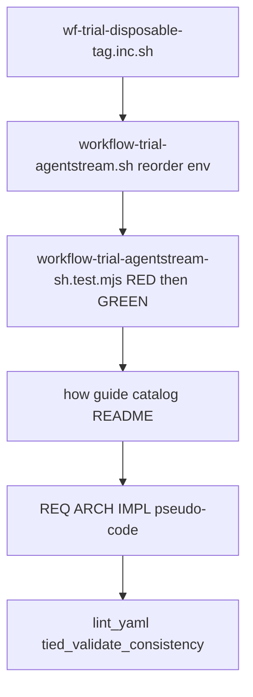

# PLAN — [REQ-WF_TRIAL_AGENTSTREAM_DISPOSABLE_TAG] (refine-plan)

**Status:** build-plan complete (implementation landed). Linked from Cursor plan `wf_trial_dir_suffix_91f07785`.

**Workflow:** add-feature → **refine-plan** → build-plan → close-out

**Request token:** `REQ-WF_TRIAL_AGENTSTREAM_DISPOSABLE_TAG` (REQ/ARCH/IMPL index: **build-plan** first step via `tied_token_create_with_detail`)

**profile_depth:** `minimal` · **gate_policy:** `advisory`

**CITDP (working draft):** [CITDP-REQ-WF_TRIAL_AGENTSTREAM_DISPOSABLE_TAG.yaml](./CITDP-REQ-WF_TRIAL_AGENTSTREAM_DISPOSABLE_TAG.yaml)

**Test strategy:** [test-strategy.md](./test-strategy.md)

**Tracker:** [checklist-tracker.yaml](./checklist-tracker.yaml)

**Origin:** Sponsor request to suffix `workflow_trial_agentstream` disposable dir with harness and model; normative example `1793805223-wf-agentstream-wf-03-cursor-composer25`.

---

## 1. Refine (Touchpoint 1 — RESOLVE) — closed

| Sponsor term | Resolved concept | Disposition |
| --- | --- | --- |
| Dir name shape | **workflow-trial disposable client id** — `{epoch}-wf-agentstream-{promptId}-{harness}-{modelBucket}` | **Locked** |
| promptId | Existing `normalize_wf_tag_suffix` → `wf-03` … `wf-08` | **Locked** |
| harness | Lowercase `${HARNESS:-cursor}` | **Locked** |
| modelBucket | **MODEL_CONFIG first**, else **MODEL_SLUG**; lowercase; strip `.` and `-` (`composer-2.5` → `composer25`) | **Locked** (sponsor confirmed) |
| build-commands.sh | **`workflow_trial_agentstream`** stays a one-line delegator; tag built in **`workflow-trial-agentstream.sh`**; comment + `how` guide only | **Locked** |
| Gold / parity | **WF03_CURSOR_GOLD** path `1793760220-wf-agentstream-wf-03` unchanged; `WF03_GOLD_CLIENT` default unchanged | **Locked** |
| `--workspace` | No bootstrap tag; operator-supplied absolute path | **Locked** |
| REQ index | Not created in refine-plan; build-plan creates stack before code | **Locked** |

**Charter lane:** All items pre-implementation. No selection-lane decisions.

**Ambiguity accepted:** Facilitator readouts and catalog table rows keep historical dirname examples; only **new** orchestrator bootstraps use the extended tag.

---

## 2. Problem (evidence)

| Gap | Today | After change |
| --- | --- | --- |
| Matrix fairness | Catalog rule: one disposable per `(PROMPT-WF-NN × model × harness)` ([catalog § matrix cells](../../../docs/demos/catalog-traditional-workflow-trial-prompts.md)) | Dirname encodes harness + model bucket |
| Claude WF-03 cell | Motivation in [REQ-AGENTSTREAM_CLAUDE_WF_PARITY PLAN](../../../tied-project/working/REQ-AGENTSTREAM_CLAUDE_WF_PARITY/PLAN.md) (`1793805223…` incomplete) | New runs distinguish `…-cursor-composer25` vs `…-claude-composer25` |
| Env ordering bug | `TAG` computed before `HARNESS` / `MODEL_*` defaults in [`workflow-trial-agentstream.sh`](../../../scripts/workflow-trial-agentstream.sh) | Defaults exported **before** bootstrap block |

---

## 3. Reference baseline

| Field | Value |
| --- | --- |
| Orchestrator | [`scripts/workflow-trial-agentstream.sh`](../../../scripts/workflow-trial-agentstream.sh) |
| Factory | [`new-tied-client.mjs`](../../../tools/bootstrap/new-tied-client.mjs) `--disposable --tag` → [`disposableClientBasename`](../../../tools/bootstrap/lib/new-tied-client-pipeline.mjs) |
| Tag validation | `^[a-zA-Z0-9]+(-[a-zA-Z0-9]+)*$` — extended tag must remain valid |
| Operator entry | `source scripts/build-commands.sh && workflow-trial-agentstream wf-03` |

---

## 4. Scope

### In scope

- New [`scripts/lib/wf-trial-disposable-tag.inc.sh`](../../../scripts/lib/wf-trial-disposable-tag.inc.sh): `normalize_wf_trial_model_suffix`, `build_wf_trial_disposable_tag`
- Reorder env defaults before bootstrap in orchestrator; set `TAG="$(build_wf_trial_disposable_tag "$WF_ID")"`
- Unit tests in [`tools/bootstrap/workflow-trial-agentstream-sh.test.mjs`](../../../tools/bootstrap/workflow-trial-agentstream-sh.test.mjs)
- Operator docs: [`scripts/_build_commands_cli_guide.inc.sh`](../../../scripts/_build_commands_cli_guide.inc.sh), orchestrator `usage()`, catalog automated path, [`tools/bootstrap/README.md`](../../../tools/bootstrap/README.md)
- **TIED:** `REQ-WF_TRIAL_AGENTSTREAM_DISPOSABLE_TAG`, `ARCH-WF_TRIAL_AGENTSTREAM_DISPOSABLE_TAG`, `IMPL-WF_TRIAL_AGENTSTREAM_DISPOSABLE_TAG` + pseudo-code sidecar
- **Vocab:** RECORD **workflow-trial disposable tag** in [`tied-project/vocab/agentstream.md`](../../vocab/agentstream.md)
- **LEAP at close-out:** extend [CITDP-REQ-TIED_SETUP-wf-trial-orchestration](../../citdp/CITDP-REQ-TIED_SETUP-wf-trial-orchestration.yaml) satisfaction criterion for tag shape

### Out of scope

- Renaming on-disk gold or historical trial clients
- `dual-harness-wf03-parity-smoke.sh` behavior change
- Agentstream package / batch YAML changes
- Full CI bootstrap integration test (unless unit tests fail to cover)

---

## 5. Implementation sequence (build-plan)



1. **TIED stack** — create tokens + IMPL `essence_pseudocode` (PRE/POST on tag builder).
2. **RED tests** — tag helper cases (see [test-strategy.md](./test-strategy.md)).
3. **GREEN** — inc.sh + orchestrator wiring.
4. **Docs + vocab** — operator-facing dirname convention.
5. **Close-out** — CITDP persist, orchestration CITDP LEAP, verification manifest.

---

## 6. Files touched (expected)

| File | Change |
| --- | --- |
| `scripts/lib/wf-trial-disposable-tag.inc.sh` | **New** — tag helpers |
| `scripts/workflow-trial-agentstream.sh` | Env order, source inc, TAG assignment, usage/DEBUG |
| `scripts/build-commands.sh` | Comment on delegator |
| `scripts/_build_commands_cli_guide.inc.sh` | Dirname pattern |
| `tools/bootstrap/workflow-trial-agentstream-sh.test.mjs` | Tag unit cases |
| `docs/demos/catalog-traditional-workflow-trial-prompts.md` | Automated path note |
| `tools/bootstrap/README.md` | Tag shape one-liner |
| `tied-project/vocab/agentstream.md` | Preferred term row |

---

## 7. Risk / consequence ladder

| Choice | Ladder | Notes |
| --- | --- | --- |
| Extended tag for new bootstraps | **Reversible** | Legacy dirs and docs references remain valid |
| MODEL_CONFIG normalization | **Reversible** | Aligns with `wf-02-composer25` facilitator naming |

---

## 8. Handoff

**Next:** `@build-plan` with linked [PLAN.md](./PLAN.md) and token `REQ-WF_TRIAL_AGENTSTREAM_DISPOSABLE_TAG`.

**Suggested verification after implement:**

```bash
node --test tools/bootstrap/workflow-trial-agentstream-sh.test.mjs
```
