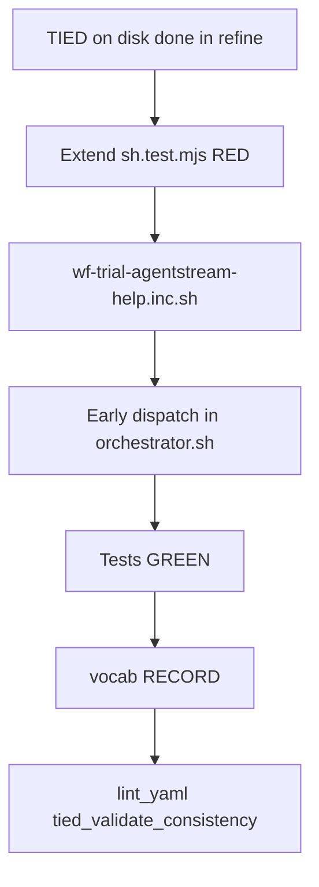

# PLAN — [REQ-WF_TRIAL_AGENTSTREAM_OPERATOR_HELP] (refine-plan)

**Status:** build-plan complete  
**Workflow:** add-feature → **refine-plan** → build-plan → close-out  
**Request token:** `REQ-WF_TRIAL_AGENTSTREAM_OPERATOR_HELP`  
**profile_depth:** `minimal` · **gate_policy:** `advisory`  
**Origin:** Sponsor request from [REQ-WF_TRIAL_MODEL_EFFORT handoff](../REQ-WF_TRIAL_MODEL_EFFORT/evidence/handoff.md) optional follow-up — styled help when `workflow_trial_agentstream` has no args or `--help`.

**CITDP (working draft):** [CITDP-REQ-WF_TRIAL_AGENTSTREAM_OPERATOR_HELP.yaml](./CITDP-REQ-WF_TRIAL_AGENTSTREAM_OPERATOR_HELP.yaml)  
**Test strategy:** [test-strategy.md](./test-strategy.md)  
**Tracker:** [checklist-tracker.yaml](./checklist-tracker.yaml)

---

## 1. Refine (Touchpoint 1 — RESOLVE) — closed

| Sponsor term | Resolved concept | Disposition |
| --- | --- | --- |
| `workflow_trial_agentstream` | Shell entry via [`scripts/build-commands.sh`](../../../scripts/build-commands.sh) delegating to [`scripts/workflow-trial-agentstream.sh`](../../../scripts/workflow-trial-agentstream.sh) | **Locked** |
| Nicely formatted help | **Operator help screen** using same presentation roles as `how()` ([`REQ-TIED_CLI_OPERATOR_OUTPUT_TEXTURE`](../../../requirements/REQ-TIED_CLI_OPERATOR_OUTPUT_TEXTURE.yaml)); stderr default | **Locked** |
| No args | Exit **0** with help (not exit 2 after plain `usage()`) | **Locked** |
| `--help` | Same content and exit 0 as no args; replaces inline `usage()` heredoc | **Locked** |
| Shell standards | Mirror `_how_stream_init`, `_how_plain_init`, section headers — **not** Node `console.mjs` stdout help ([`build-workspace.sh`](../../../build-workspace.sh)) | **Locked** |
| MODEL_EFFORT surface | Help documents `workflow_trial_range` 4th positional and env flags from model-effort handoff | **Locked** |
| Early help | No `tied-install.sh` marker check, no `gawk`, no bootstrap on help-only path | **Locked** |
| Shared texture inc | **Deferred** (`cli-operator-texture.inc.sh` DRY) — copy minimal helpers into `wf-trial-agentstream-help.inc.sh` | **Reversible** |
| `how workflow-trial-range` topic | Optional docs follow-up in [`_build_commands_cli_guide.inc.sh`](../../../scripts/_build_commands_cli_guide.inc.sh); not blocking SC | **Deferred** |

**Charter lane:** Operator discoverability only. No orchestration behavior change.

---

## 2. Problem (evidence)

| Gap | Today | After change |
| --- | --- | --- |
| Empty argv | `usage()` on stderr then `fail "WF_ID is required"` (exit 2) | Styled help, exit 0 |
| `--help` | Plain heredoc; sufficient for SC-EXIT but not texture | Styled sections + expanded operator reference |
| Discoverability | MODEL_EFFORT / `workflow_trial_range` only in handoff and dense usage text | First-class **Batch helper** and **Environment** sections |
| Help prerequisites | Help runs after `REPO_ROOT` marker validation | Help available before store-root checks |

---

## 3. Reference baseline

| Field | Value |
| --- | --- |
| Orchestrator | [`scripts/workflow-trial-agentstream.sh`](../../../scripts/workflow-trial-agentstream.sh) |
| Matrix alias | `workflow_trial_agentstream` / `workflow-trial-agentstream` in build-commands |
| Texture precedent | [`scripts/_build_commands_cli_guide.inc.sh`](../../../scripts/_build_commands_cli_guide.inc.sh) |
| Composition harness | [`tools/bootstrap/workflow-trial-agentstream-sh.test.mjs`](../../../tools/bootstrap/workflow-trial-agentstream-sh.test.mjs) |
| Stream contract test | [`tools/bootstrap/build-commands-how.test.mjs`](../../../tools/bootstrap/build-commands-how.test.mjs) |

---

## 4. Scope

### In scope

- New [`scripts/lib/wf-trial-agentstream-help.inc.sh`](../../../scripts/lib/wf-trial-agentstream-help.inc.sh) — texture + `wf_trial_agentstream_print_help()`
- Early dispatch at top of orchestrator (after `SCRIPT_DIR`, before `REPO_ROOT` gate)
- Global flags on help path: `-h`, `--help`, `--plain` / `-p` / `--no-color`, `--stdout` (peel before help print)
- Env: `NO_COLOR`, `TIED_CLI_PLAIN`, `TIED_CLI_HELP_STDOUT` (same precedence as `how()`)
- Extend `workflow-trial-agentstream-sh.test.mjs` (RED then GREEN in build-plan)
- TIED stack: [REQ](../../../requirements/REQ-WF_TRIAL_AGENTSTREAM_OPERATOR_HELP.yaml), [ARCH](../../../architecture-decisions/ARCH-WF_TRIAL_AGENTSTREAM_OPERATOR_HELP.yaml), [IMPL](../../../implementation-decisions/IMPL-WF_TRIAL_AGENTSTREAM_OPERATOR_HELP.yaml) + [pseudo-code](../../../implementation-decisions/IMPL-WF_TRIAL_AGENTSTREAM_OPERATOR_HELP-pseudocode.md)
- Vocab **RECORD** in [`tied-project/vocab/agentstream.md`](../../vocab/agentstream.md) — **workflow-trial orchestrator operator help**

### Out of scope

- Node help CLI / `console.mjs` stderr writers
- Four-phase batch or agentstream TypeScript changes
- `how workflow-trial-range` dedicated topic (optional)
- Live matrix runs

---

## 5. Help content outline (normative for build-plan)

1. **Title** — `workflow-trial-agentstream — WF trial orchestrator`
2. **Usage** — `WF_ID` required for run; flags `--dry-run`, `--workspace ABS`
3. **Examples** — dry-run; `HARNESS=claude`; sourced alias
4. **Batch helper** — `workflow_trial_range HARNESS SLUG CONFIG EFFORT END START`
5. **Environment** — `MODEL_*`, `MODEL_EFFORT`, `TIED_TEST_ROOT`, `WF_TRIAL_*`, `AGENTSTREAM_CURSOR_*` (concise; pointer to vocab)
6. **Related** — `how smoke`, catalog path, built store CLI

---

## 6. Implementation sequence (build-plan)



1. Confirm TIED stack + pseudo-code validation (refine landed tokens).
2. **RED** — new test cases (empty argv, sections, plain, stdout override, help without gawk).
3. **GREEN** — help inc + orchestrator wiring; remove legacy `usage()` heredoc or delegate to print_help.
4. **Vocab** — one glossary row under agentstream operator surface.
5. **CITDP persist** at close-out under `tied-project/citdp/`.

---

## 7. Risk assessment

| Item | Ladder | Notes |
| --- | --- | --- |
| Empty argv exit 0 vs 2 | **Reversible** | Scripts that relied on failure on empty call are unlikely; document in CHANGELOG if needed |
| Duplicate texture helpers | **Reversible** | Accept until shared inc extraction |
| Early help without repo root | **Reversible** | Improves UX; help text should still mention running from store for real trials |

---

## 8. Verification (build-plan close-out)

```bash
node --test tools/bootstrap/workflow-trial-agentstream-sh.test.mjs
```

Manual:

```bash
source scripts/build-commands.sh
workflow_trial_agentstream
workflow_trial_agentstream --help
TIED_CLI_HELP_STDOUT=1 workflow_trial_agentstream --help
```

---

## 9. Do next

**`plan_phase: pre-implementation`**

Run **`@build-plan`** with this PLAN: [PLAN.md](./PLAN.md)
