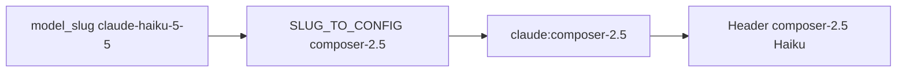

# PLAN — REQ-WF_TRIAL_COMPARISON_MATRIX_TOOLSET_FIX

**Working token:** `REQ-WF_TRIAL_COMPARISON_MATRIX_TOOLSET_FIX`  
**Track:** `@debug` discovery → **`@refine-plan`** (this pass) → **`@build-plan`** → optional `@close-out`  
**Parent:** [PLAN-WF-TRIAL-COMPARISON-MATRIX](../PLAN-WF-TRIAL-COMPARISON-MATRIX/PLAN.md) (column manifest) · [REQ-WF_TRIAL_REGISTRY_COMPARISON_MATRIX_CELLS](../REQ-WF_TRIAL_REGISTRY_COMPARISON_MATRIX_CELLS/PLAN.md) (cell renderer — shipped)  
**Primary deliverable:** Correct Claude Haiku **column headers** and **`toolset_key`** values in [`docs/demos/traditional-workflow-trial-runs-registry.md`](../../../docs/demos/traditional-workflow-trial-runs-registry.md) comparison matrix  
**plan_phase:** `post-build`  
**profile_depth:** `minimal` · **gate_policy:** `advisory` · **depth_tier:** `minimal`

**Trigger:** WF-09 run [`1794582335`](../../../docs/demos/trial-readout-PROMPT-WF-09-claudehaiku55low-1794582335-wf-agentstream-wf-09-claude-claudehaiku55low.md) sits in column ``Claude · `composer-2.5` (Haiku)`` though master table + readout show **`claude`** + **`claude-haiku-5-5`**.

---

## Sponsor intent

Facilitators reading the **Latest-run comparison matrix** must see **harness + catalog model config** in column headers that match [`wf-trial-model-specs.yaml`](../../../docs/demos/wf-trial-model-specs.yaml) and the master table **Model slug** column — not a Cursor-only **`composer-2.5`** label on Claude Haiku cells.

| Locked choice (refine 2026-11-13) | Value |
| --- | --- |
| Baseline Haiku header | ``Claude · `claude-haiku-5-5` `` |
| Haiku medium header | ``Claude · `claude-haiku-5-5` effort=medium`` |
| Baseline `toolset_key` | `claude:claude-haiku-5-5` |
| Medium `toolset_key` | `claude:claude-haiku-5-5@medium` |

Cell **placement** for existing runs is unchanged (same readout links); only **keys**, **headers**, and **slug→config** mapping change.

---

## RESOLVE

| Term | Meaning |
| --- | --- |
| **toolset_key** | `{harness}:{config_id}` optional `@medium` / `@high` — `config_id` from specs or slug map (parent PLAN) |
| **config_id** | Short matrix column id (e.g. `luna-low`, `claude-haiku-5-5`) — must not reuse Cursor `composer-2.5` for Claude Haiku |
| **Bug class** | Facilitator **mislabel** (header); not wrong pivot row (WF-09 `1794582335` already in correct Haiku column by alias) |

**Proof boundary:** Store documentation / pivot generator only — not methodology effectiveness, not HMEP, not `@record-wf-trial`.

---

## Root cause

[`build-comparison-matrix.mjs`](../PLAN-WF-TRIAL-COMPARISON-MATRIX/evidence/build-comparison-matrix.mjs) maps registry slug `claude-haiku-5-5` → config `composer-2.5` and exposes column key `claude:composer-2.5`. Parent [PLAN](../PLAN-WF-TRIAL-COMPARISON-MATRIX/PLAN.md) slug table (line 73) documents that alias for “matrix cell label Haiku” — it predates facilitator confusion when WF-09+ rows appear.

**Fix path:** identity map `claude-haiku-5-5` → `claude-haiku-5-5`; rename column ids/keys; centralize manifest + resolution in [`wf-trial-comparison-matrix.mjs`](../../../tools/bootstrap/lib/wf-trial-comparison-matrix.mjs).

---

## Architecture

| Artifact | Change |
| --- | --- |
| [`wf-trial-comparison-matrix.mjs`](../../../tools/bootstrap/lib/wf-trial-comparison-matrix.mjs) | Export `MATRIX_COLUMNS`, `slugToConfigId`, `effortFromReadout`, `toolsetKeyFromMasterRow`; keep `renderWfTrialComparisonMatrixCell` |
| [`wf-trial-comparison-matrix.test.mjs`](../../../tools/bootstrap/lib/wf-trial-comparison-matrix.test.mjs) | **SC-WF-CMX-07…09** (toolset + headers) — do not reuse SC-WF-CMX-05 (master table stable) |
| [`build-comparison-matrix.mjs`](../PLAN-WF-TRIAL-COMPARISON-MATRIX/evidence/build-comparison-matrix.mjs) | Import shared module; update `SPOT_CHECKS` keys + add WF-09 baseline spot `1794582335` |
| [PLAN-WF-TRIAL-COMPARISON-MATRIX/PLAN.md](../PLAN-WF-TRIAL-COMPARISON-MATRIX/PLAN.md) | LEAP column manifest + remove Haiku→`composer-2.5` slug row |
| Registry MD | Regenerate matrix section only |

**TIED tokens:** LEAP optional comment on [IMPL-WF_TRIAL_REGISTRY_COMPARISON_MATRIX_CELLS](../../../tied-project/implementation-decisions/IMPL-WF_TRIAL_REGISTRY_COMPARISON_MATRIX_CELLS.yaml) pseudo-code — **no new REQ/ARCH/IMPL** unless `@build-plan` sponsor asks for traceability row.

---

## Build sequence (`@build-plan`)

| Step | Action |
| --- | --- |
| 1 | RED — unit tests SC-WF-CMX-07…09 (fail on current alias) |
| 2 | GREEN — move manifest + `toolsetKeyFromMasterRow` into shared module; fix `SLUG_TO_CONFIG` |
| 3 | Wire builder `SPOT_CHECKS`: `claude:claude-haiku-5-5@medium`, baseline WF-09 `1794582335` @ `claude:claude-haiku-5-5` |
| 4 | LEAP parent PLAN manifest + footnote example keys |
| 5 | `node build-comparison-matrix.mjs` + `--check` |
| 6 | `node --test tools/bootstrap/lib/wf-trial-comparison-matrix.test.mjs` |

---

## Acceptance criteria

| ID | Criterion |
| --- | --- |
| SC-WF-CMX-07 | `{ harness: claude, slug: claude-haiku-5-5, readout: *claudehaiku55low* }` → `claude:claude-haiku-5-5` |
| SC-WF-CMX-08 | Same slug + medium readout token → `claude:claude-haiku-5-5@medium` |
| SC-WF-CMX-09 | Baseline column header text === ``Claude · `claude-haiku-5-5` `` |
| SC-WF-CMX-04 | Builder `--check` exit 0 (existing spots updated for new keys) |
| SC-WF-CMX-05 | Master table body unchanged (regression) |
| SC-WF-CMX-10 | No `composer-2.5` in Claude column headers in generated matrix |

---

## Spot-check table (builder `--check`)

| wf | toolset_key | wallMins | gradesDisplay contains | readout includes |
| --- | --- | --- | --- | --- |
| 09 | `claude:claude-haiku-5-5` | `3m` | `2.56 ·` | `1794582335` |
| 09 | `claude:claude-haiku-5-5@medium` | `5m` | `3.06 ·` | `1794350349` |
| 10 | `claude:claude-haiku-5-5@medium` | `7m` | `3.29 ·` | `1794407806` |
| 08 | `cursor:composer-2.5` | `12m` | `3.57 ·` | `1794211741` |

---

## Out of scope

- New matrix columns for `claude-sonnet-4-6` (WF-10 master rows exist; no column today)
- Master **Latest** dedupe / duplicate `yes` cleanup
- Auto-regen on `@record-wf-trial`
- Renaming disposable client tags

---

## Risk

| Item | Ladder |
| --- | --- |
| Historical docs citing `claude:composer-2.5` | **Reversible** — LEAP changelog in parent PLAN |
| Break `--check` until registry regen | **Reversible** — run builder in same commit |
| Extract shared module | **Reversible** — single import site |

---

## Do next

Optional **`@close-out`** — verification: [evidence/build-plan-verification-evidence.md](./evidence/build-plan-verification-evidence.md).

---

## Changelog

| Date | prompt_type | Summary |
| --- | --- | --- |
| 2026-11-13 | debug | Sponsor: WF-09 column header shows `composer-2.5` for Claude Haiku |
| 2026-11-13 | refine-plan | Locked `claude-haiku-5-5` headers/keys; SC-WF-CMX-07…10; working PLAN + CITDP + tracker |
| 2026-11-13 | build-plan | Shared toolset module; registry matrix regen; SC-WF-CMX-07…09 green; builder `--check` green |
