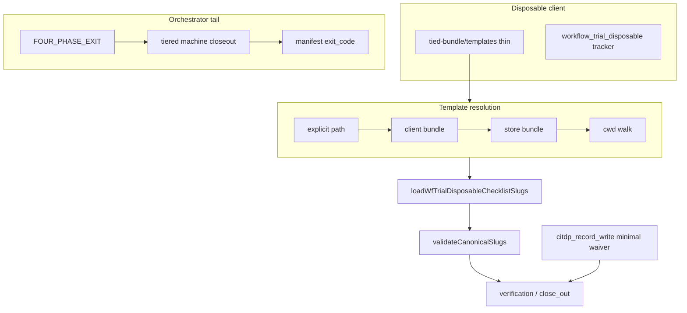

# PLAN — REQ-WF_TRIAL_DISPOSABLE_CLOSEOUT_READINESS

**Status:** build-plan bootstrap complete — `plan_phase: post-build` (live SC-DCR-06 open)  
**Request token:** `REQ-WF_TRIAL_DISPOSABLE_CLOSEOUT_READINESS`  
**profile_depth:** `minimal` · **gate_policy:** `advisory`  
**Incident class:** disposable WF-01 @ `1794978904` — `invalid_slug` (thin client template), `citdp_record_write` blocked, no `close_out` receipt, orchestrator ERROR + manifest `exit_code: 0`  
**Cursor plan:** [disposable_closeout_readiness_ad757f80.plan.md](../../../../.cursor/plans/disposable_closeout_readiness_ad757f80.plan.md)  
**Parent:** [REQ-WF_TRIAL_DISPOSABLE_GATE_ALIGNMENT](../REQ-WF_TRIAL_DISPOSABLE_GATE_ALIGNMENT/PLAN.md) (SC-WF-DGA-06 open until this REQ LEAP + live)

**CITDP:** [CITDP-REQ-WF_TRIAL_DISPOSABLE_CLOSEOUT_READINESS.yaml](../../citdp/CITDP-REQ-WF_TRIAL_DISPOSABLE_CLOSEOUT_READINESS.yaml)  
**Test strategy:** [test-strategy.md](./test-strategy.md)  
**Tracker:** [checklist-tracker.yaml](./checklist-tracker.yaml)

---

## 1. Refine — locked decisions (RESOLVE)

| # | Term | Resolution |
| --- | --- | --- |
| R1 | **Template resolution** | `explicit templatePath` → `TIED_CLIENT_BUNDLE_PATH`/…/templates/wf-trial-minimal-checklist-tracker.yaml → `TIED_STORE_ROOT`/tied-bundle/templates/… → cwd walk (12 levels). Log `DIAGNOSTIC` which path won. |
| R2 | **Install contract** | `tied-install.sh` / bootstrap **materializes** slim template into client `tied-bundle/templates/` on install and `--refresh` (idempotent copy-if-newer). Contract test under `tools/bootstrap/`. |
| R3 | **Minimal CITDP persist** | When CITDP declares `depth_tier: minimal` and tracker has `sub-adversarial-inquiry-pass` `not_applicable` + `minimal-depth-no-inquiry`, `validateCitdpOpenRecord` / `citdp_record_write` **do not** require adversarial counterexample/falsification/evidence lists. No fabricated adversarial content. |
| R4 | **Tiered machine closeout** | **Tier A (fail):** `close_out-*.json` with `allowed: false`; inventory `close_out_turn.status: incomplete`; verification handoff without `verification-*.json` when handoff claims verification. **Tier B (honest incomplete):** no `close_out` receipt and **no** Tier-A signal → `DIAGNOSTIC: wf_trial_machine_closeout_reason=no_close_out_gate_receipt` **without** `ERROR`, exit **0**. `WF_TRIAL_SKIP_MACHINE_CLOSEOUT_EXIT=1` unchanged. |
| R5 | **Manifest truth** | Final `wf-trial-orchestrator-run.v1.json` `exit_code` = shell exit **after** all post-four-phase hooks (including machine closeout); `FOUR_PHASE_EXIT` non-zero still wins when subprocess failed. |
| R6 | **Agent playbook** | Update `wf-trial-checklist-gates-adjunct.md` and `wf-trial-four-phase-close-out-playbook.md`: do not claim build-plan complete while verification `allowed: false`; close-out turn requires persisted `tied-project/citdp/CITDP-{product}.yaml`. |
| R7 | **LEAP (DGA)** | Amend [REQ-WF_TRIAL_DISPOSABLE_GATE_ALIGNMENT](../../requirements/REQ-WF_TRIAL_DISPOSABLE_GATE_ALIGNMENT.yaml) SC-WF-DGA-04 / SC-WF-DGA-06 text to describe tiered rules; **complete SC-WF-DGA-06** live WF under this REQ via SC-DCR-06. |
| R8 | **SC-DCR-06 grading** | **Locked** — see [test-strategy.md](./test-strategy.md) § SC-DCR-06 three-way table. Shell tier B **satisfies** SC-DCR-06 **partial** when verification `allowed: true`; **full** matrix close-out still requires `close_out allowed: true` or sponsor waiver in readout. |

### Costly choices (accepted)

- Tier B restores **shell exit 0** for “four-phase ran but machine `close_out` never attempted” while **readouts** grade on gate receipts (`@record-wf-trial` three-way table). `ERROR` reserved for **attempted/blocked** close-out (Tier A).

---

## 2. Architecture

---

## 3. Build-plan TDD order

1. RED — thin-bundle fixture (store env only), minimal CITDP open-record, tier A/B shell fixtures, manifest exit ordering.
2. GREEN — `checklist-slug-registry.ts` resolution; `tied-install` template copy; `validateCitdpOpenRecord` waiver branch; `wf-trial-machine-closeout-exit.inc.sh` tier B; process log finalize move/second pass.
3. Docs — prompt-shared WF adjuncts; `agentstream.md` vocab (**tiered machine closeout**, **disposable template resolution**).
4. IMPL pseudo-code validation + `tied_validate_consistency`.
5. LEAP DGA SC criteria text.
6. Live — `workflow_trial_range claude haiku-5-5 low 1 1`; `@record-wf-trial` with SC-DCR-06 grading column.

## 4. Acceptance (REQ)

| SC | Summary |
| --- | --- |
| SC-DCR-01 | Thin client + store MCP env → no `invalid_slug` on slim slugs |
| SC-DCR-02 | Fresh `tied-install` ships slim template under client bundle |
| SC-DCR-03 | `citdp_record_write` persists minimal handoff CITDP without adversarial fabrication |
| SC-DCR-04 | Tier A → ERROR + exit 1; Tier B → DIAGNOSTIC only + exit 0 |
| SC-DCR-05 | Manifest `exit_code` matches final shell exit |
| SC-DCR-06 | Live WF-01: verification pass; shell tier B acceptable as **partial** per test-strategy table |

---

## Do next

Live WF-01 for SC-DCR-06 when ready; **`@close-out`** for commit (sponsor-only). No disposable product `src/` mutations in this REQ.