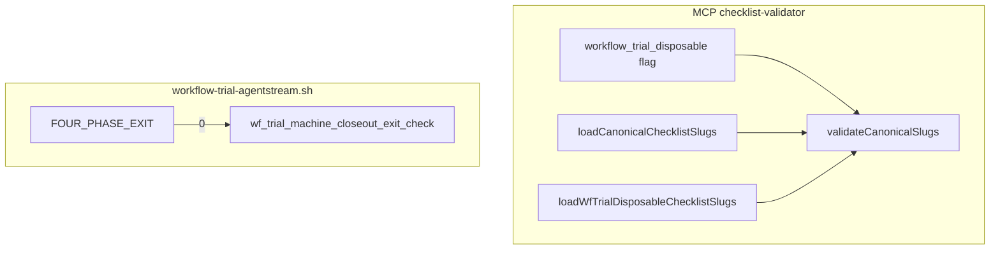

# PLAN — REQ-WF_TRIAL_DISPOSABLE_GATE_ALIGNMENT

**Status:** refine-plan complete — `plan_phase: pre-implementation`  
**Request token:** `REQ-WF_TRIAL_DISPOSABLE_GATE_ALIGNMENT`  
**profile_depth:** `minimal` · **gate_policy:** `advisory`  
**Incident:** [WF-01 Haiku low @ 1794975372](../../../docs/agent-harness-evaluation/readouts/trial-readout-PROMPT-WF-01-claudehaiku55low-1794975372-wf-agentstream-wf-01-claude-claudehaiku55low.md) (split signal)  
**Cursor plan:** [wf_disposable_gate_alignment_a159cb71.plan.md](../../../../.cursor/plans/wf_disposable_gate_alignment_a159cb71.plan.md)  
**Parent:** [REQ-WF_TRIAL_MINIMAL_CHECKLIST_PLAYBOOK](../REQ-WF_TRIAL_MINIMAL_CHECKLIST_PLAYBOOK/PLAN.md) · [REQ-WF_TRIAL_SLIM_TRACKER_INTER_TURN](../REQ-WF_TRIAL_SLIM_TRACKER_INTER_TURN/PLAN.md)

**CITDP:** [CITDP-REQ-WF_TRIAL_DISPOSABLE_GATE_ALIGNMENT.yaml](../../citdp/CITDP-REQ-WF_TRIAL_DISPOSABLE_GATE_ALIGNMENT.yaml)  
**Test strategy:** [test-strategy.md](./test-strategy.md)  
**Tracker:** [checklist-tracker.yaml](./checklist-tracker.yaml)

---

## 1. Refine — locked decisions (RESOLVE)

| # | Term | Resolution |
| --- | --- | --- |
| R1 | **Root cause** | `validateCanonicalSlugs` uses methodology checklist only; slim disposable slugs (`red-tests`, `implement-code`) → `invalid_slug` at verification/close_out. |
| R2 | **Slug strategy** | When `workflow_trial_disposable: true`, **union** slugs parsed from `tied-bundle/templates/wf-trial-minimal-checklist-tracker.yaml`; do **not** rename disposable slugs to `unit-test-red` / `unit-test-green` ([REQ-WF_TRIAL_SLIM_TRACKER_INTER_TURN](../REQ-WF_TRIAL_SLIM_TRACKER_INTER_TURN/PLAN.md) R12). |
| R3 | **Loader** | `loadWfTrialDisposableChecklistSlugs()` in `checklist-slug-registry.ts`; shared contract in `wf-trial-disposable-slug-registry.test.mjs`. |
| R4 | **Rationale seed** | Slim template `sub-adversarial-inquiry-pass` carries fixed `rationale` + `policy: minimal-depth-no-inquiry`; materialize/reconcile copies unchanged. |
| R5 | **Machine closeout exit** | New `wf_trial_machine_closeout_exit_check` in `wf-trial-machine-closeout-exit.inc.sh`; wired in `workflow-trial-agentstream.sh` after `FOUR_PHASE_EXIT=0` and existing phase-handoff / proof-manifest gates; **default on**; opt-out `WF_TRIAL_SKIP_MACHINE_CLOSEOUT_EXIT=1`. |
| R6 | **Exit rules** | Non-zero when: (a) `close_out_turn.status` is `incomplete` in `trial-workflow-interaction-inventory.v1.json`, or (b) no `gates/close_out-*.json` with `allowed: true` under product `working/{REQ}/gates/`, or (c) build handoff mentions verification but no `gates/verification-*.json` (same class as strict preflight). Turn subprocess non-zero still wins per [REQ-WF_TRIAL_FOUR_PHASE_SHELL_EXIT](../../requirements/REQ-WF_TRIAL_FOUR_PHASE_SHELL_EXIT.yaml). |
| R7 | **LEAP** | Footnote on [SC-WF-CLP-01](../../requirements/REQ-WF_TRIAL_MINIMAL_CHECKLIST_PLAYBOOK.yaml): disposable slugs gate-valid when `workflow_trial_disposable: true`. |
| R8 | **Out of scope** | Renaming slim slugs; auto-completing tracker steps without agent; integrated pseudocode gate changes; disposable client one-off repair. |

### Costly choices (accepted)

- **Default-on machine exit** will surface shell failures for cells that today show split signal (intentional honesty until agents complete turn 3–4 gates).
- **Registry union** must be gated on `workflow_trial_disposable` so store `@build-plan` trackers are unchanged.

---

## 2. Architecture

---

## 3. Build-plan TDD order

1. RED — `checklist-pseudocode-gate.test.ts` + `wf-trial-disposable-slug-registry.test.mjs`; fixture tracker from 1794975372 class.
2. GREEN — MCP slug union; template `rationale`; machine-closeout inc + shell tests.
3. Docs — `wf-trial-checklist-gates-adjunct.md`, `wf-trial-build-plan-handoff.md`, `agentstream.md` vocab.
4. IMPL pseudo-code sidecar + `tied_validate_consistency`.
5. Live — `workflow_trial_range claude haiku-5-5 low 1 1`; `@record-wf-trial`.

## 4. Acceptance (REQ)

| SC | Summary |
| --- | --- |
| SC-WF-DGA-01 | No `invalid_slug:red-tests` / `implement-code` on disposable minimal gates |
| SC-WF-DGA-02 | Template rationale → no `missing_not_applicable_policy_or_rationale` on seed |
| SC-WF-DGA-03 | Non-disposable `invalid_slug` regression |
| SC-WF-DGA-04 | Machine closeout exit fixtures + skip env |
| SC-WF-DGA-05 | `workflow-trial-agentstream-sh.test.mjs` hook order |
| SC-WF-DGA-06 | Live WF-01: machine complete **or** shell non-zero with DIAGNOSTIC |

---

## Do next

**`@build-plan`** — RED per [test-strategy.md](./test-strategy.md). No product code under disposable `src/` in this REQ.