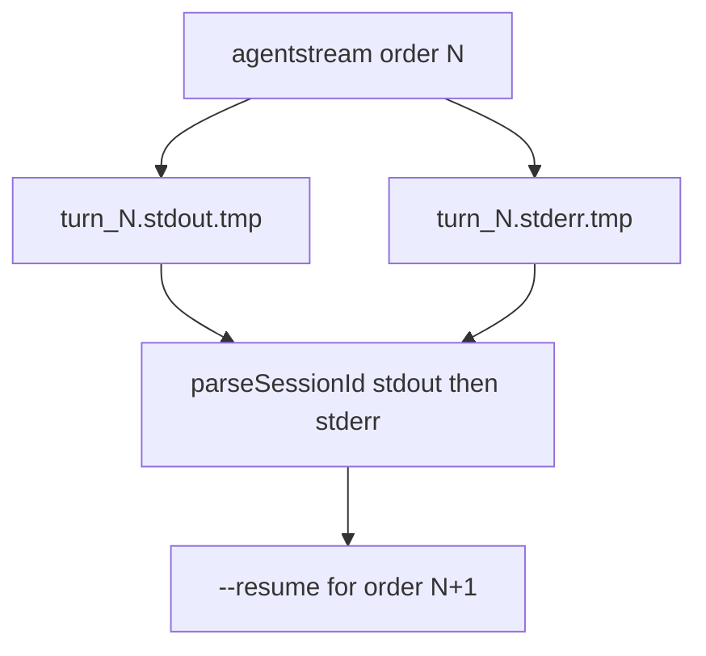

# PLAN — REQ-WF_TRIAL_INTERLEAVED_RESUME_CAPTURE

**Status:** close-out complete (live verify @ 1794975372)  
**plan_phase:** `post-build`  
**Request token:** `REQ-WF_TRIAL_INTERLEAVED_RESUME_CAPTURE`  
**profile_depth:** `minimal` · **gate_policy:** `advisory`  
**Incident:** WF-01 Claude Haiku low @ `1794973656-wf-agentstream-wf-01-claude-claudehaiku55low`  
**Parent:** [REQ-WF_TRIAL_SLIM_TRACKER_INTER_TURN](../REQ-WF_TRIAL_SLIM_TRACKER_INTER_TURN/PLAN.md)  
**Related:** [REQ-WF_TRIAL_SEQUENTIAL_PROCESS_TRANSCRIPT](../../../tied-project/requirements/REQ-WF_TRIAL_SEQUENTIAL_PROCESS_TRANSCRIPT.yaml)

**CITDP:** [CITDP-REQ-WF_TRIAL_INTERLEAVED_RESUME_CAPTURE.yaml](../../citdp/CITDP-REQ-WF_TRIAL_INTERLEAVED_RESUME_CAPTURE.yaml)  
**Test strategy:** [test-strategy.md](./test-strategy.md)  
**Tracker:** [checklist-tracker.yaml](./checklist-tracker.yaml)

---

## 1. Refine — locked decisions

| # | Term | Resolution |
| --- | --- | --- |
| R1 | **Failure** | Live interleave aborts at phase 2 with `missing session_id after turn 1` while `session_id=` is visible on orchestrator stderr ([fixture](./evidence/fixture-process-stderr-1794973656-excerpt.log)). |
| R2 | **Cause** | Per-turn capture uses `>stdout_file` only; `index.ts` suppresses operator-only stdout on exit ([SC-WF-SPT-03](../../../tied-project/requirements/REQ-WF_TRIAL_SEQUENTIAL_PROCESS_TRANSCRIPT.yaml)); `session_id=` reaches parent via fd 2 mirror. |
| R3 | **Fix boundary** | Shell: capture **stdout and stderr** per subprocess; parse `session_id=` from stdout first, else stderr file. **No** change to `liveExitStdoutIsOperatorMirrorOnly` this wave. |
| R4 | **Parser** | Add `parseSessionIdFromText` in `wf-trial-tracker-shape.mjs`; keep `parseSessionIdFromStdout` as alias; bash helper `wf_trial_parse_session_id_from_turn_capture`. |
| R5 | **LEAP (parent)** | [REQ-WF_TRIAL_SLIM_TRACKER_INTER_TURN](../REQ-WF_TRIAL_SLIM_TRACKER_INTER_TURN/PLAN.md) **R4** + SC-WF-IST-01 row updated in same `@build-plan` wave. |
| R6 | **Out of scope** | Proof manifest / phase-handoff content; interleaved default-on; agentstream MCP. |

### Costly choices (accepted)

- Resume id parsed from per-turn **stderr capture** (not full orchestrator log) — limits false positives.
- Intentionally **not** re-enabling duplicate operator lines on stdout for single-turn exits.

---

## 2. Architecture



| Module | Path |
| --- | --- |
| Capture + parse | `scripts/lib/wf-trial-interleaved-four-phase.inc.sh` |
| Shared parse | `tools/bootstrap/lib/wf-trial-tracker-shape.mjs` |
| Tests | `workflow-trial-agentstream-sh.test.mjs`, `wf-trial-tracker-shape.test.mjs` |

---

## 3. Build wave (`@build-plan`)

| ID | Deliverable |
| --- | --- |
| B1 | Dual-stream temp capture + `wf_trial_parse_session_id_from_turn_capture` |
| B2 | `parseSessionIdFromText` + tests SC-WF-IRC-01..03 |
| B3 | TIED REQ/ARCH/IMPL; LEAP parent R4; CITDP finalize |

---

## 4. Acceptance criteria

| ID | Criterion |
| --- | --- |
| SC-WF-IRC-01 | Stub emits `session_id=` on stderr only; interleaved runner completes 4 stub invokes |
| SC-WF-IRC-02 | 1794973656 fixture parses to `28a60a53-d520-4b09-8bd0-3358224cb67b` |
| SC-WF-IRC-03 | Prior SC-WF-IST / dry-run monolithic tests remain green |

---

## 5. Verification

```bash
node --test tools/bootstrap/lib/wf-trial-tracker-shape.test.mjs
node --test tools/bootstrap/workflow-trial-agentstream-sh.test.mjs
```

---

## Do next

`@close-out` — [phase-handoff-build-plan.md](./evidence/phase-handoff-build-plan.md).