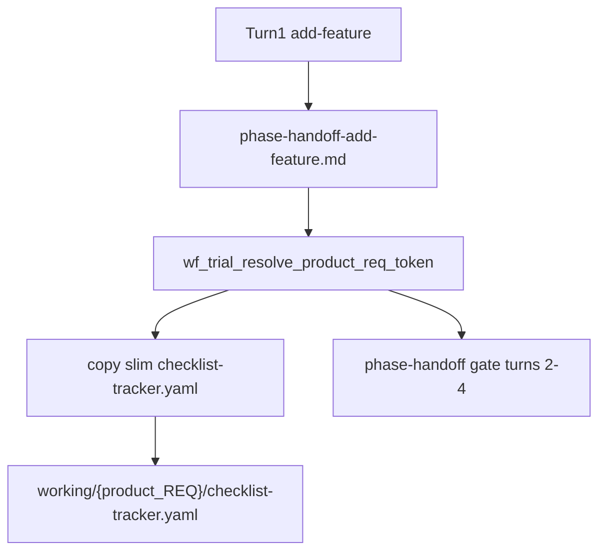

# PLAN — REQ-WF_TRIAL_MINIMAL_CHECKLIST_PLAYBOOK (+ phase handoff + manifest LEAP)

**Status:** build-plan complete · ready for `@close-out`  
**plan_phase:** `post-build`  
**Workflow:** add-feature (cursor plan) → **refine-plan** → `@build-plan` (P1+P2+P3 single wave) → `@close-out`  
**Request token (methodology):** `REQ-WF_TRIAL_MINIMAL_CHECKLIST_PLAYBOOK`  
**Sibling REQ (phase 2):** `REQ-WF_TRIAL_PHASE_HANDOFF_GATE`  
**profile_depth:** `minimal` · **gate_policy:** `advisory`

**CITDP:** [CITDP-REQ-WF_TRIAL_MINIMAL_CHECKLIST_PLAYBOOK.yaml](./CITDP-REQ-WF_TRIAL_MINIMAL_CHECKLIST_PLAYBOOK.yaml)  
**Test strategy:** [test-strategy.md](./test-strategy.md)  
**Tracker (build):** [checklist-tracker.yaml](./checklist-tracker.yaml)

**Evidence baseline:** [WF-10 Haiku low readout](../../../docs/demos/trial-readout-PROMPT-WF-10-claudehaiku55low-1794371036-wf-agentstream-wf-10-claude-claudehaiku55low.md) · [medium](../../../docs/demos/trial-readout-PROMPT-WF-10-claudehaiku55medium-1794376176-wf-agentstream-wf-10-claude-claudehaiku55medium.md)

---

## 1. Refine (Touchpoint 1 — RESOLVE)

### Locked sponsor choices

| Term | Resolution |
| --- | --- |
| TIED packaging | **Split REQs** — playbook + phase-handoff gate; manifest **LEAP** on existing `REQ-WF_TRIAL_RANGE_PROOF_MANIFEST_MANDATE` |
| Build wave | **One `@build-plan`** ships phases 1–3 |
| Depth / gates | **minimal** / **advisory** (shell default-on + `WF_TRIAL_SKIP_*`; no integrated adversarial inquiry) |
| Product vs methodology REQ | **Slim tracker seeds on disposable *product* `working/{product_REQ}/`** — not this methodology folder. Resolver reads `evidence/phase-handoff-add-feature.md` `request_token` (fallback: newest `working/*/PLAN.md` **Request token** line). |
| Orchestrator exit | Phase-handoff gate **fails turn 1–3**; turn 4 handoff **optional** for exit 0; close_out still agent-gated |
| Manifest gate | Add **FILE_EXISTS** + **FILE_COVERAGE** to existing L3 gate (no second manifest validator) |

### Costly choices (accepted)

- Historical WF-10 medium cells that exited **0** without tests or real manifest paths should **fail** on re-run under phase-handoff + strengthened manifest gate.
- Do **not** auto-repair `execution_evidence.completed` slugs (preserves traceability).
- Do **not** raise global MCP `gate_policy` to blocking for WF cohort.

### Out of scope

- Integrated adversarial inquiry at minimal depth.
- Reopening `REQ-WF_TRIAL_FOUR_PHASE_HARDENING` (read-only dependency).

---

## 2. Problem

| Dimension | Today | Target |
| --- | --- | --- |
| Process adherence | `invalid_slug` when agents list `build-plan` in `completed` | Registry slugs only; slim tracker + adjunct |
| Test strategy | Turn 3 skipped; RED/GREEN absent | Turn 3 gate: tests + handoff file on disk |
| Workflow | `exit_code: 0` with scaffold manifest | Manifest paths exist; file count ≥ colocated tests |
| Close-out | sync-dispositions waived | Turn 4 runs `sub-close-out-evidence-sync` when verification receipt exists |

---

## 3. Architecture — product REQ resolution

**Forbidden in `execution_evidence.completed`:** prompt-type ids (`add-feature`, `refine-plan`, `build-plan`, `close-out`) — see [checklist-validator.ts](../../../mcp-server/src/checklist-validator.ts) `invalid_slug`.

---

## 4. Phase 1 — Playbook (`REQ-WF_TRIAL_MINIMAL_CHECKLIST_PLAYBOOK`)

| ID | Deliverable | Path |
| --- | --- | --- |
| P1.1 | Slim tracker template | `tied-bundle/templates/wf-trial-minimal-checklist-tracker.yaml` |
| P1.2 | Seed helper | `scripts/lib/wf-trial-implementation-stack.inc.sh` + `wf_trial_resolve_product_req_token` (shared with P2) |
| P1.3 | Gate script adjunct | `tools/bundled-prompt-type-skills/prompt-shared/wf-trial-checklist-gates-adjunct.md` |
| P1.4 | Batch goals | `docs/demos/traditional-four-phase-agentstream.yaml` turns 2–4 |
| P1.5 | Preload | `tied-bundle/docs/wf-trial-agent-preload-contract.yaml` |
| P1.6 | Build handoff table | `wf-trial-build-plan-handoff.md` |
| P1.7 | Facilitator catalog | `catalog-traditional-workflow-trial-prompts.md` Process adherence note |

**Minimal tracker slugs (disposable product):** `sub-adversarial-inquiry-pass`, `persist-implementation-records`, `red-tests`, `implement-code`, `verification-gate`, `sub-close-out-evidence-sync`, `traceable-commit`.

---

## 5. Phase 2 — Fail-closed (`REQ-WF_TRIAL_PHASE_HANDOFF_GATE` + manifest LEAP)

| ID | Deliverable | Path |
| --- | --- | --- |
| P2.1 | Inter-turn gate | `scripts/lib/wf-trial-phase-handoff-gate.inc.sh` |
| P2.2 | Hook | `scripts/run-traditional-four-phase-agentstream.sh` (post-turn; preserve `FOUR_PHASE_EXIT` precedence) |
| P2.3 | Help / escape | `WF_TRIAL_SKIP_PHASE_HANDOFF_GATE=1` in `wf-trial-agentstream-help.inc.sh` |
| P2.4 | Manifest FILE_EXISTS / FILE_COVERAGE | `tools/bootstrap/lib/wf-trial-proof-manifest-gate.mjs` + LEAP **SC-RPM-09**, **SC-RPM-10** on `REQ-WF_TRIAL_RANGE_PROOF_MANIFEST_MANDATE` |
| P2.5 | Strict closeout (default off) | `WF_TRIAL_STRICT_CLOSEOUT_PREFLIGHT=1` helper |
| P2.6 | Tests | `workflow-trial-agentstream-sh.test.mjs`, `wf-trial-proof-manifest-gate.test.mjs` |

**Post-turn requirements**

| After turn | Required on disposable client |
| --- | --- |
| 1 | `{product_REQ}/evidence/phase-handoff-add-feature.md` |
| 2 | `phase-handoff-refine-plan.md` |
| 3 | `phase-handoff-build-plan.md` **and** `npm test` ≥ 1 pass **and** ≥ 1 `src/**/*.test.ts` |
| 4 | `phase-handoff-close-out.md` optional for orchestrator exit |

---

## 6. Phase 3 — Close-out ceiling (alignment)

| ID | Deliverable | Notes |
| --- | --- | --- |
| P3.1 | Turn 4 symmetry | `traceable-commit` only when `tied_gate_check` `allowed: true`; else **INCOMPLETE** in handoff |
| P3.2 | Playbook | `wf-trial-four-phase-close-out-playbook.md` — run `sub-close-out-evidence-sync` when verification receipt exists |
| P3.3 | Record skill | `@record-wf-trial` preview warns/fails without `gates/close_out-*.json` |

Align with [CITDP-wave5-process-adherence](../REQ-TIED_CHECKLIST_GATE_ENFORCEMENT/CITDP-wave5-process-adherence.yaml) — no duplicate envelope MCP work.

---

## 7. Acceptance criteria (build-plan)

| Token | IDs |
| --- | --- |
| `REQ-WF_TRIAL_MINIMAL_CHECKLIST_PLAYBOOK` | SC-WF-CLP-01 … SC-WF-CLP-05 (detail YAML) |
| `REQ-WF_TRIAL_PHASE_HANDOFF_GATE` | SC-WF-PHG-01 … SC-WF-PHG-05 |
| `REQ-WF_TRIAL_RANGE_PROOF_MANIFEST_MANDATE` (LEAP) | SC-RPM-09 FILE_EXISTS, SC-RPM-10 FILE_COVERAGE |

---

## 8. Build-plan TDD order

1. RED tests: manifest gate new error codes; phase-handoff inc fixtures.  
2. GREEN: mjs + inc.sh implementations.  
3. Docs/adjuncts + four-phase YAML + preload (no behavior until wired).  
4. IMPL pseudo-code sidecars + `tied_validate_consistency`.  
5. Vocab: `tied-project/vocab/agentstream.md` terms for slim tracker, skip envs.

**Verification (post-build):** `node --test tools/bootstrap/workflow-trial-agentstream-sh.test.mjs` · `node --test tools/bootstrap/lib/wf-trial-proof-manifest-gate.test.mjs` · optional single-cell `workflow_trial_agentstream wf-10`.

---

## Do next

**`@close-out`**
