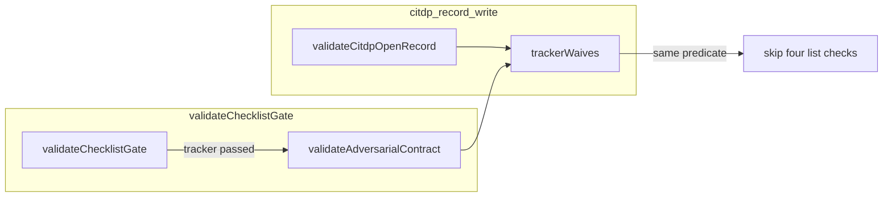

# PLAN — REQ-WF_TRIAL_MINIMAL_PROGRESSION_GATE_WAIVER

**Status:** build-plan complete — `plan_phase: verification` (awaiting `@close-out`)  
**Request token:** `REQ-WF_TRIAL_MINIMAL_PROGRESSION_GATE_WAIVER`  
**profile_depth:** `minimal` · **gate_policy:** `advisory`  
**Parent gap:** [REQ-WF_TRIAL_DISPOSABLE_CLOSEOUT_READINESS](../REQ-WF_TRIAL_DISPOSABLE_CLOSEOUT_READINESS/PLAN.md) — open-record waiver does not flow to progression gates (1794981051)  
**Cursor plan:** [minimal_progression_gate_waiver_4584fdf5.plan.md](../../../../.cursor/plans/minimal_progression_gate_waiver_4584fdf5.plan.md)

**CITDP:** [CITDP-REQ-WF_TRIAL_MINIMAL_PROGRESSION_GATE_WAIVER.yaml](../../citdp/CITDP-REQ-WF_TRIAL_MINIMAL_PROGRESSION_GATE_WAIVER.yaml)  
**Test strategy:** [test-strategy.md](./test-strategy.md)  
**Tracker:** [checklist-tracker.yaml](./checklist-tracker.yaml)

---

## 1. Refine — locked decisions (RESOLVE)

| # | Term | Resolution |
| --- | --- | --- |
| R1 | **Progression gate waiver** | Reuse `trackerWaivesMinimalAdversarialOpenRecord` — `sub-adversarial-inquiry-pass` `not_applicable` + `policy: minimal-depth-no-inquiry` |
| R2 | **Phase scope** | **All** gate phases (`pre_implementation`, `verification`, `close_out`) when depth minimal — parity with open-record, not a second policy |
| R3 | **Choke point** | `validateAdversarialContract` accepts optional `tracker`; `validateChecklistGate` passes `input.tracker` on every call |
| R4 | **Safety** | Integrated / strict_candidate unchanged; no waiver without tracker stub |
| R5 | **Docs** | [wf-trial-checklist-gates-adjunct.md](../../../tools/bundled-prompt-type-skills/prompt-shared/wf-trial-checklist-gates-adjunct.md) — minimal disposable: lists not required when stub present; envelope + traceable commit still required |
| R6 | **SC-DCR-06 follow-on** | SC-MPGW-07 live replay; SC-DCR partial/full grading per DCR test-strategy after verification `allowed: true` |
| R7 | **Costly choice (accepted)** | `pre_implementation` may allow where refine previously documented advisory block only — playbook updated |

### Non-goals

- Fabricating adversarial lists in agent turns
- Waiving integrated depth pairing or activation requirements
- Changing non-disposable store tracker defaults

---

## 2. Architecture

**Surface:** `mcp-server/src/checklist-validator.ts` only (production); tests in `checklist-validator.test.ts`, `checklist-gate-mcp.test.ts`.

---

## 3. Build-plan TDD order

1. RED — SC-MPGW-04/05 negative cases (no waiver, integrated unchanged).
2. RED — SC-MPGW-01..03 phase allow cases with minimal CITDP + waive tracker.
3. GREEN — implement tracker on `validateAdversarialContract` + call sites.
4. RED/GREEN — SC-MPGW-06 MCP composition.
5. Docs — WF adjunct + optional `agentstream.md` **progression gate waiver**.
6. `pseudocode_validate` on IMPL sidecar; `tied_validate_consistency` (project scope).
7. Live — SC-MPGW-07 gate replay on 1794981051 (sponsor-costly); optional new WF-01 + `@record-wf-trial`.

---

## 4. Acceptance (REQ)

| SC | Summary |
| --- | --- |
| SC-MPGW-01 | `pre_implementation` allowed without lists when waiver |
| SC-MPGW-02 | `verification` allowed with slim disposable tracker fixture |
| SC-MPGW-03 | `close_out` adversarial lists waived (other close_out rules unchanged) |
| SC-MPGW-04 | Minimal without waiver → four `missing_*` |
| SC-MPGW-05 | Integrated + waive stub → lists/pairing still required |
| SC-MPGW-06 | MCP `tied_checklist_gate_validate` minimal without fabricated lists |
| SC-MPGW-07 | Live replay 1794981051 verification + close_out `allowed: true` |

---

## Do next

**`@build-plan`** — RED/GREEN per [test-strategy.md](./test-strategy.md). No disposable product `src/` changes in this REQ.