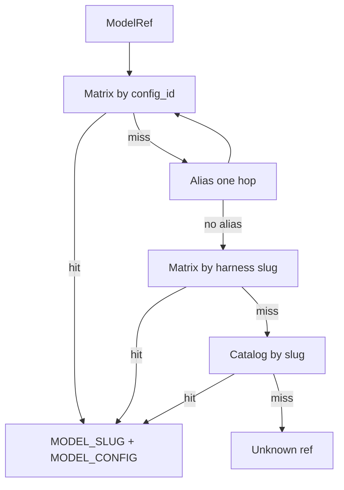

# PLAN — [REQ-WF_TRIAL_MODEL_CATALOG_RESOLVE] (refine-plan)

**Status:** build-plan complete  
**Workflow:** add-feature → **refine-plan** → `@build-plan` → close-out  
**Request token:** `REQ-WF_TRIAL_MODEL_CATALOG_RESOLVE`  
**plan_phase:** `build-complete`  
**profile_depth:** `minimal` · **gate_policy:** `advisory`

**Related:** [REQ-WF_TRIAL_MODEL_SPEC_CLI](../../requirements/REQ-WF_TRIAL_MODEL_SPEC_CLI.yaml) · [REQ-WF_TRIAL_MODEL_EFFORT](../../requirements/REQ-WF_TRIAL_MODEL_EFFORT.yaml)

**CITDP:** [CITDP-REQ-WF_TRIAL_MODEL_CATALOG_RESOLVE.yaml](./CITDP-REQ-WF_TRIAL_MODEL_CATALOG_RESOLVE.yaml)  
**Test strategy:** [test-strategy.md](./test-strategy.md)  
**Tracker:** [checklist-tracker.yaml](./checklist-tracker.yaml)

---

## 1. Refine (Touchpoint 1 — RESOLVE) — closed

| Sponsor term | Resolved concept | Disposition |
| --- | --- | --- |
| **MODEL_REF** | 2nd positional on `workflow_trial_range` / orchestrator resolve input | **Locked** — config id, catalog slug, or harness alias |
| **Matrix tier** | [wf-trial-model-specs.yaml](../../../docs/demos/wf-trial-model-specs.yaml) | **Locked** — short cell names; wins on slug/config match |
| **Catalog tier** | [wf-trial-model-catalog.yaml](../../../docs/demos/wf-trial-model-catalog.yaml) (new) | **Locked** — committed snapshot of `agent models` + Claude `/v1/models` ids |
| **Alias map** | Harness-scoped shortcuts only | **Locked** — table §2.3; single hop |
| **composer-2.5** | Cursor matrix cell | **Locked — costly** — **Claude harness rejected** (no Haiku parity) |
| **Haiku on Claude** | API `claude-haiku-5-5` | **Locked** — `haiku-5-5` / `haiku55` aliases |
| **Effort** | 3rd positional / `MODEL_EFFORT` | **Locked** — unchanged; Cursor tier on slug after resolve |

---

## 2. Problem

Operators know **Cursor** slugs from `agent models` and **Claude** ids from `/v1/models`, but [wf-trial-model-specs.yaml](../../../docs/demos/wf-trial-model-specs.yaml) only lists six matrix keys. Refs like `haiku-5-5` or `gpt-5.6-luna-low-fast` fail before the WF loop. Historical `composer-2.5` → Haiku on Claude is confusing vs API naming.

---

## 3. Resolution algorithm (normative)

**Entry:** `resolveWfTrialModelRef(harness, ref)` in [wf-trial-model-spec.mjs](../../../tools/bootstrap/lib/wf-trial-model-spec.mjs) (delegates catalog load to [wf-trial-model-catalog.mjs](../../../tools/bootstrap/lib/wf-trial-model-catalog.mjs)).

```
PRE: harness in {cursor, claude}; ref non-empty trim
1. IF matrix specs has key ref → matrix hit (config_id = ref)
2. IF aliases[harness][ref] defined → ref := alias target; GOTO 1 once (no chain)
3. IF matrix row cursor_slug|claude_slug == ref (case-sensitive slug) → matrix hit
4. IF catalog[harness] has slug ref → catalog hit
5. ELSE fail closed (stderr: unknown model ref + sync command)
POST: MODEL_SLUG, MODEL_CONFIG; optional config_id; resolution ∈ {matrix, alias, catalog}
```

Then existing [wf_trial_canonicalize_cursor_model_slug](../../../scripts/lib/wf-trial-model-spec.inc.sh) when `harness=cursor`.



**Arity unchanged:** `workflow_trial_range HARNESS MODEL_REF EFFORT END START [MONIT]`.

**Backward compatibility:** Matrix config ids (`luna-low`, `composer-2.5`, …) behave as today on the matching harness.

---

## 4. Locked decisions

| ID | Decision |
| --- | --- |
| **D-CAT-SNAPSHOT** | Catalog is committed YAML; resolve does not shell out to `agent models` |
| **D-CAT-MATRIX-WINS** | Matrix match (step 1 or 3) sets `MODEL_CONFIG` from matrix row, not catalog derive |
| **D-CAT-ALIAS-ONE-HOP** | At most one alias rewrite per resolve |
| **D-CAT-COMPOSER-CLAUDE-FAIL** | `claude` + `composer-2.5` → `HARNESS_NOT_SUPPORTED` (remove `claude_slug` from matrix row) |
| **D-CAT-CLAUDE-MODEL-CONFIG** | Claude catalog/matrix slug rows use `model_config` = API `id` |
| **D-CAT-CURSOR-DERIVE** | At **sync** time, non-matrix Cursor slugs get `model_config` via `deriveCursorModelConfig` (§5) |
| **D-CAT-SYNC-CHECK** | `sync-wf-trial-model-catalog.mjs --check` fails CI when snapshot drifts |
| **D-CAT-CLI-SUBCOMMAND** | `wf-trial-model-spec.mjs resolve-ref <harness> <ref>` emits JSON (bash inc uses this) |
| **D-CAT-DIAGNOSTIC** | Optional once per resolve: `DIAGNOSTIC: wf_trial_model_ref: … via matrix|alias|catalog` |

**Costly:** Breaking `workflow_trial_range claude composer-2.5 …` — migrate to `claude haiku-5-5` or `claude-haiku-5-5`. Disposable tags for new Haiku runs use `claudehaiku55`-style buckets from `model_config` `claude-haiku-5-5` (strip `-`/`.`), not legacy `composer-2.5` / `haiku55` matrix label unless operator sets env override.

---

## 5. `deriveCursorModelConfig(slug)` (sync + unit tests)

Reuse [parseCursorCatalogSlug](../../../tools/bootstrap/lib/cursor-catalog-model-slug.mjs): strip trailing `fast`, trailing effort tier, trailing `thinking`.

| After strip | `model_config` |
| --- | --- |
| Slug equals a matrix `cursor_slug` | Matrix row’s `model_config` (e.g. `gpt-5.6-luna-low-fast` → `luna-low`) |
| Base `gpt-5.6-luna-{tier}` | `luna-{tier}` |
| Base `gpt-5.6-sol-{tier}` | `sol-{tier}` (documented; matrix may add later) |
| Base `grok-4.7-{tier}` or `cursor-grok-4.6-{tier}` | `grok47-{tier abbreviated}` — align `medium` → `grok47-med` to match [grok47-med](../../../docs/demos/wf-trial-model-specs.yaml) when tier is `medium` |
| `composer-2.5` (+ optional `-fast`) | `composer-2.5` |
| Default | Base string (canonical grok base applied first) |

Catalog row always stores **full** `slug` as listed by `agent models` and derived `model_config` at generation time (resolve reads stored value, does not re-derive at runtime except matrix wins).

---

## 6. Harness-scoped aliases (initial set)

**Claude** (`aliases.claude`):

| Alias | Target API id |
| --- | --- |
| `haiku-5-5` | `claude-haiku-5-5` |
| `haiku55` | `claude-haiku-5-5` |
| `sonnet-5-5` | `claude-sonnet-5-5` |
| `sonnet55` | `claude-sonnet-5-5` |
| `opus-5-5` | `claude-opus-5-5` |
| `fable-5-2` | `claude-fable-5-2` |
| `fable-5-1` | `claude-fable-5-1` |
| `fable-5` | `claude-fable-5` |

**Cursor:** none at launch (slugs are already canonical in `agent models`). Add only when operators need shortcuts.

Aliases live in catalog YAML under `aliases:` (not in matrix specs).

---

## 7. Data artifacts

### 7.1 Catalog schema `wf-trial-model-catalog.v1`

Path: [docs/demos/wf-trial-model-catalog.yaml](../../../docs/demos/wf-trial-model-catalog.yaml)

```yaml
schema: wf-trial-model-catalog.v1
generated_at: "<ISO8601>"
cursor_source: "agent models"
claude_source: "GET /v1/models"
aliases:
  claude: { ... }
cursor:
  - slug: composer-2.5-fast
    model_config: composer-2.5
claude:
  - slug: claude-haiku-5-5
    model_config: claude-haiku-5-5
```

### 7.2 Matrix LEAP ([wf-trial-model-specs.yaml](../../../docs/demos/wf-trial-model-specs.yaml))

- `composer-2.5`: remove `claude_slug`
- Add `claude-haiku-5-5`: `claude_slug` + `model_config: claude-haiku-5-5` (Claude-only)

### 7.3 Sync script

[tools/bootstrap/sync-wf-trial-model-catalog.mjs](../../../tools/bootstrap/sync-wf-trial-model-catalog.mjs)

- `agent models` → parse `slug - Label` lines
- `--claude-json <file>` — sponsor `/v1/models` `data[].id`
- `--write` / default regenerate catalog; `--check` diff exit 1
- Fixture: [tools/bootstrap/testdata/wf-trial-claude-models.v1.json](../../../tools/bootstrap/testdata/wf-trial-claude-models.v1.json) for CI without API key

---

## 8. Shell / docs touchpoints

| Artifact | Change |
| --- | --- |
| [wf-trial-model-spec.inc.sh](../../../scripts/lib/wf-trial-model-spec.inc.sh) | `resolve-ref`; `wf_trial_registry_has_model_ref` |
| [build-commands.sh](../../../scripts/build-commands.sh) | Usage: MODEL_REF + examples |
| [workflow-trial-agentstream.sh](../../../scripts/workflow-trial-agentstream.sh) | Resolve when ref known to registry/catalog/alias |
| Help / `how` / [agentstream.md](../../vocab/agentstream.md) | Two-tier + sync one-liner |
| [docs/workflow-trials.md](../../../docs/workflow-trials.md) | Migration table |
| LEAP [REQ-WF_TRIAL_MODEL_SPEC_CLI](../../requirements/REQ-WF_TRIAL_MODEL_SPEC_CLI.yaml) tests/docs citing composer+claude Haiku | |

---

## 9. Build-plan order

1. TIED tokens (REQ/ARCH/IMPL + pseudo-code) via MCP  
2. `pseudocode_validate`  
3. **RED** — `wf-trial-model-catalog.test.mjs`, extend `wf-trial-model-spec.test.mjs`, shell tests  
4. Catalog YAML + sync script + testdata JSON  
5. Resolver + bash wiring  
6. Matrix LEAP + docs + vocab RECORD  
7. **GREEN** — verification manifest; `lint_yaml`; `tied_validate_consistency`  
8. Persist CITDP to `tied-project/citdp/` at close-out  

---

## 10. Out of scope

- 6-arg `SLUG CONFIG` positional form  
- Runtime live catalog fetch  
- Auto-expanding matrix specs from catalog  
- Changing agentstream effort slug rewrite  

---

## Do next

**`@build-plan`** on this folder ([evidence/session-handoff.md](./evidence/session-handoff.md)).
