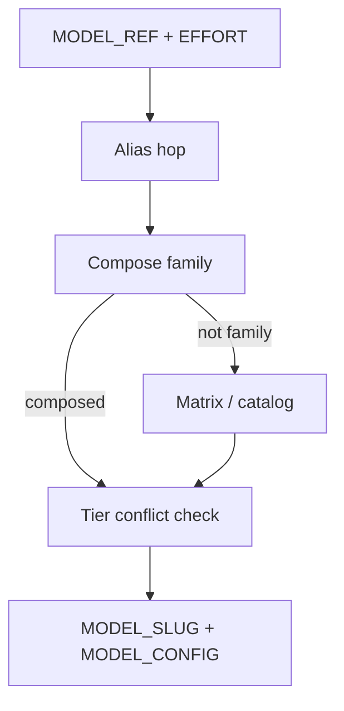

# PLAN — [REQ-WF_TRIAL_MODEL_COMPOSE] (refine-plan)

**Status:** refine-plan complete  
**Workflow:** add-feature → **refine-plan** → `@build-plan` → close-out  
**Request token:** `REQ-WF_TRIAL_MODEL_COMPOSE`  
**plan_phase:** `pre-implementation`  
**profile_depth:** `minimal` · **gate_policy:** `advisory`

**Related:** [REQ-WF_TRIAL_MODEL_CATALOG_RESOLVE](../../requirements/REQ-WF_TRIAL_MODEL_CATALOG_RESOLVE.yaml) · [REQ-WF_TRIAL_MODEL_EFFORT](../../requirements/REQ-WF_TRIAL_MODEL_EFFORT.yaml) · [REQ-WF_TRIAL_MODEL_SPEC_CLI](../../requirements/REQ-WF_TRIAL_MODEL_SPEC_CLI.yaml)

**CITDP:** [CITDP-REQ-WF_TRIAL_MODEL_COMPOSE.yaml](./CITDP-REQ-WF_TRIAL_MODEL_COMPOSE.yaml)  
**Test strategy:** [test-strategy.md](./test-strategy.md)  
**Tracker:** [checklist-tracker.yaml](./checklist-tracker.yaml)

---

## 1. Refine (Touchpoint 1 — RESOLVE) — closed

| Sponsor term | Resolved concept | Disposition |
| --- | --- | --- |
| **Compose family** | Short `MODEL_REF` (`luna`, `grok47`, `sol`, `composer-2.5`) | **Locked** — registry `compose:` in specs YAML |
| **Effort (Cursor)** | Single tier source for slug + `MODEL_EFFORT` | **Locked** — 3rd positional; required when family is compose |
| **Speed** | Always `-fast` on tiered Cursor WF families | **Locked** — `speed_suffix: fast` in registry |
| **Tiered matrix id** | `luna-low`, `grok47-med`, … | **Locked** — keep in YAML; **deprecated in docs**; mismatch with `EFFORT` → fail |
| **Claude** | API base id + `MODEL_EFFORT` | **Locked** — unchanged (no slug tier compose) |

---

## 2. Problem

`workflow_trial_range cursor gpt-5.6-luna-low-fast medium 1 1` encodes **low** in `MODEL_SLUG` and **medium** in `MODEL_EFFORT`. [cursorSlugMayMismatchEffort](mcp-server/packages/agentstream/src/model-effort.ts) treats that as ambiguous. Operators want:

```bash
workflow_trial_range cursor luna medium 2 2
# → MODEL_SLUG=gpt-5.6-luna-medium-fast, MODEL_CONFIG=luna-med, MODEL_EFFORT=medium
```

---

## 3. Compose registry (normative)

Extend [wf-trial-model-specs.yaml](../../../docs/demos/wf-trial-model-specs.yaml) — **schema `wf-trial-model-spec.v2`** (validator accepts v1 without `compose`).

```yaml
schema: wf-trial-model-spec.v2
compose:
  luna:
    catalog_base: gpt-5.6-luna
    model_config_prefix: luna
    speed_suffix: fast
  grok47:
    catalog_base: grok-4.7
    model_config_prefix: grok47
    speed_suffix: fast
  sol:
    catalog_base: gpt-5.6-sol
    model_config_prefix: sol
    speed_suffix: fast
  composer-2.5:
    catalog_base: composer-2.5
    model_config_prefix: composer-2.5
    speed_suffix: fast
    effort_in_slug: false   # existing composer DIAGNOSTIC; slug stays composer-2.5-fast
specs:
  # legacy tiered rows unchanged for backward compat
```

**Allowed effort tiers:** `low`, `medium`, `high`, `xhigh`, `max` (same as [MODEL_EFFORT_LEVELS](mcp-server/packages/agentstream/src/model-effort.ts)).

---

## 4. `model_config` abbreviation (locked)

Align disposable tags / matrix with historical buckets:

| Effort | `luna` / `sol` config | `grok47` config |
| --- | --- | --- |
| `low` | `luna-low` | `grok47-low` |
| `medium` | `luna-med` | `grok47-med` |
| `high` | `luna-high` | `grok47-high` |
| `xhigh` | `luna-xhigh` | `grok47-xhigh` |
| `max` | `luna-max` | `grok47-max` |

Implementation: shared `effortToModelConfigSuffix(effort)` — `medium` → `med`; others identity.

**Slug tier token:** use full effort name in catalog slug (`gpt-5.6-luna-medium-fast`), not `med`.

---

## 5. Resolution algorithm

**API:** `resolveWfTrialModelRef(harness, ref, { effort?, registryPath, catalogPath })`

```text
PRE: harness cursor|claude; ref trimmed non-empty
1. alias hop (once), same as catalog resolve
2. IF harness=cursor AND compose[ref] defined:
     IF effort missing or "-": FAIL effort_required_for_compose_family
     IF effort_in_slug=false: slug=base+speed per family rules (composer-2.5-fast)
     ELSE: slug = catalog_base + "-" + effort + "-" + speed_suffix (xhigh uses xhigh not extra-high in slug)
     model_config = prefix + "-" + effortToModelConfigSuffix(effort)
     VERIFY slug in wf-trial-model-catalog.yaml (fail closed if agent models drift)
     RETURN resolution=compose
3. Matrix config_id → existing resolveWfTrialModelSpec
4. Matrix slug scan → existing
5. Catalog slug → existing
6. FAIL unknown model ref

POST tier conflict (when effort provided and not "-"):
  parsed = parseCursorCatalogSlug(MODEL_SLUG)
  IF parsed.priorEffort != "" AND normalized(parsed.priorEffort) != normalized(effort):
    FAIL tier_mismatch — hint: use "cursor {family} {effort}" not "{tiered-id} {effort}"
```



**CLI:** `wf-trial-model-spec.mjs resolve-ref <harness> <ref> [effort]` — effort optional except compose families.

**Shell:** [wf_trial_resolve_model_ref](../../../scripts/lib/wf-trial-model-spec.inc.sh) passes `workflow_trial_range` 3rd arg into Node **before** exporting `MODEL_EFFORT`.

---

## 6. Locked decisions

| ID | Decision |
| --- | --- |
| **D-COMPOSE-SINGLE-TIER** | For compose families, slug tier and `MODEL_EFFORT` use the same operator effort string |
| **D-COMPOSE-CATALOG-GATE** | Composed slug must exist in committed catalog (or matrix cursor_slug) |
| **D-COMPOSE-MISMATCH-FAIL** | Tiered id/slug + conflicting effort → error, not DIAGNOSTIC-only |
| **D-COMPOSE-LEGACY-DASH** | Tiered matrix id + `EFFORT=-` → no conflict check (backward compat) |
| **D-COMPOSE-COMPOSER** | `composer-2.5` family: `effort_in_slug: false`; retain shell DIAGNOSTIC if effort set |
| **D-COMPOSE-SCHEMA-V2** | Bump specs schema; v1 files still load with empty `compose` |
| **D-COMPOSE-DOCS** | Remove `gpt-5.6-luna-low-fast medium` from usage; canonical `luna medium` |

**Costly:** Scripts using `luna-low` + non-matching effort will fail until migrated to `luna {effort}`.

---

## 7. Modules (build-plan)

| Module | Path |
| --- | --- |
| Compose logic | [wf-trial-model-compose.mjs](../../../tools/bootstrap/lib/wf-trial-model-compose.mjs) (new) |
| Spec loader v2 | [wf-trial-model-spec.mjs](../../../tools/bootstrap/lib/wf-trial-model-spec.mjs) |
| Shell | [wf-trial-model-spec.inc.sh](../../../scripts/lib/wf-trial-model-spec.inc.sh), [build-commands.sh](../../../scripts/build-commands.sh) |
| Tests | `wf-trial-model-compose.test.mjs`, extend spec + shell tests |

---

## 8. Build-plan order

1. TIED REQ/ARCH/IMPL + pseudo-code  
2. `pseudocode_validate`  
3. RED tests  
4. Registry v2 + compose module + resolver + shell  
5. Docs / vocab / LEAP effort examples  
6. `tied_validate_consistency` · close-out  

---

## 9. Out of scope

- Flag-based CLI  
- Removing tiered matrix YAML rows  
- Auto-compose for arbitrary catalog slugs without family registry  
- Changing Claude resolve  

---

## Do next

**`@build-plan`** — [evidence/session-handoff.md](./evidence/session-handoff.md)
