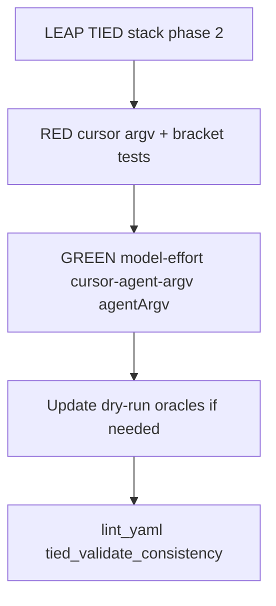

# PLAN — [REQ-WF_TRIAL_MODEL_EFFORT]

**Trial context:** store TIED repo (methodology); operator surface via `source scripts/build-commands.sh` after `./build-workspace.sh`.

**Phase 1:** build-plan complete (shell + Claude effort + Cursor diagnostic) — see [build-plan-verification-evidence.md](./evidence/build-plan-verification-evidence.md).

**Phase 2:** refine-plan reopen — Cursor `agent` CLI bracket effort + live-batch argv parity.

**plan_phase:** `post-build` (phase 1 + phase 2 complete)

**Request token:** `REQ-WF_TRIAL_MODEL_EFFORT`  
**Workflow:** add-feature → refine-plan → **@build-plan (phase 2)** → @close-out

**Linked Cursor plan:** `cursor_cli_argv_parity_32942403`

**profile_depth:** `minimal` · **gate_policy:** `advisory`

**CITDP (working draft):** [CITDP-REQ-WF_TRIAL_MODEL_EFFORT.draft.yaml](./CITDP-REQ-WF_TRIAL_MODEL_EFFORT.draft.yaml)

**Test strategy:** [test-strategy.md](./test-strategy.md)

**Tracker:** [checklist-tracker.yaml](./checklist-tracker.yaml)

---

## 1. Refine (Touchpoint 1 — RESOLVE) — phase 2 closed

| Sponsor term | Resolved concept | Disposition |
| --- | --- | --- |
| Effort in API | **`output_config.effort`** on Anthropic Messages (`low` … `max`) | **Locked** (phase 1) — operator-facing **model effort** |
| Entry shell | **`workflow_trial_range`** 4th positional; **`-`** = unset | **Locked** (phase 1) |
| Claude harness | `--effort` + **`CLAUDE_CODE_EFFORT_LEVEL`** | **Locked** (phase 1) |
| Cursor effort on CLI | Native **`agent --model`** bracket overrides (`…[effort=high,…]`) per shipped CLI help | **Locked** (phase 2) — always append `effort=` when `MODEL_EFFORT` set |
| Bracket opt-out | **`AGENTSTREAM_CURSOR_MODEL_BRACKET_EFFORT=0`** restores evidence-only `--model` | **Locked** |
| Extra bracket keys | **`AGENTSTREAM_CURSOR_MODEL_OVERRIDES`** (e.g. `context=1m,fast=false`) merged into same bracket | **Locked** (operator env; not new agentstream flags) |
| Cursor live batch | **`--approve-mcps`** default on; **`--add-dir`** for **`TIED_STORE_ROOT`** when linked client resolves store | **Locked** — mirror [REQ-AGENTSTREAM_CLAUDE_WF_PARITY](../../../requirements/REQ-AGENTSTREAM_CLAUDE_WF_PARITY.yaml) posture |
| Cursor performance toggles | **`--auto-review`**, **`--stream-partial-output`** opt-in via env only | **Locked** — off by default |
| Cursor slug tier | **`MODEL_SLUG`** may still encode depth; bracket is additive argv, not slug rewrite | **Locked** |

**Supersedes (phase 1 only):** **D-CURSOR-DIAG** evidence-only Cursor effort; **SC-CURSOR-NOOP**; PLAN out-of-scope “bracket syntax unstable.”

**Origin (phase 2):** Sponsor `agent --help` shows parameterized `--model` bracket overrides; matrix cells with `MODEL_EFFORT` must affect Cursor subprocess, not only manifest/DIAGNOSTIC.

**Ambiguity accepted:** Non-parameterized slugs may ignore bracket keys at runtime; operator verifies live behavior; opt-out env remains.

---

## 2. Problem (evidence) — phase 2 delta

| Gap | After phase 1 | After phase 2 |
| --- | --- | --- |
| Cursor live argv | Plain `--model` slug; DIAGNOSTIC when tier mismatch | `--model` includes `[effort=…]` (+ optional overrides); DEBUG when bracket applied |
| Cursor MCP stalls | `--trust`/`--force` only | **`--approve-mcps`** on non-interactive batch |
| Linked disposable store | Claude gets **`--add-dir`**; Cursor does not | Cursor **`--add-dir`** for store root |
| Facilitator readout | Effort in manifest; Cursor depth may not match subprocess | Subprocess model token matches recorded **`model_effort`** |

---

## 3. Reference baseline (unchanged shell; phase 2 code)

| Field | Value |
| --- | --- |
| Range helper | [`workflow_trial_range`](../../../scripts/build-commands.sh) |
| Four-phase | [`run-traditional-four-phase-agentstream.sh`](../../../scripts/run-traditional-four-phase-agentstream.sh) → `tied agentstream --model-effort` |
| Agent argv | [`agentArgv`](../../../mcp-server/packages/agentstream/src/executor-dry-run.ts) + **new** [`cursor-agent-argv.ts`](../../../mcp-server/packages/agentstream/src/cursor-agent-argv.ts) |
| Bracket helper | [`model-effort.ts`](../../../mcp-server/packages/agentstream/src/model-effort.ts) `applyCursorModelEffortBracket` |
| Claude parity | [`claude-agent-argv.ts`](../../../mcp-server/packages/agentstream/src/claude-agent-argv.ts) — share add-dir resolver |

---

## 4. Scope — phase 2

### In scope

- LEAP **[ARCH-WF_TRIAL_MODEL_EFFORT](../../../architecture-decisions/ARCH-WF_TRIAL_MODEL_EFFORT.yaml)**, **[REQ-WF_TRIAL_MODEL_EFFORT](../../../requirements/REQ-WF_TRIAL_MODEL_EFFORT.yaml)** SC updates, **[IMPL-WF_TRIAL_MODEL_EFFORT](../../../implementation-decisions/IMPL-WF_TRIAL_MODEL_EFFORT-pseudocode.md)** replace `CURSOR_EFFORT_EVIDENCE_ONLY`
- `model-effort.ts`, `cursor-agent-argv.ts`, `executor-dry-run.ts`, `live-executor.ts`
- Unit tests: `model-effort.test.ts`, `cursor-agent-argv.test.ts`; oracle updates if default cursor argv expands
- [`mcp-server/packages/agentstream/README.md`](../../../mcp-server/packages/agentstream/README.md) Cursor env table
- [`tied-project/vocab/agentstream.md`](../../vocab/agentstream.md) model-effort row

### Out of scope

- Shell signature / `workflow_trial_range` changes (phase 1 locked)
- Full `agent` surface (`worktree`, `plugin-dir`, `bedrock`, default `--sandbox disabled`)
- Matrix rerun, close-out commit, `@record-wf-trial` schema bump
- Renaming historical disposable clients

---

## 5. Locked decisions — phase 2

| ID | Decision | Rationale |
| --- | --- | --- |
| **D-CURSOR-BRACKET** | When `modelEffort` non-empty and opt-out unset: format `--model` with merged `[effort=level]`; merge existing `[…]` keys | Sponsor: always append; CLI-documented |
| **D-CURSOR-APPROVE-MCPS** | Cursor harness batch argv includes `--approve-mcps` unless `AGENTSTREAM_CURSOR_KEEP_MCPS=1` | Non-interactive MCP with `--trust`/`--force` |
| **D-CURSOR-ADD-DIR** | Include `--add-dir` store root when resolver finds **`TIED_STORE_ROOT`** (shared with Claude) | Linked disposable skill paths |
| **D-CURSOR-AUTO-OPT** | `--auto-review` / `--stream-partial-output` only when respective env `=1` | Behavior change; reversible |
| **D-ORACLE-DELTA** | Refresh frozen dry-run oracles when default cursor argv changes | `parity.test.ts` contract |

**Retained from phase 1:** **D-EFFORT-ENUM**, **D-TAG-SUFFIX**, **D-CLAUDE-DUAL**, **D-MIGRATION**

---

## 6. Implementation sequence (build-plan phase 2)

| Step | Deliverable |
| --- | --- |
| 1 | LEAP REQ/ARCH/IMPL pseudo-code blocks `CURSOR_APPLY_MODEL_BRACKET_EFFORT`, `CURSOR_LIVE_ARGV_EXTRAS` |
| 2 | RED: bracket merge, approve-mcps, add-dir, `agentArgv` cursor effort on `--model` |
| 3 | GREEN: implement modules + wire `agentArgv` + live DEBUG diagnostic |
| 4 | Oracle / parity snapshot if argv default expanded |
| 5 | README + vocab |
| 6 | Verification evidence append + `tied_validate_consistency` |

**Phase 1 steps** (complete): shell chain, Claude effort, tag LEAP, bootstrap tests — do not redo unless regression.

---

## 7. Acceptance criteria — phase 2

| ID | Verification |
| --- | --- |
| SC-CURSOR-BRACKET | `agentArgv` cursor + `modelEffort=medium` → `--model` contains `effort=medium` |
| SC-CURSOR-BRACKET-MERGE | Existing `slug[context=1m]` + effort → single bracket with both keys |
| SC-CURSOR-APPROVE-MCPS | Default cursor argv includes `--approve-mcps`; opt-out env removes |
| SC-CURSOR-ADD-DIR | Temp client with store root → argv includes `--add-dir` |
| SC-CURSOR-OPT-OUT | `AGENTSTREAM_CURSOR_MODEL_BRACKET_EFFORT=0` → plain slug (phase 1 diagnostic path) |
| SC-PHASE1-REGRESS | Shell/bootstrap tests + Claude `--effort` cases remain green |

**Phase 1 criteria** (SC-RANGE-SIG, SC-TAG-EFFORT, SC-MANIFEST, SC-CLAUDE-*, SC-INVALID) remain satisfied; phase 2 must not regress.

---

## 8. Files touched (phase 2)

| File | Change |
| --- | --- |
| `mcp-server/packages/agentstream/src/model-effort.ts` | bracket helpers |
| **new** `cursor-agent-argv.ts` | approve-mcps, add-dir, optional flags |
| `executor-dry-run.ts` | cursor branch |
| `live-executor.ts` | DEBUG/DIAGNOSTIC text |
| `claude-agent-argv.ts` | optional shared add-dir extraction |
| `model-effort.test.ts`, **new** `cursor-agent-argv.test.ts` | unit coverage |
| `testdata/oracle/*.txt` | if default argv changes |
| TIED REQ/ARCH/IMPL + vocab + README | LEAP + operator docs |

---

## 9. Risk / consequence ladder — phase 2

| Choice | Ladder | Notes |
| --- | --- | --- |
| Always append bracket | **Reversible** (`AGENTSTREAM_CURSOR_MODEL_BRACKET_EFFORT=0`) | Some slugs may ignore overrides |
| Default `--approve-mcps` | **Reversible** | Aligns with trusted batch trials |
| Oracle refresh | **Costly** review | Confined to cursor `command:` lines |
| Reopen after phase 1 close | **Reversible** | Same REQ token; LEAP not new REQ |

---

## 10. Handoff

**Do next:** **`@close-out`** — CITDP persist, CHANGELOG, verification manifest (optional live matrix smoke).

**Changelog**

| Date | Prompt | Summary |
| --- | --- | --- |
| 2026-11-09 | add-feature | Phase 1 PLAN |
| 2026-11-09 | refine-plan | Phase 1 locked decisions |
| 2026-11-09 | build-plan | Phase 1 implementation |
| 2026-11-09 | refine-plan | Phase 2: Cursor CLI bracket effort + argv parity; `plan_phase` → pre-implementation |
