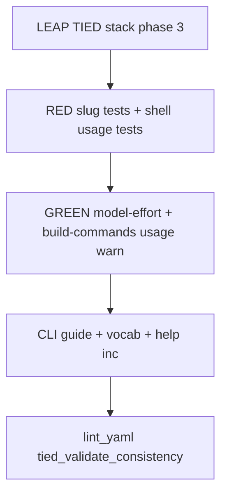

# PLAN — [REQ-WF_TRIAL_MODEL_EFFORT]

**Trial context:** store TIED repo (methodology); operator surface via `source scripts/build-commands.sh` after `./build-workspace.sh`.

**Phase 1:** build-plan complete (shell + Claude effort + Cursor diagnostic) — see [build-plan-verification-evidence.md](./evidence/build-plan-verification-evidence.md).

**Phase 2:** build-plan complete — Cursor bracket effort + argv parity (superseded by phase 3 root-cause fix).

**Phase 3:** refine-plan reopen — Cursor `agent` CLI **slug-tier** effort (not `[effort=…]` brackets) + **`workflow_trial_range`** operator docs/warnings in [`scripts/build-commands.sh`](../../../scripts/build-commands.sh).

**plan_phase:** `post-build` (phase 3)

**Request token:** `REQ-WF_TRIAL_MODEL_EFFORT`  
**Workflow:** refine-plan (phase 3) → **@build-plan** → @close-out

**Linked Cursor plan:** `cursor_agent_effort_slugs_b40812e4`

**profile_depth:** `minimal` · **gate_policy:** `advisory`

**CITDP (working draft):** [CITDP-REQ-WF_TRIAL_MODEL_EFFORT.draft.yaml](./CITDP-REQ-WF_TRIAL_MODEL_EFFORT.draft.yaml)

**Test strategy:** [test-strategy.md](./test-strategy.md)

**Tracker:** [checklist-tracker.yaml](./checklist-tracker.yaml)

---

## 1. Refine (Touchpoint 1 — RESOLVE) — phase 3

| Sponsor term | Resolved concept | Disposition |
| --- | --- | --- |
| Effort in API | **`output_config.effort`** on Anthropic Messages (`low` … `max`) | **Locked** (phase 1) |
| Entry shell | **`workflow_trial_range`** 4th positional; **`-`** = unset | **Locked** — signature unchanged; **phase 3** improves usage text + operator warnings |
| Claude harness | `--effort` + **`CLAUDE_CODE_EFFORT_LEVEL`** | **Locked** (phase 1) |
| Cursor effort on CLI | **`agent --model`** accepts **catalog slug** with hyphen tiers (`…-medium-fast`, `…-thinking-high`); rejects `slug[effort=…]` | **Locked (phase 3)** — agentstream rewrites slug; no bracket syntax |
| Bracket opt-out env | **`AGENTSTREAM_CURSOR_MODEL_BRACKET_EFFORT=0`** | **Locked** — keep name; doc = disable Cursor slug rewrite |
| Cursor slug tier | **`MODEL_SLUG`** provides base + optional existing tier/modifiers; **`MODEL_EFFORT`** replaces/inserts tier at argv build | **Locked (phase 3)** — supersedes “bracket additive” |
| Composer default | **`composer-2.5` / `composer-2.5-fast`** have **no** effort tiers in catalog | **Locked** — effort ignored + DIAGNOSTIC (agentstream + optional shell warn) |
| Middle modifiers | e.g. **`thinking`**, **`max`** between base id and effort tier in slug | **Locked** — preserve on rewrite |
| Cursor live batch | **`--approve-mcps`**, **`--add-dir`** | **Locked** (phase 2) — unchanged |

**Supersedes (phase 2):** **D-CURSOR-BRACKET**, **SC-CURSOR-BRACKET**, **SC-CURSOR-BRACKET-MERGE**, `AGENTSTREAM_CURSOR_MODEL_OVERRIDES` bracket merge for Cursor.

**Origin (phase 3):** Live `agent` error `Cannot use this model: composer-2.5[effort=medium]` — bracket form is Claude/API-style, not Cursor catalog ids.

**Ambiguity accepted:** Shell does not auto-pick tier-capable `MODEL_SLUG`; operators pass a slug family that supports tiers or accept DIAGNOSTIC for Composer.

---

## 2. Problem (evidence) — phase 3 delta

| Gap | After phase 2 | After phase 3 |
| --- | --- | --- |
| Cursor `--model` | `composer-2.5[effort=medium]` → **agent rejects** | `grok-4.7-medium-fast` style catalog slug |
| Operator entrypoint | `workflow_trial_range` usage silent on Cursor slug vs effort | Usage + CLI guide explain harness split; warn on composer + effort |
| Facilitator manifest | `model_effort` set but subprocess model invalid | Subprocess `--model` matches rewritten slug when tiers exist |

---

## 3. Reference baseline

| Field | Value |
| --- | --- |
| Range helper | [`workflow_trial_range`](../../../scripts/build-commands.sh) |
| CLI guide | [`scripts/_build_commands_cli_guide.inc.sh`](../../../scripts/_build_commands_cli_guide.inc.sh) `_how_smoke` |
| Four-phase | [`run-traditional-four-phase-agentstream.sh`](../../../scripts/run-traditional-four-phase-agentstream.sh) → `tied agentstream --model-effort` |
| Slug helper | [`model-effort.ts`](../../../mcp-server/packages/agentstream/src/model-effort.ts) `applyCursorModelForAgent` |
| Agent argv | [`executor-dry-run.ts`](../../../mcp-server/packages/agentstream/src/executor-dry-run.ts) `agentArgv` |

---

## 4. Scope — phase 3

### In scope

- **Agentstream:** slug rewrite in `model-effort.ts`; DEBUG string in `live-executor.ts`; unit tests (`model-effort.test.ts`, `cursor-agent-argv.test.ts`); oracles if argv changes
- **LEAP:** IMPL pseudo-code `CURSOR_APPLY_MODEL_SLUG_EFFORT`; ARCH/REQ **SC-CURSOR-SLUG**; vocab + agentstream README
- **`workflow_trial_range` in [`scripts/build-commands.sh`](../../../scripts/build-commands.sh):**
  - **Usage block** (zero-arg path): harness-specific effort note — Claude → `MODEL_EFFORT` → `--effort`; Cursor → `MODEL_EFFORT` → agentstream **slug tier rewrite** on `MODEL_SLUG` (not a 5th positional)
  - **Examples** in usage echo, e.g. `workflow_trial_range cursor gpt-5.6-luna-low-fast luna-low medium 1 1` and `workflow_trial_range claude … medium …`
  - **One-shot stderr `DIAGNOSTIC`** when `harness=cursor`, `effort≠-`, and `model_slug` matches `composer-2.5` prefix (effort will not change `--model`; pick a tier-capable slug)
  - Positional signature **unchanged** (breaking change already shipped in phase 1)
- **`_build_commands_cli_guide.inc.sh`:** extend smoke section line for `workflow_trial_range` with Cursor slug + effort example (closes optional how-topic from session handoff)
- **`wf-trial-agentstream-help.inc.sh`:** align batch-helper note with slug effort (cross-ref vocab)
- **Bootstrap tests:** extend `workflow-trial-agentstream-sh.test.mjs` only if new usage/diagnostic strings are stable contracts

### Out of scope

- Changing `workflow_trial_range` positional arity or default `model_slug`
- Auto-rewriting default `composer-2.5-fast` to a different catalog id when effort set
- Matrix rerun, `record-wf-trial` schema bump
- Full `agent` CLI surface

---

## 5. Locked decisions — phase 3

| ID | Decision | Rationale |
| --- | --- | --- |
| **D-CURSOR-SLUG** | Rewrite `MODEL_SLUG` tier when `modelEffort` set; preserve `thinking` / `-fast`; blocklist `composer-2.5*` | Matches live `agent` catalog |
| **D-CURSOR-SHELL-WARN** | `workflow_trial_range` emits one DIAGNOSTIC for cursor+composer+effort before loop | Fail-early operator clarity at matrix entry |
| **D-CURSOR-SHELL-USAGE** | Zero-arg usage documents harness split + tier-capable slug examples | Same helper operators already run with no args |
| **D-CURSOR-OPT-OUT** | `AGENTSTREAM_CURSOR_MODEL_BRACKET_EFFORT=0` → no slug rewrite | Reversible |
| **D-ORACLE-DELTA** | Refresh dry-run oracles if default cursor `command:` changes | Parity contract |

**Retained:** **D-EFFORT-ENUM**, **D-TAG-SUFFIX**, **D-CLAUDE-DUAL**, **D-CURSOR-APPROVE-MCPS**, **D-CURSOR-ADD-DIR**

---

## 6. Implementation sequence (build-plan phase 3)

| Step | Deliverable |
| --- | --- |
| 1 | LEAP REQ/ARCH/IMPL — slug effort; SC-CURSOR-SLUG |
| 2 | RED: `model-effort.test.ts`, `cursor-agent-argv.test.ts`; optional bootstrap usage/diagnostic case |
| 3 | GREEN: `applyCursorModelForAgent` slug algorithm; live DEBUG text |
| 4 | GREEN: `workflow_trial_range` usage + composer DIAGNOSTIC; `_build_commands_cli_guide.inc.sh` |
| 5 | Oracle refresh if needed; README + vocab + help inc |
| 6 | Verification evidence + `tied_validate_consistency` |

---

## 7. Acceptance criteria — phase 3

| ID | Verification |
| --- | --- |
| **SC-CURSOR-SLUG** | `agentArgv` cursor + `grok-4.7-low-fast` + `medium` → `--model` `grok-4.7-medium-fast` (no `[effort=`) |
| **SC-CURSOR-SLUG-MOD** | `claude-opus-5-thinking-high` + `max` → `claude-opus-5-thinking-max` |
| **SC-CURSOR-COMPOSER** | `composer-2.5-fast` + `medium` → slug unchanged; DIAGNOSTIC path |
| **SC-RANGE-USAGE** | `workflow_trial_range` (no args) stderr mentions Cursor slug effort + example tier-capable slug |
| **SC-RANGE-WARN** | `workflow_trial_range cursor composer-2.5-fast … medium …` prints composer DIAGNOSTIC once |
| **SC-PHASE1-2-REGRESS** | Claude `--effort`, approve-mcps, add-dir, bootstrap green |

---

## 8. Files touched (phase 3)

| File | Change |
| --- | --- |
| `mcp-server/packages/agentstream/src/model-effort.ts` | slug rewrite replaces bracket |
| `live-executor.ts`, `executor-dry-run.ts` | DEBUG / wire unchanged |
| `model-effort.test.ts`, `cursor-agent-argv.test.ts` | slug cases |
| **`scripts/build-commands.sh`** | **`workflow_trial_range` usage + diagnostic** |
| `scripts/_build_commands_cli_guide.inc.sh` | smoke examples |
| `scripts/lib/wf-trial-agentstream-help.inc.sh` | batch note |
| `tools/bootstrap/workflow-trial-agentstream-sh.test.mjs` | optional usage/diagnostic assertions |
| TIED REQ/ARCH/IMPL + vocab + README | LEAP |

---

## 9. Risk / consequence ladder — phase 3

| Choice | Ladder | Notes |
| --- | --- | --- |
| Slug rewrite vs bracket | **Reversible** | Wrong tier mapping fixed in unit tests |
| Shell composer WARN | **Reversible** | stderr only; does not block run |
| Usage text expansion | **Reversible** | May require bootstrap oracle substring update |
| LEAP SC rename | **Costly** review | Same REQ token |

---

## 10. Handoff

**Do next:** **`@close-out`** — CITDP persist, CHANGELOG, optional live matrix smoke.

**Changelog**

| Date | Prompt | Summary |
| --- | --- | --- |
| 2026-11-09 | add-feature | Phase 1 PLAN |
| 2026-11-09 | refine-plan | Phase 1 locked decisions |
| 2026-11-09 | build-plan | Phase 1 implementation |
| 2026-11-09 | refine-plan | Phase 2: Cursor CLI bracket effort + argv parity |
| 2026-11-09 | build-plan | Phase 2 implementation |
| 2026-11-09 | refine-plan | Phase 3: Cursor slug effort + `workflow_trial_range` operator surface |
