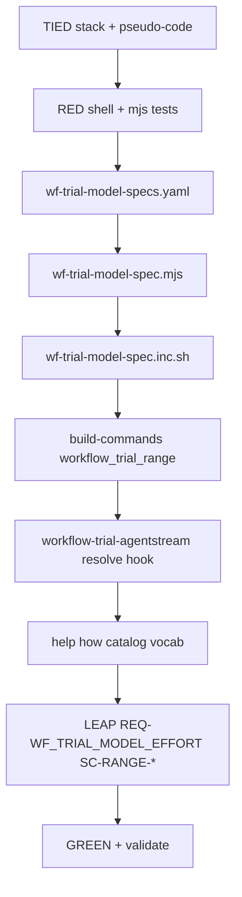

# PLAN — [REQ-WF_TRIAL_MODEL_SPEC_CLI] (refine-plan)

**Status:** build-plan complete  
**Workflow:** add-feature → refine-plan → **build-plan** → @close-out  
**Request token:** `REQ-WF_TRIAL_MODEL_SPEC_CLI`  
**plan_phase:** `build-complete`  
**profile_depth:** `minimal` · **gate_policy:** `advisory`

**Origin:** Sponsor matrix entry duplicated slug + config (`workflow_trial_range cursor gpt-5.6-luna-low-fast luna-low medium 2 2`). Target: `workflow_trial_range cursor luna-low medium 2 2`.

**CITDP (working draft):** [CITDP-REQ-WF_TRIAL_MODEL_SPEC_CLI.yaml](./CITDP-REQ-WF_TRIAL_MODEL_SPEC_CLI.yaml)  
**Test strategy:** [test-strategy.md](./test-strategy.md)  
**Tracker:** [checklist-tracker.yaml](./checklist-tracker.yaml)

**Normative naming (read-only refs):**

- [docs/demos/catalog-traditional-workflow-trial-prompts.md](../../../docs/demos/catalog-traditional-workflow-trial-prompts.md) — Model configurations
- [docs/demos/traditional-workflow-trial-runs-registry.md](../../../docs/demos/traditional-workflow-trial-runs-registry.md) — disposable `modelBucket`
- [tools/bundled-record-wf-trial-skill/reference.md](../../../tools/bundled-record-wf-trial-skill/reference.md) — readout filename slug

---

## 1. Refine (Touchpoint 1 — RESOLVE) — closed

| Sponsor term | Resolved concept | Disposition |
| --- | --- | --- |
| **Config id** | Single catalog key (`luna-low`, `composer-2.5`, …) replacing paired SLUG+CONFIG positionals | **Locked** |
| **Model slug** | Harness-specific agent catalog id derived from registry (`cursor_slug` / `claude_slug`) | **Locked** |
| **Model config** | Facilitator `MODEL_CONFIG` / PLAN header / `record-wf-trial --model-config` | **Locked** — equals registry `model_config` field |
| **modelBucket** | Disposable tag suffix — unchanged rule: normalize `MODEL_CONFIG` first ([REQ-WF_TRIAL_AGENTSTREAM_DISPOSABLE_TAG](../../../requirements/REQ-WF_TRIAL_AGENTSTREAM_DISPOSABLE_TAG.yaml)) | **Locked** |
| **Effort** | Still 3rd positional after config id; tier rewrite stays in agentstream ([REQ-WF_TRIAL_MODEL_EFFORT](../../../requirements/REQ-WF_TRIAL_MODEL_EFFORT.yaml)) | **Locked** |
| **6-arg legacy** | Removed (sponsor chose **replace**, not alias) | **Locked — costly** |
| **Ad-hoc slug** | `MODEL_SLUG` + `MODEL_CONFIG` env override without config id — still allowed on `workflow_trial_agentstream` | **Locked** |

### Claude matrix (locked)

| Config id | `model_config` | `cursor_slug` | `claude_slug` | Harness notes |
| --- | --- | --- | --- | --- |
| `composer-2.5` | `composer-2.5` | `composer-2.5-fast` | `claude-haiku-5-5` | Cross-harness parity cell (Composer vs Haiku) |
| `luna-low` | `luna-low` | `gpt-5.6-luna-low-fast` | — | **Cursor-only** — resolver errors if `HARNESS=claude` |
| `luna-med` | `luna-med` | `gpt-5.6-luna-med-fast` | — | Cursor-only |
| `luna-high` | `luna-high` | `gpt-5.6-luna-high-fast` | — | Cursor-only |
| `grok47-med` | `grok47-med` | `grok-4.7-medium-fast` | — | Cursor-only |
| `claude-sonnet-5-5` | `claude-sonnet-5-5` | — | `claude-sonnet-5-5` | **Claude-only** — Sonnet matrix per [runs registry](../../../docs/demos/traditional-workflow-trial-runs-registry.md) |

**Deferred:** `claude-haiku-5-5` as a standalone config id (use `composer-2.5` on Claude harness instead). **Catalog table extension** in build-plan: add `claude-sonnet-5-5` row + link to registry YAML.

---

## 2. Problem (evidence)

| Gap | Today | After change |
| --- | --- | --- |
| Matrix CLI | `HARNESS SLUG CONFIG EFFORT END START` — two names per cell | `HARNESS CONFIG_ID EFFORT END START` |
| Operator error | Slug/config drift breaks tags and readouts | One id → composed `MODEL_SLUG` + `MODEL_CONFIG` |
| Discoverability | Slugs only in examples and handoffs | Registry YAML + help/`how` cite config ids |
| Orchestrator | Defaults `MODEL_SLUG` / `MODEL_CONFIG` disagree (`composer-2.5-fast` vs `composer-2.5`) | Optional resolve when `WF_TRIAL_CONFIG_ID` or bare catalog id set |

**Sponsor exemplar:**

```bash
# before
workflow_trial_range cursor gpt-5.6-luna-low-fast luna-low medium 2 2
# after
workflow_trial_range cursor luna-low medium 2 2
```

---

## 3. Reference baseline

| Field | Value |
| --- | --- |
| Range helper | [`workflow_trial_range`](../../../scripts/build-commands.sh) |
| Disposable tag | [`scripts/lib/wf-trial-disposable-tag.inc.sh`](../../../scripts/lib/wf-trial-disposable-tag.inc.sh) |
| Operator help | [`scripts/lib/wf-trial-agentstream-help.inc.sh`](../../../scripts/lib/wf-trial-agentstream-help.inc.sh) |
| Tests | [`tools/bootstrap/workflow-trial-agentstream-sh.test.mjs`](../../../tools/bootstrap/workflow-trial-agentstream-sh.test.mjs) |
| Effort (unchanged) | [`mcp-server/packages/agentstream/src/model-effort.ts`](../../../mcp-server/packages/agentstream/src/model-effort.ts) |

---

## 4. Scope

### In scope

- **Registry:** [`docs/demos/wf-trial-model-specs.yaml`](../../../docs/demos/wf-trial-model-specs.yaml) (`schema: wf-trial-model-spec.v1`)
- **Resolver:** [`tools/bootstrap/lib/wf-trial-model-spec.mjs`](../../../tools/bootstrap/lib/wf-trial-model-spec.mjs) + [`scripts/lib/wf-trial-model-spec.inc.sh`](../../../scripts/lib/wf-trial-model-spec.inc.sh)
- **5-arg** `workflow_trial_range`; zero-arg usage + examples
- **Orchestrator:** resolve config id before defaults when `MODEL_CONFIG` looks like a registry id (no `/`, matches known key) or `WF_TRIAL_CONFIG_ID` set
- Help, `how`, catalog cross-link, vocab **RECORD**
- **LEAP:** Update [REQ-WF_TRIAL_MODEL_EFFORT](../../../requirements/REQ-WF_TRIAL_MODEL_EFFORT.yaml) `SC-RANGE-SIG` / usage criteria to describe 5-arg form (supersedes 6-arg wording)
- Bootstrap tests + new `wf-trial-model-spec.test.mjs`

### Out of scope

- Flag-based CLI (`--config`, `--from`/`--to`)
- Auto-sync registry from runs table
- `record-wf-trial` slug derivation changes (already uses `model_config` from PLAN/manifest)
- Agentstream slug rewrite logic

---

## 5. Locked decisions

| ID | Decision | Rationale |
| --- | --- | --- |
| **D-SPEC-REGISTRY** | Single YAML registry is source of truth for matrix cells | Matches catalog Model configurations |
| **D-SPEC-ARITY-5** | `HARNESS CONFIG_ID EFFORT END START [MONIT]` only | Sponsor replace — no 6-arg detection |
| **D-SPEC-NODE-RESOLVE** | Node parses registry; bash inc shells out | Testable; avoids yq in hot path |
| **D-SPEC-FAIL-CLOSED** | Unknown id or harness gap → exit before WF loop | Prevents silent wrong cell |
| **D-SPEC-CURSOR-ONLY-LUNA** | Luna/Grok ids reject `claude` harness | No invented Claude slug |
| **D-SPEC-COMPOSER-PARITY** | `composer-2.5` maps to Haiku on Claude harness | Recorded trial convention |
| **D-SPEC-SONNET-ID** | `claude-sonnet-5-5` config id for Claude-only matrix | Registry sonnet rows |
| **D-SPEC-ENV-ESCAPE** | Raw `MODEL_SLUG`+`MODEL_CONFIG` env still wins over id | Ad-hoc experiments |
| **D-CURSOR-SHELL-WARN** | Retain composer+effort DIAGNOSTIC (now `workflow_trial_range cursor composer-2.5 medium 1 1`) | [REQ-WF_TRIAL_MODEL_EFFORT](../../../requirements/REQ-WF_TRIAL_MODEL_EFFORT.yaml) |

**Costly choice:** Breaking every script/docs line using 6-arg form — grep-listed in build-plan migration checklist.

---

## 6. Registry schema (normative)

```yaml
schema: wf-trial-model-spec.v1
specs:
  luna-low:
    model_config: luna-low
    cursor_slug: gpt-5.6-luna-low-fast
  # … per §1 table
```

Resolver output (stdout JSON for bash): `{ "model_config", "model_slug", "config_id" }`.

---

## 7. Implementation sequence (build-plan)



| Step | Artifact |
| --- | --- |
| 1 | IMPL pseudo-code validate |
| 2 | RED: `wf-trial-model-spec.test.mjs`; extend `workflow-trial-agentstream-sh.test.mjs` |
| 3 | Registry + resolver + inc + range + orchestrator hook |
| 4 | Docs + LEAP sibling REQ criteria |
| 5 | `node --test` batteries; `lint_yaml`; `tied_validate_consistency` |

---

## 8. Satisfaction criteria (REQ summary)

| ID | Check |
| --- | --- |
| **SC-SPEC-RESOLVE** | `workflow_trial_range cursor luna-low - 2 2` with `echo_exec` dry-run exports `MODEL_CONFIG=luna-low`, `MODEL_SLUG=gpt-5.6-luna-low-fast` |
| **SC-SPEC-UNKNOWN** | Unknown config id → non-zero before loop |
| **SC-SPEC-HARNESS** | `workflow_trial_range claude luna-low …` errors |
| **SC-SPEC-CLAUDE-SONNET** | `claude claude-sonnet-5-5` resolves slug |
| **SC-SPEC-USAGE** | Zero-arg usage documents 5-arg + `luna-low medium 2 2` example |
| **SC-SPEC-REGISTRY** | `node --test tools/bootstrap/lib/wf-trial-model-spec.test.mjs` green |

---

## 9. Migration (build-plan grep)

Update call sites (non-exhaustive; re-grep at build):

- [`scripts/build-commands.sh`](../../../scripts/build-commands.sh)
- [`scripts/lib/wf-trial-agentstream-help.inc.sh`](../../../scripts/lib/wf-trial-agentstream-help.inc.sh)
- [`scripts/_build_commands_cli_guide.inc.sh`](../../../scripts/_build_commands_cli_guide.inc.sh)
- [`tools/bootstrap/workflow-trial-agentstream-sh.test.mjs`](../../../tools/bootstrap/workflow-trial-agentstream-sh.test.mjs)
- [`tied-project/vocab/agentstream.md`](../../vocab/agentstream.md)
- [`tied-project/working/REQ-WF_TRIAL_MODEL_EFFORT/`](../../REQ-WF_TRIAL_MODEL_EFFORT/) evidence examples (historical note only)

---

## 10. Changelog

| Date | Phase | Note |
| --- | --- | --- |
| 2026-11-09 | refine-plan | Locked registry + 5-arg CLI; Claude sonnet id; cursor-only Luna/Grok |
