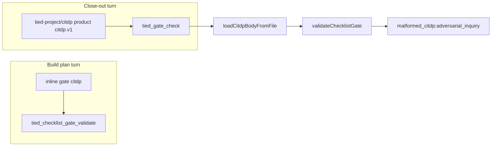

# PLAN — REQ-WF_TRIAL_PRODUCT_CITDP_GATE_HYDRATION

**Status:** close-out verification complete · `plan_phase: close_out` · **traceable-commit deferred** (sponsor commit when requested)  
**Request token:** `REQ-WF_TRIAL_PRODUCT_CITDP_GATE_HYDRATION`  
**profile_depth:** `minimal` · **gate_policy:** `advisory`  
**Parent gap:** Live clients `1794984015` / `1794981051` (WF-01 Haiku low) — path-based `tied_gate_check` + product `citdp.v1` → `malformed_citdp:adversarial_inquiry` while inline gate-shaped CITDP passes ([MPGW replay](../REQ-WF_TRIAL_MINIMAL_PROGRESSION_GATE_WAIVER/evidence/sc-mpgw-07-live-replay.md); fixture [1794984015](./evidence/fixture-live-gate-1794984015.md)).  
**Cursor plan:** [product_citdp_gate_hydration_fa5eaad0.plan.md](../../../../.cursor/plans/product_citdp_gate_hydration_fa5eaad0.plan.md)

**CITDP:** [CITDP-REQ-WF_TRIAL_PRODUCT_CITDP_GATE_HYDRATION.yaml](../../citdp/CITDP-REQ-WF_TRIAL_PRODUCT_CITDP_GATE_HYDRATION.yaml)  
**Test strategy:** [test-strategy.md](./test-strategy.md)  
**Tracker:** [checklist-tracker.yaml](./checklist-tracker.yaml)

**Depends on:** [REQ-WF_TRIAL_MINIMAL_PROGRESSION_GATE_WAIVER](../../requirements/REQ-WF_TRIAL_MINIMAL_PROGRESSION_GATE_WAIVER.yaml), [REQ-WF_TRIAL_DISPOSABLE_CLOSEOUT_READINESS](../REQ-WF_TRIAL_DISPOSABLE_CLOSEOUT_READINESS/PLAN.md), [REQ-TIED_DAE_INCORPORATION](../../requirements/REQ-TIED_DAE_INCORPORATION.yaml), [REQ-CLAUDE_WF03_LIVE_MATRIX_GAPS](../REQ-CLAUDE_WF03_LIVE_MATRIX_GAPS/PLAN.md)

---

## 1. Refine — locked decisions (RESOLVE)

| # | Term | Resolution |
| --- | --- | --- |
| R1 | **Validation-only hydration** | Shallow in-memory clone for gate evaluation; **no** silent on-disk product CITDP rewrite. |
| R2 | **Predicate** | If `adversarialSection(citdp)` already present (same shapes as `checklist-validator.ts`), hydration **no-op**. |
| R3 | **Synthesis** | When `profile_depth` is `minimal` **or** `strict_candidate`, inject `risk_analysis.adversarial_inquiry: { depth_tier, gate_policy }` from `citdp.gate_policy` and tracker `execution_profile` / top-level `gate_policy` (default `advisory`). |
| R4 | **Fail closed** | `profile_depth: integrated` or **missing** `profile_depth` on product record → **no** synthesis; validator keeps `malformed_citdp`. |
| R5 | **Primary choke point** | `runGateCheckComposition` after `loadCitdpBodyFromFile`, before `callGateValidate`. |
| R6 | **`citdp_path` MCP (v1)** | **Yes** — `tied_checklist_gate_validate` accepts optional `citdp_path`; load + hydrate when inline `citdp` omitted; **error** if both `citdp` and `citdp_path` set. |
| R7 | **Reasons** | When gate `allowed: false` and MCP returns diagnostics, map them into `tied_gate_check` `reasons` (not bare `gate_blocked`). **`gateReasonsFromValidateResult`** in `gate-check-composition.ts` (not a separate `gate-check-mcp.ts` edit). |
| R8 | **Receipt hashes** | Persisted gate receipts hash the **hydrated** citdp the validator saw. |
| R9 | **Shared predicate** | `mcp-server/src/citdp-adversarial-shape.ts` — shared with `citdp-envelope-context.ts` and hydration module. |
| R10 | **Non-goals** | No `citdp_record_write` product schema change; no envelope `depthFromRecord` LEAP in this REQ. |

### Open items resolved (refine)

| # | Topic | Resolution |
| --- | --- | --- |
| O1 | `citdp_path` on `tied_checklist_gate_validate` in v1? | **Yes** (R6). |
| O2 | `strict_candidate` hydrate like minimal? | **Yes** (R3). |
| O3 | Shared `adversarialSection` vs duplicate? | **Extract shared** (R9). |
| O4 | SC-CGH-06 live cell | **Primary 1794984015**; 1794981051 remains MPGW cross-check only. |

### Costly choices (accepted)

- Hydration is **synthetic** adversarial metadata for gates only — auditors must read on-disk product CITDP + receipt to see hydrated view.
- `integrated` product files without adversarial sections **stay broken** at path-based gates until authors add checklist-shaped sections (intentional fail-closed).

---

## 2. Problem

`gate-check-composition.ts` loads the inner CITDP body and passes it to validation with **no** bridging. `citdp-writer.ts` skips open-record validation when the record lacks `risk_analysis` / `adversarial_inquiry`, so product files persist legally but break path-based gates.

**MPGW relationship:** MPGW waives four list fields when `depth_tier: minimal` and tracker stub present. **CGH** supplies `depth_tier` visibility for **`tied_gate_check`** using **`tied-project/citdp/CITDP-{product}.yaml`**. Both are required for WF-01 close-out parity with inline gate CITDP.

---

## 3. Build surface (shipped)

| Module | Status |
| --- | --- |
| `mcp-server/src/citdp-adversarial-shape.ts` | **done** |
| `mcp-server/src/dae/citdp-gate-hydration.ts` | **done** |
| `mcp-server/src/dae/gate-check-composition.ts` | **done** — hydrate + `gateReasonsFromValidateResult` |
| `mcp-server/src/tools/index.ts` | **done** — `citdp_path`; hydrate on inline `citdp` too |
| `citdp-envelope-context.ts` | **done** — import shared shape |
| Tests | **done** — `citdp-gate-hydration.test.ts`, `tied-gate-check-mcp.test.ts` |
| Docs | **done** — `wf-trial-four-phase-close-out-playbook.md` |

### Build notes (post-refine LEAP)

- **Double hydrate:** `tied_gate_check` hydrates in composition, then `tied_checklist_gate_validate` hydrates again on inline body — second pass is **no-op** when adversarial already present (accepted).
- **SC-CGH-06:** Fixture replay via [evidence/sc-cgh-06-replay.mjs](./evidence/sc-cgh-06-replay.mjs) + [sc-cgh-06-live-replay.md](./evidence/sc-cgh-06-live-replay.md); optional live client `1794984015` under `/Users/fareed/Documents/dev/test/…` (read-only).
- **Out of scope (unchanged):** Live WF-01 matrix re-run for product proof — store bootstrap + frozen fixtures suffice for methodology REQ close-out.

---

## 4. Acceptance (REQ)

| SC | Summary |
| --- | --- |
| SC-CGH-01 | Product `citdp.v1` minimal + waiver tracker → `tied_gate_check` **verification** `allowed: true` |
| SC-CGH-02 | Same → **close_out** `allowed: true` with MPGW list waiver |
| SC-CGH-03 | Checklist CITDP with existing adversarial → hydration no-op |
| SC-CGH-04 | `profile_depth: integrated` without adversarial → still `malformed_citdp` |
| SC-CGH-05 | Gate failure returns **reasons** with diagnostics, not only `gate_blocked` |
| SC-CGH-06 | Live replay **1794984015** paths + store dist → verification/close_out `allowed: true` |

---

## Do next

**Sponsor traceable-commit** when requested — scope per [evidence/traceable-commit-evidence.md](./evidence/traceable-commit-evidence.md) and [evidence/proposed-commit-message.txt](./evidence/proposed-commit-message.txt).