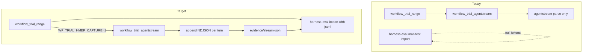
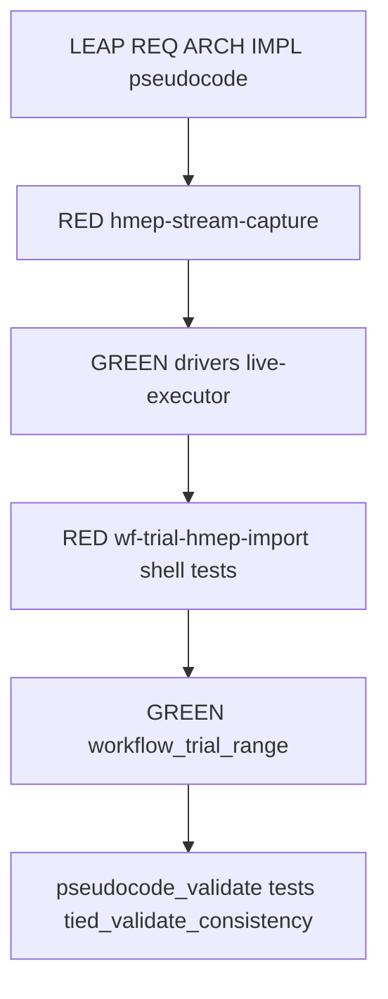

# PLAN — [REQ-WF_TRIAL_RANGE_HMEP_AUTO_INGEST]

**Trial context:** store TIED repo; operator surface via `source scripts/build-commands.sh`.

**plan_phase:** `post-build`

**Request token:** `REQ-WF_TRIAL_RANGE_HMEP_AUTO_INGEST`  
**Workflow:** add-feature → **refine-plan** → **@build-plan** → @close-out

**profile_depth:** `minimal` · **gate_policy:** `advisory`

**Composes with:** [REQ-TIED_HARNESS_MODEL_EVAL_PLATFORM](../../requirements/REQ-TIED_HARNESS_MODEL_EVAL_PLATFORM.yaml) · [REQ-WF_TRIAL_ORCHESTRATOR_PROCESS_LOG](../../requirements/REQ-WF_TRIAL_ORCHESTRATOR_PROCESS_LOG.yaml) · [REQ-GOAGENT-AGENT-EXECUTOR](../../requirements/REQ-GOAGENT-AGENT-EXECUTOR.yaml)

**CITDP:** [CITDP-REQ-WF_TRIAL_RANGE_HMEP_AUTO_INGEST.yaml](./CITDP-REQ-WF_TRIAL_RANGE_HMEP_AUTO_INGEST.yaml)  
**Test strategy:** [test-strategy.md](./test-strategy.md)  
**Tracker:** [checklist-tracker.yaml](./checklist-tracker.yaml)

**Origin:** `/debug` — `workflow_trial_range claude haiku-5-5 low 9 9` → manifest-only HMEP import; null `harness_estimated_cost` ([harness-eval-import.md](../../working/FACILITATOR-WF-09-1794579829-wf-agentstream-wf-09-claude-claudehaiku55low/evidence/harness-eval-import.md)).

---

## 1. Refine (Touchpoint 1 — RESOLVE)

| Sponsor term | Resolved concept | Disposition |
| --- | --- | --- |
| Price / utilization on range runs | **HMEP** token + **list-price** via `harness-eval events import` + `--jsonl` | **Locked** |
| Matrix entry | **`workflow_trial_range`** only (not single-cell default) | **Locked** (sponsor) |
| Capture default | **`WF_TRIAL_HMEP_CAPTURE=1`** exported by range | **Locked** |
| Opt-out | **`WF_TRIAL_SKIP_HMEP_CAPTURE=1`** | **Locked** |
| Import when four-phase fails | Post-cell import **still runs** (partial metrics) | **Locked** (sponsor) |
| Import failure | **Soft-fail** unless **`WF_TRIAL_STRICT_HMEP_IMPORT=1`** | **Locked** |
| Capture files | `{workspace}/tied-project/working/wf-trial-orchestrator-run/evidence/stream-json/turn-{NNN}.jsonl` | **Locked** |
| Env read in agentstream | **`WF_TRIAL_HMEP_CAPTURE`** primary; alias **`AGENTSTREAM_HMEP_STREAM_CAPTURE`** for parity with other `AGENTSTREAM_*` toggles | **Locked** |
| HMEP trace | **`AGENTSTREAM_HARNESS_TRACE`** remains separate (turn metadata, not billing NDJSON) | **Locked** — no merge |

**Ambiguity accepted:** Parallel range jobs sharing one `TIED_TEST_ROOT` and tag pattern are unsupported; **newest matching directory** wins.

---

## 2. Problem / desired (CITDP spine)

**Unchanged:** `workflow_trial_agentstream` without range parent; `@record-wf-trial` proof boundary ([harness-model-eval.md](../../vocab/harness-model-eval.md) § proof boundary).

---

## 3. Reference baseline

| Field | Value |
| --- | --- |
| Range helper | [`workflow_trial_range`](../../../scripts/build-commands.sh) |
| Orchestrator | [`workflow-trial-agentstream.sh`](../../../scripts/workflow-trial-agentstream.sh) |
| Process log | [`wf-trial-process-log.inc.sh`](../../../scripts/lib/wf-trial-process-log.inc.sh) → manifest `workspace` |
| Disposable tag | [`wf-trial-disposable-tag.inc.sh`](../../../scripts/lib/wf-trial-disposable-tag.inc.sh) |
| Cursor subprocess | [`executor-run.ts`](../../../mcp-server/packages/agentstream/src/executor-run.ts) `runAgent` |
| Claude subprocess | [`claude-driver.ts`](../../../mcp-server/packages/agentstream/src/claude-driver.ts) `collectClaudeStreamFromSpawn` |
| Turn loop | [`live-executor.ts`](../../../mcp-server/packages/agentstream/src/live-executor.ts) `turnIndex: cfg.firstTurn + i` |
| Trace pattern (mirror) | [`harness-turn-trace.ts`](../../../mcp-server/packages/agentstream/src/harness-turn-trace.ts) |
| HMEP import | [`import-wf.ts`](../../../mcp-server/packages/harness-eval/src/runner/import-wf.ts) |
| Operator capture doc | [stream-json-capture-import.md](../REQ-TIED_HARNESS_MODEL_EVAL_PLATFORM/evidence/stream-json-capture-import.md) |

---

## 4. Scope

### In scope

- **`hmep-stream-capture.ts`:** enablement, path resolve, per-turn file append (sync appendFile or write stream; fail-soft log to stderr).
- **Driver wiring:** each NDJSON stdout line in `runAgent` / `collectClaudeStreamFromSpawn` → `appendHmepStreamLine(workspace, turnIndex, line)` when enabled.
- **`live-executor.ts`:** pass `turnIndex` + `workspace` into driver options on every `runTurn` (including retries — **same turn file** for retry attempts, or suffix `-attempt-N`; **locked:** single file per turn index, append all attempts).
- **`wf-trial-hmep-import.inc.sh`:** `wf_trial_resolve_latest_client_for_tag`, `wf_trial_hmep_import_cell`, glob `stream-json/*.jsonl`.
- **`workflow_trial_range`:** export capture env; after each cell call import helper (even on non-zero orchestrator exit).
- **Tests + vocab + CLI guide** per [test-strategy.md](./test-strategy.md).
- **LEAP:** `REQ-WF_TRIAL_RANGE_HMEP_AUTO_INGEST`, `ARCH-*`, `IMPL-*`, pseudocode sidecar blocks.

### Out of scope

- `importWfClient` auto-discovery without `--jsonl`
- Default-on for lone `workflow_trial_agentstream`
- Copy to `HARNESS_EVAL_STORE/raw/` (import uses client paths)
- Billing ledger / M3 reconcile automation
- Retroactive capture for client `1794579829-…`

---

## 5. Locked decisions

| ID | Decision |
| --- | --- |
| **D-WRH-CAPTURE-ENV** | `WF_TRIAL_HMEP_CAPTURE=1` set only in `workflow_trial_range` unless operator exports manually |
| **D-WRH-CAPTURE-PATH** | Fixed relative dir under orchestrator evidence: `stream-json/turn-%03d.jsonl` |
| **D-WRH-IMPORT-SOFT** | Import errors log `DIAGNOSTIC` and continue range unless `WF_TRIAL_STRICT_HMEP_IMPORT=1` |
| **D-WRH-CLIENT-RESOLVE** | `ls -td "${TEST_ROOT}"/*-${disposable_tag}` → head -1 |
| **D-WRH-CLAUDE-MERGE** | Multiple `--jsonl` files → HMEP `mergeClaudeCumulativeSnapshots` max across per-file snapshots (SC-HMEP-M1-02) |
| **D-WRH-CURSOR-NULL** | Cursor capture allowed but may yield `observations_inserted=0`; no fabrication |
| **D-WRH-HARNESS-EVAL-BIN** | Use `harness_eval` from build-commands when `dist/cli/main.js` exists; else DIAGNOSTIC skip |

---

## 6. Satisfaction criteria

| ID | Criterion |
| --- | --- |
| SC-WRH-01 | Capture on → ≥1 `turn-*.jsonl` under client `stream-json/` after live subprocess |
| SC-WRH-02 | `workflow_trial_range` sets capture env and invokes import helper after each cell |
| SC-WRH-03 | Claude fixture/live JSONL with `type:result`+`usage` → `observations_inserted≥1`, pricing applied when catalog matches |
| SC-WRH-04 | `WF_TRIAL_SKIP_HMEP_CAPTURE=1` → no capture files, no import DIAGNOSTIC |
| SC-WRH-05 | Single-cell `workflow_trial_agentstream` without parent export → capture off |
| SC-WRH-06 | Orchestrator exit ≠ 0 → import still attempted when client dir exists |

---

## 7. IMPL pseudo-code (draft for sidecar @build-plan)

### WF_TRIAL_HMEP_CAPTURE_ENABLED

- [REQ-WF_TRIAL_RANGE_HMEP_AUTO_INGEST] [ARCH-WF_TRIAL_RANGE_HMEP_AUTO_INGEST] [IMPL-WF_TRIAL_RANGE_HMEP_AUTO_INGEST]
- PRE: process env readable
- POST: boolean true when `WF_TRIAL_HMEP_CAPTURE` or `AGENTSTREAM_HMEP_STREAM_CAPTURE` is `1`/`true` and skip env unset

### RESOLVE_HMEP_STREAM_JSON_PATH

- [REQ-WF_TRIAL_RANGE_HMEP_AUTO_INGEST] [IMPL-WF_TRIAL_RANGE_HMEP_AUTO_INGEST] composes REQ-WF_TRIAL_ORCHESTRATOR_PROCESS_LOG
- INPUT: `workspace` absolute, `turnIndex` integer ≥ 1
- OUTPUT: absolute path `…/wf-trial-orchestrator-run/evidence/stream-json/turn-{turnIndex:03d}.jsonl`
- EFFECTS: `mkdir -p` parent on first write

### APPEND_HMEP_STREAM_JSON_LINE

- [REQ-WF_TRIAL_RANGE_HMEP_AUTO_INGEST] [REQ-GOAGENT-AGENT-EXECUTOR]
- PRE: capture enabled; `line` non-empty trimmed NDJSON
- POST: line appended with newline; failures → stderr `DIAGNOSTIC` only (no throw)

### WF_TRIAL_RANGE_HMEP_IMPORT_CELL

- [REQ-WF_TRIAL_RANGE_HMEP_AUTO_INGEST] [REQ-TIED_HARNESS_MODEL_EVAL_PLATFORM] SC-HMEP-M1-06
- INPUT: `wf_id`, `harness`, `model_config`, `model_slug`, `model_effort`
- DATA: `disposable_tag` from `build_wf_trial_disposable_tag`; `client_root` newest `*-${tag}` under `TIED_TEST_ROOT`
- CONTROL: skip entire block when skip capture env set
- POST: `harness-eval events import` with all existing `stream-json/*.jsonl`; emit `DIAGNOSTIC: hmep_import observations_inserted=N`
- FAILURE_MODES: missing client → DIAGNOSTIC; missing harness-eval dist → DIAGNOSTIC; strict env → propagate CLI exit

---

## 8. Implementation sequence (@build-plan)

| Step | Work |
| --- | --- |
| 1 | MCP/script: mint tokens; `pseudocode_validate` |
| 2 | RED/GREEN agentstream capture module + driver hooks |
| 3 | RED/GREEN `wf-trial-hmep-import.inc.sh` + `build-commands.sh` range loop |
| 4 | Vocab, CLI guide, harness-eval README blurb |
| 5 | Verification manifest in `evidence/` |

---

## 9. Risks (refined)

| Risk | Mitigation |
| --- | --- |
| Large NDJSON disk per range batch | Opt-out env; files live only on disposable clients |
| Wrong client picked (stale tag) | Use newest mtime; document no parallel same-tag |
| harness-eval not built | DIAGNOSTIC + skip (D-WRH-HARNESS-EVAL-BIN) |
| Cursor null tokens despite capture | SC-WRH-03 scoped to Claude; document Cursor limitation |

**Adversarial inquiry:** N/A at minimal depth — [evidence/sub-adversarial-inquiry-pass-na.md](./evidence/sub-adversarial-inquiry-pass-na.md).

---

## Do next

**@close-out** — traceable commit when sponsor ready. Verification: [evidence/build-plan-verification-evidence.md](./evidence/build-plan-verification-evidence.md).
