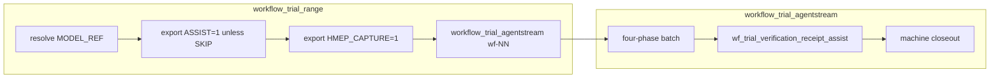

# PLAN — REQ-WF_TRIAL_RANGE_VERIFICATION_RECEIPT_ASSIST

**Status:** close-out committed · **`plan_phase: close-out-committed`**  
**Workflow:** add-feature → **refine-plan** → **`@build-plan`** → `@close-out`  
**Request token:** `REQ-WF_TRIAL_RANGE_VERIFICATION_RECEIPT_ASSIST`  
**profile_depth:** `minimal` · **gate_policy:** `advisory`

**Origin:** Sponsor `/add-feature` — practical recommendation from VRCS operator thread (no manual `WF_TRIAL_VERIFICATION_RECEIPT_ASSIST=1` on matrix runs).

**Cursor plan:** [range_receipt_assist_default_2b9de1ca.plan.md](../../../../.cursor/plans/range_receipt_assist_default_2b9de1ca.plan.md)

**Composes with:**

- [REQ-WF_TRIAL_VERIFICATION_RECEIPT_CLOSEOUT_SYNC](../../requirements/REQ-WF_TRIAL_VERIFICATION_RECEIPT_CLOSEOUT_SYNC.yaml) — post-batch assist hook (orchestrator; assist **default off** on single-cell)
- [REQ-WF_TRIAL_RANGE_HMEP_AUTO_INGGEST](../../requirements/REQ-WF_TRIAL_RANGE_HMEP_AUTO_INGEST.yaml) — **pattern twin** (range-only default env + skip hatch)
- [REQ-WF_TRIAL_DISPOSABLE_CLOSEOUT_READINESS](../../requirements/REQ-WF_TRIAL_DISPOSABLE_CLOSEOUT_READINESS.yaml) — machine closeout unchanged

**CITDP:** [CITDP-REQ-WF_TRIAL_RANGE_VERIFICATION_RECEIPT_ASSIST.yaml](./CITDP-REQ-WF_TRIAL_RANGE_VERIFICATION_RECEIPT_ASSIST.yaml)  
**Test strategy:** [test-strategy.md](./test-strategy.md)  
**Tracker:** [checklist-tracker.yaml](./checklist-tracker.yaml)

**Prerequisite:** VRCS shell (`wf-trial-verification-receipt-assist.inc.sh`, orchestrator hook) present in store before assist export is meaningful; may close in same commit wave as WVR.

---

## 1. Refine — locked decisions (RESOLVE)

| # | Term | Resolution |
| --- | --- | --- |
| R1 | **Scope surface** | Only [`workflow_trial_range`](../../../scripts/build-commands.sh) sets default; **not** orchestrator-wide (VRCS non-goal: orchestrator default-on assist **unchanged**) |
| R2 | **Default** | Before the `for` loop: unless skip, **`export WF_TRIAL_VERIFICATION_RECEIPT_ASSIST=1`** (unconditional override style matching `WF_TRIAL_HMEP_CAPTURE`) |
| R3 | **Opt-out** | **`WF_TRIAL_SKIP_VERIFICATION_RECEIPT_ASSIST=1`** → `unset WF_TRIAL_VERIFICATION_RECEIPT_ASSIST` for SC-VRCS-06 **control** replays via range |
| R4 | **Single-cell** | `workflow_trial_agentstream` — assist **default off** unless operator sets env (explicit control / agent-only grading) |
| R5 | **Telemetry** | Existing manifest `verification_receipt_assist: true` when assist runs; `@record-wf-trial` grades facilitator vs agent ([wf-trial-closeout-operator-env.md](../../../docs/agent-harness-evaluation/wf-trial-closeout-operator-env.md)) |
| R6 | **Preconditions** | Assist logic unchanged (VRCS R3): green `npm test`, no receipt on disk, `tied-cli`, product REQ — range default does not bypass four-phase failures or other tier-A signals |
| R7 | **Ordering vs VRCS** | WVR is a **sibling** REQ; VRCS R9 “no default-on assist” applies to **orchestrator**; matrix default is owned by WVR only |
| R8 | **Export order** | Apply assist env block **adjacent to** HMEP block (after model resolve, before loop) so each cell inherits both matrix facilitators |

**Costly choice (accepted):** Cohort `workflow_trial_range` runs are facilitator-assisted for verification closeout when product tests green; agent-only matrix cells require `WF_TRIAL_SKIP_VERIFICATION_RECEIPT_ASSIST=1` or single-cell orchestrator.

---

## 2. Architecture



**ARCH intent:** Range is the **matrix facilitator boundary** for verification receipt assist env; orchestrator remains a pure consumer of `WF_TRIAL_VERIFICATION_RECEIPT_ASSIST` (no range detection inside orchestrator sh).

---

## 3. Satisfaction criteria

| ID | Criterion |
| --- | --- |
| SC-WVR-01 | `workflow_trial_range` exports `WF_TRIAL_VERIFICATION_RECEIPT_ASSIST=1` when skip unset |
| SC-WVR-02 | `WF_TRIAL_SKIP_VERIFICATION_RECEIPT_ASSIST=1` prevents assist enablement for the range loop |
| SC-WVR-03 | Zero-arg usage heredoc documents assist default + skip (HMEP-line parity) |
| SC-WVR-04 | Bootstrap contract test asserts export, skip branch, and usage text |
| SC-WVR-05 | Orchestrator help documents single-cell opt-in assist without stating range default |
| SC-WVR-06 | CLI guide mentions range default assist + skip |

---

## 4. Implementation touchpoints (`@build-plan`)

| Area | File |
| --- | --- |
| Core export | [`scripts/build-commands.sh`](../../../scripts/build-commands.sh) `workflow_trial_range` |
| CLI guide | [`scripts/_build_commands_cli_guide.inc.sh`](../../../scripts/_build_commands_cli_guide.inc.sh) |
| Help | [`scripts/lib/wf-trial-agentstream-help.inc.sh`](../../../scripts/lib/wf-trial-agentstream-help.inc.sh) |
| Operator recipes | [`docs/agent-harness-evaluation/wf-trial-closeout-operator-env.md`](../../../docs/agent-harness-evaluation/wf-trial-closeout-operator-env.md) |
| Vocab | [`tied-project/vocab/agentstream.md`](../../vocab/agentstream.md) |
| VRCS handoff (docs) | [`tied-project/working/REQ-WF_TRIAL_VERIFICATION_RECEIPT_CLOSEOUT_SYNC/evidence/handoff-operator-testing.md`](../REQ-WF_TRIAL_VERIFICATION_RECEIPT_CLOSEOUT_SYNC/evidence/handoff-operator-testing.md) |
| Tests | `tools/bootstrap/wf-trial-range-receipt-assist.test.mjs` (new) |
| TIED | REQ/ARCH/IMPL + `semantic-tokens.yaml`; IMPL pseudo-code HMEP-parity block |

**No change** to [`scripts/lib/wf-trial-verification-receipt-assist.inc.sh`](../../../scripts/lib/wf-trial-verification-receipt-assist.inc.sh) unless build finds a defect.

---

## 5. Out of scope

- Orchestrator default-on assist (G6-style)
- Claim parser / tier A·B rule changes
- Per-WF-id toggles in model catalog
- `@record-wf-trial` policy beyond existing `verification_receipt_assist` flag

---

## 6. Operator commands (post-ship)

```bash
# default (assist on via range)
workflow_trial_range claude haiku-5-5 low 9 9

# control / agent-only via range
WF_TRIAL_SKIP_VERIFICATION_RECEIPT_ASSIST=1 workflow_trial_range claude haiku-5-5 low 9 9

# control single-cell (unchanged)
workflow_trial_agentstream wf-09
```

---

## 7. Plan execution steps

See [evidence/session-handoff.md](./evidence/session-handoff.md).

**Do next:** **`@build-plan`**