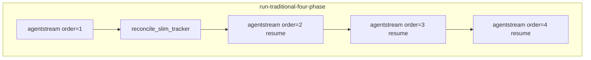

# PLAN — REQ-WF_TRIAL_SLIM_TRACKER_INTER_TURN

**Status:** build-plan complete — ready for `@close-out`  
**plan_phase:** `post-build`  
**Request token:** `REQ-WF_TRIAL_SLIM_TRACKER_INTER_TURN`  
**profile_depth:** `minimal` · **gate_policy:** `advisory`  
**Incident:** [WF-01 Haiku low @ 1794971027](../../../docs/agent-harness-evaluation/readouts/trial-readout-PROMPT-WF-01-claudehaiku55low-1794971027-wf-agentstream-wf-01-claude-claudehaiku55low.md)  
**Cursor plan:** [wf_slim_tracker_inter-turn_c214c8da.plan.md](../../../../.cursor/plans/wf_slim_tracker_inter-turn_c214c8da.plan.md)  
**Parent:** [REQ-WF_TRIAL_MINIMAL_CHECKLIST_PLAYBOOK](../REQ-WF_TRIAL_MINIMAL_CHECKLIST_PLAYBOOK/PLAN.md)

**CITDP:** [CITDP-REQ-WF_TRIAL_SLIM_TRACKER_INTER_TURN.yaml](../../citdp/CITDP-REQ-WF_TRIAL_SLIM_TRACKER_INTER_TURN.yaml)  
**Test strategy:** [test-strategy.md](./test-strategy.md)  
**Tracker:** [checklist-tracker.yaml](./checklist-tracker.yaml)

---

## 1. Refine — locked decisions (RESOLVE)

| # | Term | Resolution |
| --- | --- | --- |
| R1 | **Root cause** | Turn-1 agents author legacy `checklist-tracker.yaml`; post-run copy-if-absent never replaces it; gates see `malformed_tracker:steps`. |
| R2 | **Mechanism (sponsor)** | **Shell interleave:** four sequential `agentstream` invocations; orchestrator hook **after turn 1 only** before turn 2. |
| R3 | **CLI surface** | Use existing `--feature-spec-batch-order` / `--select-order` (parsed in [`dry-run-config.ts`](../../../mcp-server/packages/agentstream/src/dry-run-config.ts)) on live `agentstream` argv; verify parity in build-plan spike test. |
| R4 | **Resume** | Turns 2–4 pass `--resume <session_id>` from prior subprocess capture: parse `session_id=` **stdout first, else stderr** per turn ([`wf_trial_parse_session_id_from_turn_capture`](../../../scripts/lib/wf-trial-interleaved-four-phase.inc.sh)). Needed when [`liveExitStdoutIsOperatorMirrorOnly`](../../../mcp-server/packages/agentstream/src/live-executor.ts) suppresses operator-only stdout on exit ([REQ-WF_TRIAL_INTERLEAVED_RESUME_CAPTURE](../REQ-WF_TRIAL_INTERLEAVED_RESUME_CAPTURE/PLAN.md)). |
| R5 | **Reconcile policy** | `wf_trial_reconcile_slim_checklist_tracker`: if tracker missing → materialize; if **invalid slim shape** → backup to `evidence/checklist-tracker-agent-replaced.v1.bak` → seed template; if valid slim → no overwrite. |
| R6 | **Invalid shape** | Root lacks `schema_version: checklist-tracker.v1` **or** `steps` is not a top-level array **or** wrapper-only `tracker:` root (1794971027 class). Implemented via [`wf-trial-tracker-shape.mjs`](../../../tools/bootstrap/lib/wf-trial-tracker-shape.mjs) sharing slug expectations with slim template. |
| R7 | **Default / opt-out** | Interleaved seed **default on** when `WF_TRIAL_SKIP_INTERLEAVED_TRACKER_SEED` unset; skip env documented in [`wf-trial-agentstream-help.inc.sh`](../../../scripts/lib/wf-trial-agentstream-help.inc.sh). |
| R8 | **Operator banners** | Each subprocess may emit `turn 1/1`; orchestrator prints `DIAGNOSTIC: WF trial interleaved phase N/4` before each invoke so process logs stay auditable for `@record-wf-trial`. |
| R9 | **Exit precedence** | Non-zero exit on turn *k* skips turns *k+1*…4 (preserve [REQ-WF_TRIAL_FOUR_PHASE_SHELL_EXIT](../../../tied-project/requirements/REQ-WF_TRIAL_FOUR_PHASE_SHELL_EXIT.yaml)). |
| R10 | **LEAP** | Amend SC-WF-CLP-05 wording (inter-turn timing) in same `@build-plan` wave. |
| R11 | **Out of scope** | MCP verification gate minimal adversarial fields; `WF-METER-01`; auto-marking tracker step dispositions. |
| R12 | **Store vs disposable tracker** | This REQ’s **store** tracker uses methodology checklist slugs (`unit-test-red`, …). **Disposable** clients keep slim template slugs (`red-tests`, …); reconcile only rewrites **malformed disposable** trackers, not valid slim shapes. |

### Costly choices (accepted)

- Four process starts per WF cell (wall-clock cost) vs one monolithic batch.
- Reconcile **replaces** malformed agent tracker (backup retained) — intentional traceability over preserving agent slug experiments.
- Turn operator text in stderr may differ from historical `turn k/4` single-process logs.

---

## 2. Architecture



| Module | Path |
| --- | --- |
| Interleaved runner | `scripts/lib/wf-trial-interleaved-four-phase.inc.sh` (new) |
| Reconcile | `scripts/lib/wf-trial-product-req.inc.sh` (extend) or sibling `wf-trial-tracker-reconcile.inc.sh` |
| Shape check | `tools/bootstrap/lib/wf-trial-tracker-shape.mjs` |
| Wire | `scripts/run-traditional-four-phase-agentstream.sh` |
| Post-run no-op | `scripts/workflow-trial-agentstream.sh` materialize DIAGNOSTIC when interleaved ran |
| Prompt | `prompt-shared/wf-trial-add-feature-tracker-adjunct.md` + turn-1 batch goal |

---

## 3. Build wave (`@build-plan`)

| ID | Deliverable |
| --- | --- |
| B1 | `wf-trial-tracker-shape.mjs` + unit tests |
| B2 | `wf_trial_reconcile_slim_checklist_tracker` + bash tests SC-WF-IST-02 |
| B3 | `wf_trial_four_phase_run_interleaved` + SC-WF-IST-01 (dry-run / mocked argv) |
| B4 | Wire `run-traditional-four-phase-agentstream.sh`; help text SC-WF-IST skip env |
| B5 | `wf-trial-add-feature-tracker-adjunct.md` + `traditional-four-phase-agentstream.yaml` turn 1 |
| B6 | LEAP SC-WF-CLP-05 + REQ/ARCH/IMPL indexes for `REQ-WF_TRIAL_SLIM_TRACKER_INTER_TURN` |
| B7 | IMPL pseudo-code sidecar |

---

## 4. Acceptance criteria

| ID | Criterion |
| --- | --- |
| SC-WF-IST-01 | Interleaved runner runs orders 1..4 with resume chain; dry-run or fixture proves hook between 1 and 2 |
| SC-WF-IST-02 | Legacy fixture tracker reconciled to slim template; backup under `evidence/` |
| SC-WF-IST-03 | Turn-1 batch cites tracker adjunct; no “scaffold custom tracker” wording |
| SC-WF-IST-04 | `workflow-trial-agentstream-sh.test.mjs` covers reconcile + skip env |
| SC-WF-IST-05 | SC-WF-CLP-05 text matches inter-turn seed semantics |

---

## 5. Verification

```bash
node --test tools/bootstrap/lib/wf-trial-tracker-shape.test.mjs
node --test tools/bootstrap/workflow-trial-agentstream-sh.test.mjs
```

Manual (post-ship): `workflow_trial_agentstream wf-01` + `@record-wf-trial`; expect no `malformed_tracker:steps` on turn 2 pre_implementation when shape fix works.

---

## Do next

`@close-out` — verification gate + traceable commit per [phase-handoff-build-plan.md](./evidence/phase-handoff-build-plan.md).