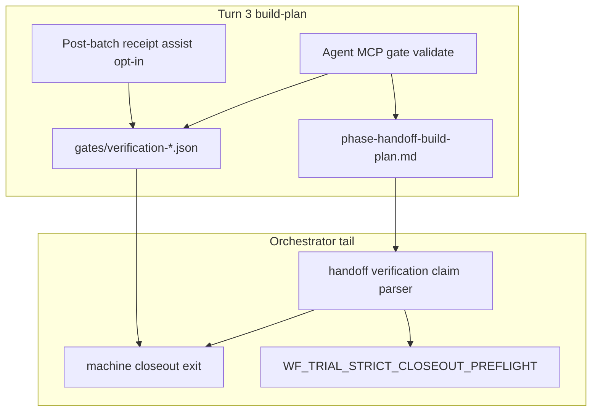

# PLAN — REQ-WF_TRIAL_VERIFICATION_RECEIPT_CLOSEOUT_SYNC

**Status:** close-out committed — `plan_phase: close-out-committed`  
**Request token:** `REQ-WF_TRIAL_VERIFICATION_RECEIPT_CLOSEOUT_SYNC`  
**profile_depth:** `minimal` · **gate_policy:** `advisory`  
**Incident:** WF-09 @ `1795019148-wf-agentstream-wf-09-claude-claudehaiku55low` — `verification_handoff_without_receipt` after four interleaved phases  
**Cursor plan:** [wf_verification_receipt_alignment_6207968b.plan.md](../../../../.cursor/plans/wf_verification_receipt_alignment_6207968b.plan.md)

**CITDP:** [CITDP-REQ-WF_TRIAL_VERIFICATION_RECEIPT_CLOSEOUT_SYNC.yaml](../../citdp/CITDP-REQ-WF_TRIAL_VERIFICATION_RECEIPT_CLOSEOUT_SYNC.yaml)  
**Test strategy:** [test-strategy.md](./test-strategy.md)  
**Tracker:** [checklist-tracker.yaml](./checklist-tracker.yaml)

---

## 1. Refine — locked decisions (RESOLVE)

| # | Term | Resolution |
| --- | --- | --- |
| R1 | **Three pillars** | (1) Agent **must** persist `gates/verification-*.json` at turn 3; (2) operator **bypass** env recipes documented; (3) **handoff honesty** via front matter + claim parser (not `grep -qi verification`) |
| R2 | **Receipt assist** | `WF_TRIAL_VERIFICATION_RECEIPT_ASSIST=1` only (default **off**); runs after four-phase batch, **before** machine closeout; uses `tied-cli.sh tied_checklist_gate_validate` + `receipt_persistence` |
| R3 | **Assist preconditions** | Product REQ resolved; `npm test` exit 0; no existing `gates/verification-*.json`; `citdp_path` when `tied-project/citdp/CITDP-{product}.yaml` exists else adjunct minimal inline CITDP (disposable shape) |
| R4 | **Assist telemetry** | `wf-trial-orchestrator-run.v1.json` records `verification_receipt_assist: true` when assist wrote a receipt (@record-wf-trial grades agent vs facilitator) |
| R5 | **Claim parser** | Shared `wf-trial-handoff-verification-claim.inc.sh`; machine closeout + `WF_TRIAL_STRICT_CLOSEOUT_PREFLIGHT` call `_wf_trial_handoff_claims_verification_pass_without_receipt` |
| R6 | **Front matter** | Build handoff: `verification_receipt_status: persisted \| deferred \| not_run`; `verification_receipt_path:` when persisted; `deferred`/`not_run` **must not** pair with Verification gate row `allowed: true` |
| R7 | **Orchestrator order** | phase handoff gate → strict preflight (opt-in) → **receipt assist** (opt-in) → machine closeout exit |
| R8 | **LEAP (DCR/DGA/PHG)** | Amend SC-DCR-04 / SC-WF-DGA-04 / SC-WF-PHG-05 criterion text: Tier A on **positive verification pass claim** without receipt, not bare word “verification” |
| R9 | **Non-goals** | Default-on assist; changing CGH/MPGW; fabricating gate JSON without MCP validate |
| R10 | **Costly choice (accepted)** | Claim parser may miss exotic handoff prose — fixtures + live WF-09 replay; adjust regex in follow-on kaizen |

### Parentage

- [REQ-WF_TRIAL_DISPOSABLE_GATE_ALIGNMENT](../../requirements/REQ-WF_TRIAL_DISPOSABLE_GATE_ALIGNMENT.yaml)
- [REQ-WF_TRIAL_DISPOSABLE_CLOSEOUT_READINESS](../../requirements/REQ-WF_TRIAL_DISPOSABLE_CLOSEOUT_READINESS.yaml)
- [REQ-WF_TRIAL_MINIMAL_CHECKLIST_PLAYBOOK](../../requirements/REQ-WF_TRIAL_MINIMAL_CHECKLIST_PLAYBOOK.yaml)
- [REQ-WF_TRIAL_PHASE_HANDOFF_GATE](../../requirements/REQ-WF_TRIAL_PHASE_HANDOFF_GATE.yaml)

---

## 2. Architecture

**Surfaces:** `scripts/lib/wf-trial-handoff-verification-claim.inc.sh`, `scripts/lib/wf-trial-verification-receipt-assist.inc.sh`, `scripts/lib/wf-trial-machine-closeout-exit.inc.sh`, `scripts/lib/wf-trial-phase-handoff-gate.inc.sh`, `scripts/workflow-trial-agentstream.sh`, prompt-shared WF adjuncts, `traditional-four-phase-agentstream.yaml`, `docs/agent-harness-evaluation/wf-trial-closeout-operator-env.md`.

---

## 3. Build-plan TDD order

1. RED — claim parser fixtures in `workflow-trial-agentstream-sh.test.mjs` (WF-09-like, deferred front matter, receipt on disk).
2. RED — assist skip/persist fixtures (mock workspace; dry-run CLI or stub when CLI missing).
3. GREEN — shell libs + orchestrator wiring + manifest field.
4. RED/GREEN — batch/adjunct contract test (`receipt_persistence`, `verification_receipt_status`).
5. Docs — operator env doc, help, `agentstream.md` vocab.
6. LEAP — DCR/DGA/PHG criterion wording where Tier A definition changes.
7. `pseudocode_validate` on IMPL sidecar; `tied_validate_consistency`.
8. Live — SC-VRCS-06 WF-09 replay assist on/off (sponsor).

---

## 4. Acceptance (REQ)

| SC | Summary |
| --- | --- |
| SC-VRCS-01 | Turn-3 batch + adjunct contract tests require `receipt_persistence` + handoff front matter |
| SC-VRCS-02 | Claim parser: pass-claim-without-file → Tier A; `deferred` front matter → Tier B; receipt on disk → pass |
| SC-VRCS-03 | Assist persists when `WF_TRIAL_VERIFICATION_RECEIPT_ASSIST=1`, tests green, CLI available |
| SC-VRCS-04 | Assist default off; manifest `verification_receipt_assist` when assist ran |
| SC-VRCS-05 | Operator env doc + `workflow-trial-agentstream.sh --help` |
| SC-VRCS-06 | Live WF-09 Haiku low: assist off → Tier A unless agent persists; assist on → exit 0 when tests green |
| SC-VRCS-07 | Handoff with `verification_receipt_status: deferred` does not emit `verification_handoff_without_receipt` |

---

## Do next

**`@build-plan`** — RED/GREEN per [test-strategy.md](./test-strategy.md). No disposable product `src/` in store repo.