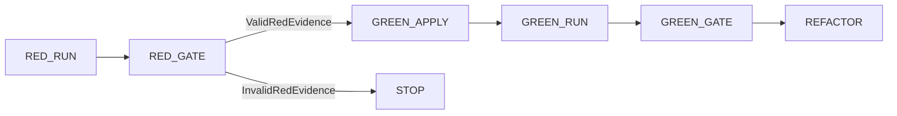
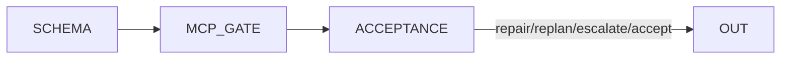

# LangGraph pilot (`tied-langgraph-pilot`)

Phase 1 scaffold for [PLAN-TIED-LANGGRAPH-ORCHESTRATION](../../tied-project/working/PLAN-TIED-LANGGRAPH-ORCHESTRATION/PLAN.md).

## Install

```bash
cd tools/langgraph-pilot
uv venv && uv pip install -e ".[dev]"
# or: python -m venv .venv && source .venv/bin/activate && pip install -e ".[dev]"
```

## Tests (CI)

```bash
uv run pytest
```

Unit tests mock MCP JSON-RPC; no live Node MCP server is required.

## Optional live MCP smoke

From repo root, with `TIED_BASE_PATH` pointing at `tied-project/`:

```bash
.cursor/skills/tied-yaml/scripts/tied-cli.sh tied_config_get_base_path '{}'
```

The pilot `McpClient` can spawn `node mcp-server/dist/index.js` when configured with a real transport (see `tied_langgraph/mcp_client.py`).

## Run ledger (P2)

Schema: [`schemas/langgraph-run-ledger.v1.json`](schemas/langgraph-run-ledger.v1.json). Observations append under the run directory via `tied_langgraph.ledger.append_observation` (tool, commit, exit code, artifact path, sha256).

Envelope gaps drive routes through `tied_langgraph.routing` (`continue` | `collect_more` | `escalate`); error-severity gaps never continue. Staleness compares `candidate_commit` to evidence commit in `tied_langgraph.policies.staleness`.

## TDD subgraph (P3)

Policy: **`ImplementAllowed => ValidRedEvidence`** (`tied_langgraph.policies.tdd_red`). Test-weakening heuristics live in `tied_langgraph.policies.test_weakening` with optional `tdd_waiver` on the run ledger.



- Graph builder: `tied_langgraph.graphs.task_tdd.build_task_tdd_graph`
- Subprocess runner: `tied_langgraph.runners.subprocess_test`
- Hermetic CI fixture: `tests/fixtures/tdd-mini-repo/` (`run_tests.sh` expects `.green` after implement)
- Optional charter client: set `LANGGRAPH_FIXTURE_CLIENT_ROOT` to `/Users/fareed/Documents/dev/test/1791767366` for the integration-marked pytest

## Verification subgraph (P4)

Policy: **`AcceptAllowed => GreenEvidence && RegressionEvidence && ReviewEvidence`** (commit-aligned records) via `tied_langgraph.policies.acceptance`. Implement-role MCP clients cannot call envelope or gate mutators (`tied_langgraph.policies.separation`).



- Graph builder: `tied_langgraph.graphs.verification.build_verification_graph`
- Evidence schema: `tied_langgraph.verification_evidence.validate_evidence_for_acceptance`
- Default CI mocks MCP gate; optional live `tied_checklist_gate_validate` documented for sponsor runs
